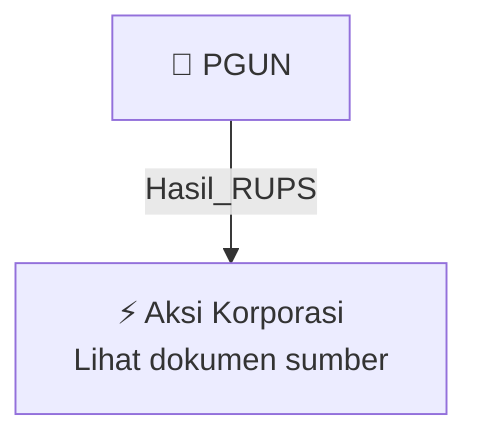

# 🏛️ Hasil & Keputusan RUPS / RUPSLB — [[PGUN]]

⬅️ [[knowledge-base/daily-digests/Daily_Digest_20260924|Kembali ke Daily Digest]] | 📅 **2026-09-24** | 🎛️ [[Dashboard|Ke Dashboard Utama]]

> [!IMPORTANT]
> Laporan ini disusun secara otomatis oleh **Corporate Action Intelligence Agent** pada **2026-09-24**.
> Sumber dokumen: `20260923_PGUN_20260923_PGUN_Ringkasan RisalahRisalah RUPS_32150506_lamp1.pdf`

---

## 📌 1. Ringkasan Eksekutif & Tujuan Strategis

- **Kode & Nama Emiten**: `[[PGUN]]`
- **Kategori Aksi Korporasi**: `Hasil_RUPS`
- **Dokumen Sumber**: `20260923_PGUN_20260923_PGUN_Ringkasan RisalahRisalah RUPS_32150506_lamp1.pdf`
- **Tanggal Laporan**: `2026-09-24`

[Analisis LLM tidak tersedia — isi manual]

---

## 📊 2. Fakta Material & Parameter Keuangan

| Parameter Utama | Nilai / Keterangan |
| :--- | :--- |
| **Tanggal RUPSLB** | `2026-09-21` |
| **Waktu RUPSLB** | `09.19 WIB - 09.24 WIB` |
| **Tempat RUPSLB** | `Ruang Srikandi Hotel Bidakara, Jalan Gatot Subroto No. 71-73, Jakarta Selatan` |
| **Kehadiran Pemegang Saham** | `5.300.387.032 saham (92,38%) dari total 5.737.848.882 saham` |
| **Mata Acara** | `Persetujuan Penyesuaian KBLI Tahun 2025` |
| **Keputusan RUPSLB** | `Menyetujui penyesuaian Pasal 3 Anggaran Dasar sesuai Peraturan BPS No. 7 Tahun 2025 tentang KBLI` |
| **Kuasa kepada Direksi** | `Menyetujui pemberian kuasa kepada Direksi untuk tindakan terkait penyesuaian Pasal 3 Anggaran Dasar` |
| **Mekanisme Pengambilan Keputusan** | `Musyawarah untuk mufakat` |
| **Direksi Hadir** | `JONET BUDIARTO (Direktur Utama), TAMLIKHO (Direktur)` |
| **Komisaris Hadir** | `INDRA SURYA (Komisaris Independen)` |
| **Komisaris Tidak Hadir** | `LIANA SAPUTRI (Komisaris Utama)` |

---

## 👥 3. Struktur Kepemilikan, Pengendali & Pembeli Siaga

- **Emiten**: `PGUN` | Informasi kepemilikan mengacu pada dokumen resmi sumber.

---

## 🎯 4. Alokasi & Rencana Penggunaan Dana

- Informasi alokasi dana belum tersedia — lihat prospektus / dokumen resmi.

---

## 📅 5. Timeline & Jadwal Pelaksanaan

| Tahapan / Event | Tanggal |
| :--- | :---: |
| **Jadwal** | Lihat dokumen sumber. |

---

## 📈 6. Diagram Visual Flowchart (Mermaid)

---

## 💡 7. Rekomendasi Investor & Strategi Trading

[Analisis LLM tidak tersedia — isi manual]

---

## 🔗 8. Hubungan Note Terkait (Knowledge Graph)

- [[knowledge-base/daily-digests/Daily_Digest_20260924|📄 Daily Digest 2026-09-24]]
- [[knowledge-base/trading-signals/Trading_Signals_20260924|🎯 Sinyal Cuan 2026-09-24]]
- [[PGUN|🏬 Halaman Emiten PGUN]]
- [[Dashboard|🎛️ Kembali ke Dashboard Utama]]

---

*Laporan dibuat otomatis oleh Corporate Action Intelligence Agent · 2026-09-24*