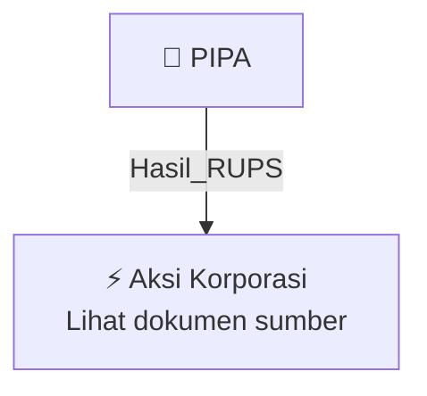

# 🏛️ Hasil & Keputusan RUPS / RUPSLB — [[PIPA]]

⬅️ [[knowledge-base/daily-digests/Daily_Digest_20261002|Kembali ke Daily Digest]] | 📅 **2026-10-02** | 🎛️ [[Dashboard|Ke Dashboard Utama]]

> [!IMPORTANT]
> Laporan ini disusun secara otomatis oleh **Corporate Action Intelligence Agent** pada **2026-10-02**.
> Sumber dokumen: `20261001_PIPA_20261001_PIPA_Laporan Informasi dan Fakta Material_32162383.pdf`

---

## 📌 1. Ringkasan Eksekutif & Tujuan Strategis

- **Kode & Nama Emiten**: `[[PIPA]]`
- **Kategori Aksi Korporasi**: `Hasil_RUPS`
- **Dokumen Sumber**: `20261001_PIPA_20261001_PIPA_Laporan Informasi dan Fakta Material_32162383.pdf`
- **Tanggal Laporan**: `2026-10-02`

[Analisis LLM tidak tersedia — isi manual]

---

## 📊 2. Fakta Material & Parameter Keuangan

| Parameter Utama | Nilai / Keterangan |
| :--- | :--- |
| **Nomor Surat** | `056/Oxala-Corsec/X/2026` |
| **Nama Emiten** | `PT Oxala Energy International Tbk` |
| **Kode Emiten** | `PIPA` |
| **Tanggal Kejadian** | `30 September 2026` |
| **Jenis Informasi atau Fakta Material** | `Penunjukan Kantor Jasa Penilai Publik (KJPP) Independen untuk Rencana Transaksi Akuisisi Saham PT Aztech Pandu Persada` |
| **Pihak yang Ditunjuk (KJPP)** | `KJPP Toto Suharto & Rekan` |
| **Penilai Publik** | `Ir. Henrianto, S.Pi, S.Ak, MM, M.Ec.Dev, Ak, CA, A-CPA, CLI, MAPPI (Cert.)` |
| **STTD OJK Penilai Publik** | `KEP-1351/KS.13/2026` |
| **Pemberi Tugas** | `PT Oxala Energy International Tbk` |
| **Pengguna Laporan** | `PT Oxala Energy International Tbk dan Otoritas Jasa Keuangan (OJK)` |
| **Objek Penilaian** | `75,00% saham PT Aztech Pandu Persada` |
| **Tujuan Penilaian** | `Memberikan pendapat/opini mengenai Nilai Wajar atas Objek Penilaian untuk Rencana Transaksi Akuisisi pada Perusahaan Terbuka` |
| **Tanggal Penilaian (Cut-Off Date)** | `30 September 2026` |
| **Pendekatan Penilaian** | `Kombinasi pendekatan penilaian yang relevan (Pendapatan / Pendekatan Aset / Pasar) sesuai POJK No. 35/POJK.04/2020 dan Standar Penilaian Indonesia (SPI)` |
| **Dasar Tindak Lanjut** | `Conditional Share Purchase Agreement (CSPA) tertanggal 07 September 2026` |
| **Dampak terhadap Perseroan** | `Tidak memberikan dampak negatif terhadap kegiatan operasional, hukum, kondisi keuangan, maupun kelangsungan usaha Perseroan; merupakan langkah terstruktur untuk merealisasikan rencana ekspansi bisnis di sektor energi` |
| **Independensi KJPP** | `Independen, bebas dari benturan kepentingan, dan tidak memiliki hubungan afiliasi dengan Perseroan maupun PT Aztech Pandu Persada` |
| **Syarat Pelaksanaan Transaksi Akuisisi** | `Tunduk pada hasil penilaian independen, pemenuhan conditions precedent, serta persetujuan RUPSLB Perseroan dan regulator terkait` |
| **Nama Pengirim Laporan** | `Haerul Maelani` |
| **Jabatan Pengirim** | `Corsec` |
| **Tanggal Pelaporan Elektronik** | `01-10-2026 11:47` |

---

## 👥 3. Struktur Kepemilikan, Pengendali & Pembeli Siaga

- **Emiten**: `PIPA` | Informasi kepemilikan mengacu pada dokumen resmi sumber.

---

## 🎯 4. Alokasi & Rencana Penggunaan Dana

- Informasi alokasi dana belum tersedia — lihat prospektus / dokumen resmi.

---

## 📅 5. Timeline & Jadwal Pelaksanaan

| Tahapan / Event | Tanggal |
| :--- | :---: |
| **Jadwal** | Lihat dokumen sumber. |

---

## 📈 6. Diagram Visual Flowchart (Mermaid)

---

## 💡 7. Rekomendasi Investor & Strategi Trading

[Analisis LLM tidak tersedia — isi manual]

---

## 🔗 8. Hubungan Note Terkait (Knowledge Graph)

- [[knowledge-base/daily-digests/Daily_Digest_20261002|📄 Daily Digest 2026-10-02]]
- [[knowledge-base/trading-signals/Trading_Signals_20261002|🎯 Sinyal Cuan 2026-10-02]]
- [[PIPA|🏬 Halaman Emiten PIPA]]
- [[Dashboard|🎛️ Kembali ke Dashboard Utama]]

---

*Laporan dibuat otomatis oleh Corporate Action Intelligence Agent · 2026-10-02*