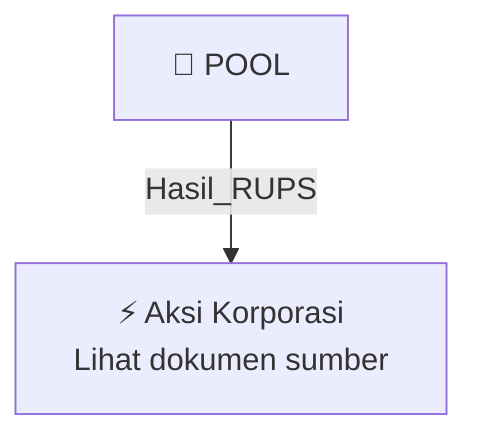

# 🏛️ Hasil & Keputusan RUPS / RUPSLB — [[POOL]]

⬅️ [[knowledge-base/daily-digests/Daily_Digest_20260925|Kembali ke Daily Digest]] | 📅 **2026-09-25** | 🎛️ [[Dashboard|Ke Dashboard Utama]]

> [!IMPORTANT]
> Laporan ini disusun secara otomatis oleh **Corporate Action Intelligence Agent** pada **2026-09-25**.
> Sumber dokumen: `20260924_POOL_20260924_POOL_Ringkasan RisalahRisalah RUPS_32150843_lamp1.pdf`

---

## 📌 1. Ringkasan Eksekutif & Tujuan Strategis

- **Kode & Nama Emiten**: `[[POOL]]`
- **Kategori Aksi Korporasi**: `Hasil_RUPS`
- **Dokumen Sumber**: `20260924_POOL_20260924_POOL_Ringkasan RisalahRisalah RUPS_32150843_lamp1.pdf`
- **Tanggal Laporan**: `2026-09-25`

[Analisis LLM tidak tersedia — isi manual]

---

## 📊 2. Fakta Material & Parameter Keuangan

| Parameter Utama | Nilai / Keterangan |
| :--- | :--- |
| **Uraian Kejadian** | `PENGUMUMAN RINGKASAN RISALAH RAPAT UMUM PEMEGANG SAHAM LUAR BIASA PT POOL ADVISTA INDONESIA Tbk. PT POOL ADVISTA INDONESIA Tbk, berkedudukan di Jakarta Selatan, dengan ini memberitahukan bahwa pada hari Selasa, tanggal 22 September 2026, di Aula Kantor PT Pool Advista Indonesia Tbk Lantai 2, Jalan Letjen Soepomo Blok CC6 nomor 9-10, Arteri Permata Hijau, Jakarta Selatan 12210, Indonesia, telah diadakan Rapat Umum Pemegang Saham Luar Biasa (selanjutnya disebut “RUPSLB”) PT POOL ADVISTA INDONESIA` |

---

## 👥 3. Struktur Kepemilikan, Pengendali & Pembeli Siaga

- **Emiten**: `POOL` | Informasi kepemilikan mengacu pada dokumen resmi sumber.

---

## 🎯 4. Alokasi & Rencana Penggunaan Dana

- Informasi alokasi dana belum tersedia — lihat prospektus / dokumen resmi.

---

## 📅 5. Timeline & Jadwal Pelaksanaan

| Tahapan / Event | Tanggal |
| :--- | :---: |
| **Jadwal** | Lihat dokumen sumber. |

---

## 📈 6. Diagram Visual Flowchart (Mermaid)

---

## 💡 7. Rekomendasi Investor & Strategi Trading

[Analisis LLM tidak tersedia — isi manual]

---

## 🔗 8. Hubungan Note Terkait (Knowledge Graph)

- [[knowledge-base/daily-digests/Daily_Digest_20260925|📄 Daily Digest 2026-09-25]]
- [[knowledge-base/trading-signals/Trading_Signals_20260925|🎯 Sinyal Cuan 2026-09-25]]
- [[POOL|🏬 Halaman Emiten POOL]]
- [[Dashboard|🎛️ Kembali ke Dashboard Utama]]

---

*Laporan dibuat otomatis oleh Corporate Action Intelligence Agent · 2026-09-25*