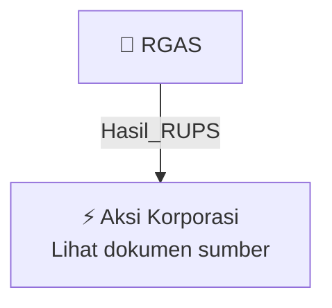

# 🏛️ Hasil & Keputusan RUPS / RUPSLB — [[RGAS]]

⬅️ [[knowledge-base/daily-digests/Daily_Digest_20261002|Kembali ke Daily Digest]] | 📅 **2026-10-02** | 🎛️ [[Dashboard|Ke Dashboard Utama]]

> [!IMPORTANT]
> Laporan ini disusun secara otomatis oleh **Corporate Action Intelligence Agent** pada **2026-10-02**.
> Sumber dokumen: `20261001_RGAS_20261001_RGAS_Laporan Informasi dan Fakta Material_32162529_lamp2.pdf`

---

## 📌 1. Ringkasan Eksekutif & Tujuan Strategis

- **Kode & Nama Emiten**: `[[RGAS]]`
- **Kategori Aksi Korporasi**: `Hasil_RUPS`
- **Dokumen Sumber**: `20261001_RGAS_20261001_RGAS_Laporan Informasi dan Fakta Material_32162529_lamp2.pdf`
- **Tanggal Laporan**: `2026-10-02`

[Analisis LLM tidak tersedia — isi manual]

---

## 📊 2. Fakta Material & Parameter Keuangan

| Parameter Utama | Nilai / Keterangan |
| :--- | :--- |
| **Nama Perseroan** | `PT Kian Santang Muliatama Tbk` |
| **Kode Emiten** | `RGAS` |
| **Bank Pemberi Fasilitas** | `PT Bank Syariah Indonesia (Persero) Tbk` |
| **Jenis Fasilitas** | `Multiskim Line Facility Musyarakah / Kafalah bil Ujrah (Revolving) dan fasilitas pembiayaan modal kerja` |
| **Nomor Akad Pembiayaan** | `06/833/CM1-FOG/IX/2026/MSYR` |
| **Nomor Surat Penawaran Pemberian Pembiayaan (SP3)** | `06/023-3/SP3/RCB Jakarta II` |
| **Tanggal SP3** | `2026-09-28` |
| **Tanggal Penandatanganan Akad** | `2026-09-29` |
| **Tanggal Keterbukaan Informasi** | `2026-10-01` |
| **Penambahan Limit Pembiayaan** | `Rp14.500.000.000,00` |
| **Limit Pembiayaan Semula** | `Rp20.000.000.000,00` |
| **Total Limit Pembiayaan Setelah Penambahan** | `Rp34.500.000.000,00` |
| **Jangka Waktu Fasilitas** | `Sejak penandatanganan akad sampai dengan 20 Agustus 2027` |
| **Tujuan Penggunaan** | `Modal kerja proyek pengadaan dan kontraktor di bidang Oil and Gas dari Bouwheer APBN dan/atau BUMN (Pertamina Group)` |
| **Agunan** | `Aset tanah/bangunan, piutang, persediaan, dan agunan tunai (Cash Collateral) dari Perseroan dan Pihak Afiliasi kepada Bank BSI` |
| **Jumlah Agunan Tanah/Bangunan yang Dirinci** | `8 bidang (rincian pada dokumen)` |
| **Pengecualian Kewajiban Penilai Independen dan RUPS** | `Transaksi merupakan pembiayaan langsung dari bank serta penjaminan agunan dari pihak afiliasi kepada bank, sehingga tidak wajib menggunakan penilai independen dan tidak wajib memperoleh persetujuan RUPS sesuai Pasal 11 huruf b POJK 17/2020 dan Pasal 6 ayat (1) huruf e POJK 42/2020` |
| **Kegiatan Usaha Utama** | `Jasa penunjang industri gas, meliputi penyediaan produk (spare parts) serta Engineering, Procurement and Construction (EPC)` |
| **Kedudukan** | `Bekasi, Indonesia` |
| **Alamat Kantor** | `Blok A5 No. 8, Kel. Jatiluhur, Kec. Jatiasih, Kota Bekasi, Jawa Barat, 17425` |
| **Telepon** | `(021) 82748249` |
| **Pihak Afiliasi dalam Agunan** | `PT Ergas Kians Ikon` |

---

## 👥 3. Struktur Kepemilikan, Pengendali & Pembeli Siaga

- **Emiten**: `RGAS` | Informasi kepemilikan mengacu pada dokumen resmi sumber.

---

## 🎯 4. Alokasi & Rencana Penggunaan Dana

- Informasi alokasi dana belum tersedia — lihat prospektus / dokumen resmi.

---

## 📅 5. Timeline & Jadwal Pelaksanaan

| Tahapan / Event | Tanggal |
| :--- | :---: |
| **Jadwal** | Lihat dokumen sumber. |

---

## 📈 6. Diagram Visual Flowchart (Mermaid)

---

## 💡 7. Rekomendasi Investor & Strategi Trading

[Analisis LLM tidak tersedia — isi manual]

---

## 🔗 8. Hubungan Note Terkait (Knowledge Graph)

- [[knowledge-base/daily-digests/Daily_Digest_20261002|📄 Daily Digest 2026-10-02]]
- [[knowledge-base/trading-signals/Trading_Signals_20261002|🎯 Sinyal Cuan 2026-10-02]]
- [[RGAS|🏬 Halaman Emiten RGAS]]
- [[Dashboard|🎛️ Kembali ke Dashboard Utama]]

---

*Laporan dibuat otomatis oleh Corporate Action Intelligence Agent · 2026-10-02*