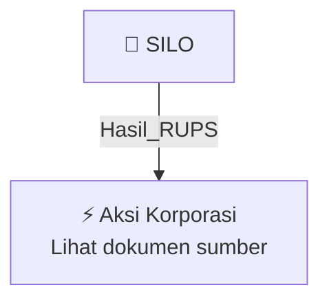

# 🏛️ Hasil & Keputusan RUPS / RUPSLB — [[SILO]]

⬅️ [[knowledge-base/daily-digests/Daily_Digest_20260923|Kembali ke Daily Digest]] | 📅 **2026-09-23** | 🎛️ [[Dashboard|Ke Dashboard Utama]]

> [!IMPORTANT]
> Laporan ini disusun secara otomatis oleh **Corporate Action Intelligence Agent** pada **2026-09-23**.
> Sumber dokumen: `20260922_SILO_20260922_SILO_Ringkasan RisalahRisalah RUPS_32150448_lamp2.pdf`

---

## 📌 1. Ringkasan Eksekutif & Tujuan Strategis

- **Kode & Nama Emiten**: `[[SILO]]`
- **Kategori Aksi Korporasi**: `Hasil_RUPS`
- **Dokumen Sumber**: `20260922_SILO_20260922_SILO_Ringkasan RisalahRisalah RUPS_32150448_lamp2.pdf`
- **Tanggal Laporan**: `2026-09-23`

[Analisis LLM tidak tersedia — isi manual]

---

## 📊 2. Fakta Material & Parameter Keuangan

| Parameter Utama | Nilai / Keterangan |
| :--- | :--- |
| **Uraian Kejadian** | `Siloam International Hospitals 1 Lippo Village, Tangerang 15811, Indonesia RINGKASAN RISALAH RAPAT UMUM PEMEGANG SAHAM LUAR BIASA PT SILOAM INTERNATIONAL HOSPITALS TBK A. Pendahuluan dan Informasi Umum tentang Rapat Umum Pemegang Saham Luar Biasa (“Rapat”) Direksi PT Siloam International Hospitals Tbk (“Perseroan”) dengan ini mengumumkan kepada para Pemegang Saham Perseroan bahwa Rapat telah diselenggarakan secara fisik dan elektronik Institute for Nanotechnology, Jl. Jenderal Sudirman No.1688,` |

---

## 👥 3. Struktur Kepemilikan, Pengendali & Pembeli Siaga

- **Emiten**: `SILO` | Informasi kepemilikan mengacu pada dokumen resmi sumber.

---

## 🎯 4. Alokasi & Rencana Penggunaan Dana

- Informasi alokasi dana belum tersedia — lihat prospektus / dokumen resmi.

---

## 📅 5. Timeline & Jadwal Pelaksanaan

| Tahapan / Event | Tanggal |
| :--- | :---: |
| **Jadwal** | Lihat dokumen sumber. |

---

## 📈 6. Diagram Visual Flowchart (Mermaid)

---

## 💡 7. Rekomendasi Investor & Strategi Trading

[Analisis LLM tidak tersedia — isi manual]

---

## 🔗 8. Hubungan Note Terkait (Knowledge Graph)

- [[knowledge-base/daily-digests/Daily_Digest_20260923|📄 Daily Digest 2026-09-23]]
- [[knowledge-base/trading-signals/Trading_Signals_20260923|🎯 Sinyal Cuan 2026-09-23]]
- [[SILO|🏬 Halaman Emiten SILO]]
- [[Dashboard|🎛️ Kembali ke Dashboard Utama]]

---

*Laporan dibuat otomatis oleh Corporate Action Intelligence Agent · 2026-09-23*