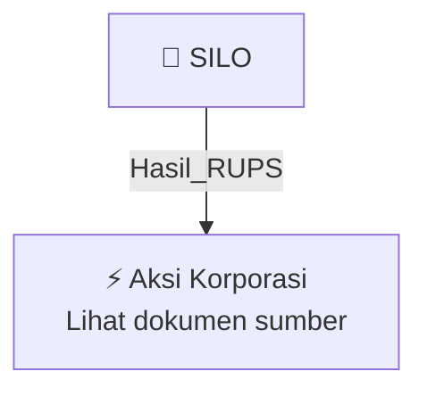

# 🏛️ Hasil & Keputusan RUPS / RUPSLB — [[SILO]]

⬅️ [[knowledge-base/daily-digests/Daily_Digest_20261002|Kembali ke Daily Digest]] | 📅 **2026-10-02** | 🎛️ [[Dashboard|Ke Dashboard Utama]]

> [!IMPORTANT]
> Laporan ini disusun secara otomatis oleh **Corporate Action Intelligence Agent** pada **2026-10-02**.
> Sumber dokumen: `20261001_SILO_20261001_SILO_Laporan Informasi dan Fakta Material_32162351_lamp1.pdf`

---

## 📌 1. Ringkasan Eksekutif & Tujuan Strategis

- **Kode & Nama Emiten**: `[[SILO]]`
- **Kategori Aksi Korporasi**: `Hasil_RUPS`
- **Dokumen Sumber**: `20261001_SILO_20261001_SILO_Laporan Informasi dan Fakta Material_32162351_lamp1.pdf`
- **Tanggal Laporan**: `2026-10-02`

[Analisis LLM tidak tersedia — isi manual]

---

## 📊 2. Fakta Material & Parameter Keuangan

| Parameter Utama | Nilai / Keterangan |
| :--- | :--- |
| **Nomor Surat** | `136/Corsec-SIH/X/2026` |
| **Tanggal Surat** | `2026-10-01` |
| **Jenis Informasi atau Fakta Material** | `Perubahan Anggaran Dasar Perseroan: perubahan dan penegasan kembali Pasal 3 Anggaran Dasar tentang Maksud dan Tujuan serta Kegiatan Usaha dalam rangka penyesuaian dengan KBLI 2025` |
| **Tanggal Kejadian** | `2026-09-29` |
| **Dasar Penyesuaian** | `Klasifikasi Baku Lapangan Usaha Indonesia (KBLI) 2025 dan Peraturan Pemerintah No. 28 Tahun 2025 tentang Penyelenggaraan Perizinan Berusaha Berbasis Risiko` |
| **Tanggal RUPSLB** | `2026-09-22` |
| **Mata Acara RUPSLB yang Disetujui** | `Mata Acara Pertama, yaitu perubahan dan penegasan kembali Pasal 3 Anggaran Dasar Perseroan tentang Maksud dan Tujuan serta Kegiatan Usaha` |
| **Jumlah Saham Hadir dalam RUPSLB** | `12.304.999.007 saham` |
| **Persentase Saham Hadir dalam RUPSLB** | `94,612%` |
| **Total Saham Dikeluarkan Perseroan** | `13.005.739.365 saham` |
| **Akta Pernyataan Keputusan RUPSLB** | `Akta No. 41 tanggal 22 September 2026` |
| **Notaris** | `Lisa Sujanto, S.H., M.Kn., Notaris di Kota Tangerang Selatan` |
| **Persetujuan Menteri Hukum Republik Indonesia** | `Keputusan No. AHU-0101449.AH.01.02.Tahun 2026 tanggal 29 September 2026` |
| **Pendaftaran dalam Daftar Perseroan** | `No. AHU-0253368.AH.01.11.Tahun 2026 tanggal 29 September 2026` |
| **Tanggal Efektif Perubahan** | `2026-09-29` |
| **Maksud dan Tujuan Perseroan Setelah Perubahan** | `Berusaha dalam bidang Aktivitas Kesehatan Manusia (Pelayanan Kesehatan)` |
| **Sifat Perubahan** | `Administratif dan prosedural, tidak mengakibatkan penambahan kegiatan usaha baru dan/atau perluasan ruang lingkup kegiatan usaha Perseroan` |

---

## 👥 3. Struktur Kepemilikan, Pengendali & Pembeli Siaga

- **Emiten**: `SILO` | Informasi kepemilikan mengacu pada dokumen resmi sumber.

---

## 🎯 4. Alokasi & Rencana Penggunaan Dana

- Informasi alokasi dana belum tersedia — lihat prospektus / dokumen resmi.

---

## 📅 5. Timeline & Jadwal Pelaksanaan

| Tahapan / Event | Tanggal |
| :--- | :---: |
| **Jadwal** | Lihat dokumen sumber. |

---

## 📈 6. Diagram Visual Flowchart (Mermaid)

---

## 💡 7. Rekomendasi Investor & Strategi Trading

[Analisis LLM tidak tersedia — isi manual]

---

## 🔗 8. Hubungan Note Terkait (Knowledge Graph)

- [[knowledge-base/daily-digests/Daily_Digest_20261002|📄 Daily Digest 2026-10-02]]
- [[knowledge-base/trading-signals/Trading_Signals_20261002|🎯 Sinyal Cuan 2026-10-02]]
- [[SILO|🏬 Halaman Emiten SILO]]
- [[Dashboard|🎛️ Kembali ke Dashboard Utama]]

---

*Laporan dibuat otomatis oleh Corporate Action Intelligence Agent · 2026-10-02*