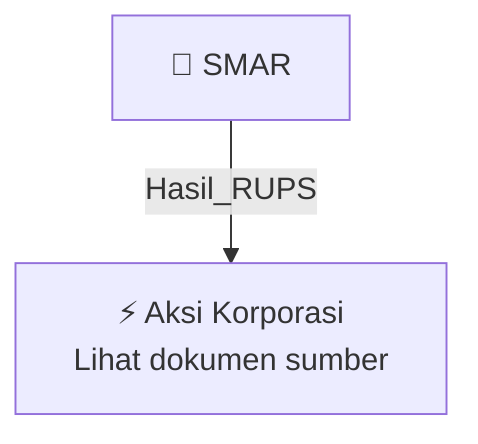

# 🏛️ Hasil & Keputusan RUPS / RUPSLB — [[SMAR]]

⬅️ [[knowledge-base/daily-digests/Daily_Digest_20261007|Kembali ke Daily Digest]] | 📅 **2026-10-07** | 🎛️ [[Dashboard|Ke Dashboard Utama]]

> [!IMPORTANT]
> Laporan ini disusun secara otomatis oleh **Corporate Action Intelligence Agent** pada **2026-10-07**.
> Sumber dokumen: `20261006_SMAR_20261002_SMAR_Laporan Informasi dan Fakta Material_32162685.pdf`

---

## 📌 1. Ringkasan Eksekutif & Tujuan Strategis

- **Kode & Nama Emiten**: `[[SMAR]]`
- **Kategori Aksi Korporasi**: `Hasil_RUPS`
- **Dokumen Sumber**: `20261006_SMAR_20261002_SMAR_Laporan Informasi dan Fakta Material_32162685.pdf`
- **Tanggal Laporan**: `2026-10-07`

[Analisis LLM tidak tersedia — isi manual]

---

## 📊 2. Fakta Material & Parameter Keuangan

| Parameter Utama | Nilai / Keterangan |
| :--- | :--- |
| **Nomor Surat** | `093/SMART-IR/X/2026` |
| **Nama Emiten atau Perusahaan Publik** | `PT Sinar Mas Agro Resources and Technology Tbk` |
| **Bidang Usaha** | `Agribisnis` |
| **Tanggal Kejadian** | `02 Oktober 2026` |
| **Jenis Informasi atau Fakta Material** | `Keterbukaan Informasi atas Penunjukan Akuntan Publik dan Kantor Akuntan Publik` |
| **Dasar Penunjukan** | `Keputusan Pemegang Saham dalam RUPS Tahunan 22 Mei 2026, rekomendasi Komite Audit, dan Keputusan Tertulis Dewan Komisaris` |
| **Akuntan Publik yang Ditunjuk** | `Yelly Warsono` |
| **Kantor Akuntan Publik yang Ditunjuk** | `Mirawati Sensi Idris` |
| **Tujuan Penunjukan** | `Melakukan audit atas Laporan Keuangan Konsolidasian Perseroan dan entitas anak untuk tahun buku yang berakhir pada 31 Desember 2026` |
| **Tanggal Persetujuan Manajemen** | `02 Oktober 2026` |
| **Dampak Kejadian** | `Tidak ada` |
| **Nama Pengirim** | `Jimmy Pramono` |
| **Tanggal dan Waktu Pelaporan** | `06-10-2026 17:04` |
| **Lampiran** | `Srt KI Penunjukan AP dan KAP 061026.pdf` |

---

## 👥 3. Struktur Kepemilikan, Pengendali & Pembeli Siaga

- **Emiten**: `SMAR` | Informasi kepemilikan mengacu pada dokumen resmi sumber.

---

## 🎯 4. Alokasi & Rencana Penggunaan Dana

- Informasi alokasi dana belum tersedia — lihat prospektus / dokumen resmi.

---

## 📅 5. Timeline & Jadwal Pelaksanaan

| Tahapan / Event | Tanggal |
| :--- | :---: |
| **Jadwal** | Lihat dokumen sumber. |

---

## 📈 6. Diagram Visual Flowchart (Mermaid)

---

## 💡 7. Rekomendasi Investor & Strategi Trading

[Analisis LLM tidak tersedia — isi manual]

---

## 🔗 8. Hubungan Note Terkait (Knowledge Graph)

- [[knowledge-base/daily-digests/Daily_Digest_20261007|📄 Daily Digest 2026-10-07]]
- [[knowledge-base/trading-signals/Trading_Signals_20261007|🎯 Sinyal Cuan 2026-10-07]]
- [[SMAR|🏬 Halaman Emiten SMAR]]
- [[Dashboard|🎛️ Kembali ke Dashboard Utama]]

---

*Laporan dibuat otomatis oleh Corporate Action Intelligence Agent · 2026-10-07*