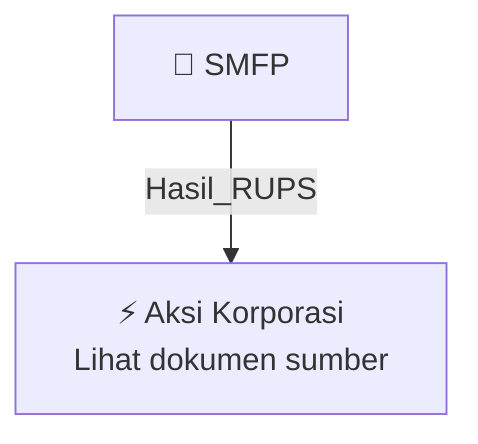

# 🏛️ Hasil & Keputusan RUPS / RUPSLB — [[SMFP]]

⬅️ [[knowledge-base/daily-digests/Daily_Digest_20261009|Kembali ke Daily Digest]] | 📅 **2026-10-09** | 🎛️ [[Dashboard|Ke Dashboard Utama]]

> [!IMPORTANT]
> Laporan ini disusun secara otomatis oleh **Corporate Action Intelligence Agent** pada **2026-10-09**.
> Sumber dokumen: `20261008_SMFP_20261008_SMFP_Laporan Informasi dan Fakta Material_32164668_lamp1.pdf`

---

## 📌 1. Ringkasan Eksekutif & Tujuan Strategis

- **Kode & Nama Emiten**: `[[SMFP]]`
- **Kategori Aksi Korporasi**: `Hasil_RUPS`
- **Dokumen Sumber**: `20261008_SMFP_20261008_SMFP_Laporan Informasi dan Fakta Material_32164668_lamp1.pdf`
- **Tanggal Laporan**: `2026-10-09`

[Analisis LLM tidak tersedia — isi manual]

---

## 📊 2. Fakta Material & Parameter Keuangan

| Parameter Utama | Nilai / Keterangan |
| :--- | :--- |
| **Nomor Surat** | `S-2410/DIR/SMF/X/2026` |
| **Tanggal Surat** | `8 Oktober 2026` |
| **Perihal** | `Penyampaian Akta Perubahan Anggota Direksi PT Sarana Multigriya Finansial (Persero)` |
| **Nomor Akta Perubahan Anggota Direksi** | `66 Tahun 2026` |
| **Dasar Keputusan** | `Pernyataan Keputusan Rapat Umum Pemegang Saham di Luar Rapat Perusahaan Perseroan (Persero) PT Sarana Multigriya Finansial` |
| **Pemberhentian Direktur Utama** | `Sdr. Ananta Wiyogo diberhentikan dengan hormat dari jabatan sebagai Direktur Utama Perseroan` |
| **Pengangkatan Direktur Utama** | `Sdr. Budi Susanto diangkat sebagai Direktur Utama Perseroan` |
| **Susunan Direksi - Direktur Utama** | `Budi Susanto` |
| **Susunan Direksi - Pelaksana Tugas Direktur** | `Heliantopo` |
| **Susunan Direksi - Direktur** | `Bonai Subiakto` |
| **Nomor Penerimaan Kementerian Hukum** | `AHU-AH.01.09-0414454` |
| **Tanggal Penerimaan Kementerian Hukum** | `7 Oktober 2026` |

---

## 👥 3. Struktur Kepemilikan, Pengendali & Pembeli Siaga

- **Emiten**: `SMFP` | Informasi kepemilikan mengacu pada dokumen resmi sumber.

---

## 🎯 4. Alokasi & Rencana Penggunaan Dana

- Informasi alokasi dana belum tersedia — lihat prospektus / dokumen resmi.

---

## 📅 5. Timeline & Jadwal Pelaksanaan

| Tahapan / Event | Tanggal |
| :--- | :---: |
| **Jadwal** | Lihat dokumen sumber. |

---

## 📈 6. Diagram Visual Flowchart (Mermaid)

---

## 💡 7. Rekomendasi Investor & Strategi Trading

[Analisis LLM tidak tersedia — isi manual]

---

## 🔗 8. Hubungan Note Terkait (Knowledge Graph)

- [[knowledge-base/daily-digests/Daily_Digest_20261009|📄 Daily Digest 2026-10-09]]
- [[knowledge-base/trading-signals/Trading_Signals_20261009|🎯 Sinyal Cuan 2026-10-09]]
- [[SMFP|🏬 Halaman Emiten SMFP]]
- [[Dashboard|🎛️ Kembali ke Dashboard Utama]]

---

*Laporan dibuat otomatis oleh Corporate Action Intelligence Agent · 2026-10-09*