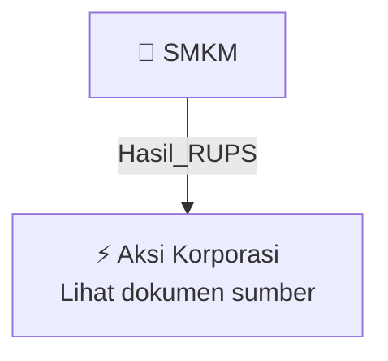

# 🏛️ Hasil & Keputusan RUPS / RUPSLB — [[SMKM]]

⬅️ [[knowledge-base/daily-digests/Daily_Digest_20261007|Kembali ke Daily Digest]] | 📅 **2026-10-07** | 🎛️ [[Dashboard|Ke Dashboard Utama]]

> [!IMPORTANT]
> Laporan ini disusun secara otomatis oleh **Corporate Action Intelligence Agent** pada **2026-10-07**.
> Sumber dokumen: `20261006_SMKM_20261006_SMKM_Laporan Informasi dan Fakta Material_32163922_lamp2.pdf`

---

## 📌 1. Ringkasan Eksekutif & Tujuan Strategis

- **Kode & Nama Emiten**: `[[SMKM]]`
- **Kategori Aksi Korporasi**: `Hasil_RUPS`
- **Dokumen Sumber**: `20261006_SMKM_20261006_SMKM_Laporan Informasi dan Fakta Material_32163922_lamp2.pdf`
- **Tanggal Laporan**: `2026-10-07`

[Analisis LLM tidak tersedia — isi manual]

---

## 📊 2. Fakta Material & Parameter Keuangan

| Parameter Utama | Nilai / Keterangan |
| :--- | :--- |
| **Tanggal perjanjian CSPA dengan Lim Shrimp Org Pte. Ltd.** | `2025-12-22` |
| **Tanggal perjanjian CSPA dengan Advanced Systems Automation Limited** | `2026-01-30` |
| **Pemberitahuan PAA kepada Perseroan terkait restrukturisasi internal** | `2026-10-01` |
| **Perpanjangan long stop date CSPA** | `2027-06-30` |
| **Perkiraan penyelesaian Pengambilalihan PAA** | `Paling lambat 2027-03-31` |
| **Perkiraan penyelesaian Pengambilalihan LOH** | `Kuartal pertama 2027` |
| **Kepemilikan tidak langsung Perseroan setelah Transaksi** | `Paling sedikit 75% hingga paling banyak 100% dari seluruh kegiatan usaha grup PAA dan LOH` |
| **Syarat pendahuluan Pengambilalihan PAA** | `Restrukturisasi internal PAA` |
| **Syarat pendahuluan Pengambilalihan LOH** | `Audit keuangan dan penilaian independen LOH` |
| **Status audit LOH dan entitas anak** | `LOH, LSOSB, LSO Pacific, dan LSO BVI telah menyelesaikan audit keuangan sampai dengan tahun buku 2025; sedang menyelesaikan audit sampai cut-off 2026 untuk Pengambilalihan LOH` |
| **Status penilaian independen LOH** | `Masih berlangsung` |
| **Tanggal penyelesaian akuisisi AAPL oleh PAA** | `2026-06-18` |
| **Tanggal penyelesaian akuisisi 75% saham PMA oleh AAPL** | `2026-07-20` |
| **Luas properti tambak udang PMA** | `68,07 hektare (680.700 m2)` |
| **Lokasi properti tambak udang PMA** | `Indonesia` |
| **Rencana RUPSLB** | `Akan diselenggarakan pada waktu yang akan ditentukan kemudian` |

---

## 👥 3. Struktur Kepemilikan, Pengendali & Pembeli Siaga

- **Emiten**: `SMKM` | Informasi kepemilikan mengacu pada dokumen resmi sumber.

---

## 🎯 4. Alokasi & Rencana Penggunaan Dana

- Informasi alokasi dana belum tersedia — lihat prospektus / dokumen resmi.

---

## 📅 5. Timeline & Jadwal Pelaksanaan

| Tahapan / Event | Tanggal |
| :--- | :---: |
| **Jadwal** | Lihat dokumen sumber. |

---

## 📈 6. Diagram Visual Flowchart (Mermaid)

---

## 💡 7. Rekomendasi Investor & Strategi Trading

[Analisis LLM tidak tersedia — isi manual]

---

## 🔗 8. Hubungan Note Terkait (Knowledge Graph)

- [[knowledge-base/daily-digests/Daily_Digest_20261007|📄 Daily Digest 2026-10-07]]
- [[knowledge-base/trading-signals/Trading_Signals_20261007|🎯 Sinyal Cuan 2026-10-07]]
- [[SMKM|🏬 Halaman Emiten SMKM]]
- [[Dashboard|🎛️ Kembali ke Dashboard Utama]]

---

*Laporan dibuat otomatis oleh Corporate Action Intelligence Agent · 2026-10-07*