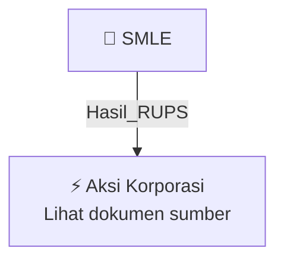

# 🏛️ Hasil & Keputusan RUPS / RUPSLB — [[SMLE]]

⬅️ [[knowledge-base/daily-digests/Daily_Digest_20261012|Kembali ke Daily Digest]] | 📅 **2026-10-12** | 🎛️ [[Dashboard|Ke Dashboard Utama]]

> [!IMPORTANT]
> Laporan ini disusun secara otomatis oleh **Corporate Action Intelligence Agent** pada **2026-10-12**.
> Sumber dokumen: `20261009_SMLE_20261008_SMLE_Laporan Penggunaan Dana Hasil Penawaran Umum_32164938_lamp4.pdf`

---

## 📌 1. Ringkasan Eksekutif & Tujuan Strategis

- **Kode & Nama Emiten**: `[[SMLE]]`
- **Kategori Aksi Korporasi**: `Hasil_RUPS`
- **Dokumen Sumber**: `20261009_SMLE_20261008_SMLE_Laporan Penggunaan Dana Hasil Penawaran Umum_32164938_lamp4.pdf`
- **Tanggal Laporan**: `2026-10-12`

[Analisis LLM tidak tersedia — isi manual]

---

## 📊 2. Fakta Material & Parameter Keuangan

| Parameter Utama | Nilai / Keterangan |
| :--- | :--- |
| **Nama emiten** | `PT Sinergi Multi Lestarindo Tbk` |
| **Jenis penawaran umum** | `Penawaran Umum Saham Perdana (IPO)` |
| **Tanggal efektif** | `29 Desember 2023` |
| **Jumlah hasil penawaran umum** | `Rp81.484.375.000` |
| **Periode laporan** | `30 Juni 2026` |
| **Tanggal surat** | `8 Oktober 2026` |
| **Nomor surat** | `00105/P-DIR/SMLE/X/2026` |
| **Tanggal RUPSLB perubahan rencana penggunaan dana** | `28 November 2024` |
| **Rencana penggunaan dana - Pembelian Lahan dan Pembangunan Gudang** | `Rp31.300.000.000` |
| **Rencana penggunaan dana - Pembelian Alat Laboratorium** | `Rp3.400.000.000` |
| **Rencana penggunaan dana - Modal Kerja** | `Rp43.766.342.092` |
| **Persentase rencana penggunaan dana terhadap nilai hasil Penawaran Umum** | `96,30%` |
| **Realisasi penggunaan dana - Pembelian Lahan** | `Rp6.572.100.000` |
| **Realisasi penggunaan dana - Pembelian Alat Laboratorium** | `Rp471.606.932` |
| **Realisasi penggunaan dana - Modal Kerja** | `Rp43.766.342.092` |
| **Persentase realisasi terhadap nilai hasil Penawaran Umum** | `62,36%` |
| **Direktur Utama** | `Siu Min` |

---

## 👥 3. Struktur Kepemilikan, Pengendali & Pembeli Siaga

- **Emiten**: `SMLE` | Informasi kepemilikan mengacu pada dokumen resmi sumber.

---

## 🎯 4. Alokasi & Rencana Penggunaan Dana

- Informasi alokasi dana belum tersedia — lihat prospektus / dokumen resmi.

---

## 📅 5. Timeline & Jadwal Pelaksanaan

| Tahapan / Event | Tanggal |
| :--- | :---: |
| **Jadwal** | Lihat dokumen sumber. |

---

## 📈 6. Diagram Visual Flowchart (Mermaid)

---

## 💡 7. Rekomendasi Investor & Strategi Trading

[Analisis LLM tidak tersedia — isi manual]

---

## 🔗 8. Hubungan Note Terkait (Knowledge Graph)

- [[knowledge-base/daily-digests/Daily_Digest_20261012|📄 Daily Digest 2026-10-12]]
- [[knowledge-base/trading-signals/Trading_Signals_20261012|🎯 Sinyal Cuan 2026-10-12]]
- [[SMLE|🏬 Halaman Emiten SMLE]]
- [[Dashboard|🎛️ Kembali ke Dashboard Utama]]

---

*Laporan dibuat otomatis oleh Corporate Action Intelligence Agent · 2026-10-12*