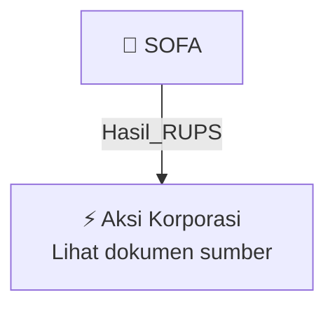

# 🏛️ Hasil & Keputusan RUPS / RUPSLB — [[SOFA]]

⬅️ [[knowledge-base/daily-digests/Daily_Digest_20261002|Kembali ke Daily Digest]] | 📅 **2026-10-02** | 🎛️ [[Dashboard|Ke Dashboard Utama]]

> [!IMPORTANT]
> Laporan ini disusun secara otomatis oleh **Corporate Action Intelligence Agent** pada **2026-10-02**.
> Sumber dokumen: `20261001_SOFA_20261001_SOFA_Ringkasan RisalahRisalah RUPS_32162381_lamp1.pdf`

---

## 📌 1. Ringkasan Eksekutif & Tujuan Strategis

- **Kode & Nama Emiten**: `[[SOFA]]`
- **Kategori Aksi Korporasi**: `Hasil_RUPS`
- **Dokumen Sumber**: `20261001_SOFA_20261001_SOFA_Ringkasan RisalahRisalah RUPS_32162381_lamp1.pdf`
- **Tanggal Laporan**: `2026-10-02`

[Analisis LLM tidak tersedia — isi manual]

---

## 📊 2. Fakta Material & Parameter Keuangan

| Parameter Utama | Nilai / Keterangan |
| :--- | :--- |
| **Nama Perseroan** | `PT SOLUSI ENVIRONMENT ASIA Tbk` |
| **Jenis Rapat** | `Rapat Umum Pemegang Saham Luar Biasa` |
| **Hari/Tanggal Rapat** | `Rabu, 30 September 2026` |
| **Waktu Rapat** | `14.15 WIB s.d. 15.05 WIB` |
| **Tempat Rapat** | `Sequis Tower, Lantai 2, Jl. Jenderal Sudirman Kav. 71, SCBD Lot 11B, Senayan, Kebayoran Baru, Jakarta Selatan 12190` |
| **Mata Acara I** | `Persetujuan Laporan Studi Kelayakan yang dibuat oleh KJPP Independen atas Rencana Penambahan Kegiatan Usaha Perseroan dalam rangka memenuhi POJK No.17/POJK.04/2020 tentang Transaksi Material dan Perubahan Kegiatan Usaha` |
| **Mata Acara II** | `Persetujuan atas Perubahan Maksud dan Tujuan Serta Kegiatan Usaha Perseroan` |
| **Direktur Utama Hadir** | `DENNY RIZAL` |
| **Direktur Hadir** | `REZA MUHAMMAD MANDARA` |
| **Komisaris Hadir** | `LUSI AMANDA` |
| **Komisaris Independen Hadir** | `NURYANA HIDAYAT` |
| **Jumlah Saham Hadir** | `1.191.228.300 saham` |
| **Persentase Saham Hadir** | `72,0396% dari seluruh saham dengan hak suara sah` |
| **Pertanyaan Mata Acara I** | `Tidak ada pemegang saham yang mengajukan pertanyaan/pendapat` |
| **Pertanyaan Mata Acara II** | `Terdapat 1 pertanyaan` |
| **Hasil Voting Mata Acara I - Setuju** | `1.190.725.300 suara atau kurang lebih 99,9578%` |
| **Hasil Voting Mata Acara I - Abstain** | `503.000 suara atau kurang lebih 0,0422%` |
| **Hasil Voting Mata Acara I - Tidak Setuju** | `Tidak ada` |
| **Keputusan Mata Acara I** | `Menyetujui dan menerima baik Laporan Studi Kelayakan yang dibuat oleh Kantor Jasa Penilai Publik Ferdinand, Danar, Ichsan & Rekan atas Rencana Penambahan Kegiatan Usaha Perseroan` |
| **KJPP Independen** | `Ferdinand, Danar, Ichsan & Rekan` |
| **Laporan Auditor Independen** | `No. 00070/3.0291/AU.1/04/0824-3/1/VIII/2026 tanggal 21 Agustus 2026` |
| **Laporan Studi Kelayakan KBLI 64210** | `Nomor 00179/2.0176-00/BS/04/0213/1/IX/2026 tanggal 18 September 2026` |
| **Laporan Studi Kelayakan KBLI 64220** | `Nomor 00179/2.0176-00/BS/04/0213/1/IX/2026 tanggal 18 September 2026` |
| **Hasil Voting Mata Acara II - Setuju** | `1.190.725.300 suara atau kurang lebih 99,9578%` |
| **Hasil Voting Mata Acara II - Abstain** | `503.000 suara atau kurang lebih 0,0422%` |
| **Hasil Voting Mata Acara II - Tidak Setuju** | `Tidak ada` |
| **Keputusan Mata Acara II** | `Menyetujui perubahan Pasal 3 Anggaran Dasar Perseroan terkait Maksud dan Tujuan Serta Kegiatan Usaha Perseroan` |
| **Kegiatan Usaha Utama - Industri Furnitur dari Kayu** | `KBLI 31011` |
| **Kegiatan Usaha Utama - Industri Furnitur dari Logam** | `KBLI 31022` |
| **Kegiatan Usaha Utama - Aktivitas Perusahaan Induk** | `KBLI 64210` |
| **Kegiatan Usaha Utama - Aktivitas Pembiayaan Conduit** | `KBLI 64220` |
| **Kegiatan Usaha Penunjang - Perdagangan Eceran Furnitur** | `KBLI 47591` |
| **Kegiatan Usaha Penunjang - Perdagangan Eceran Peralatan dan Perlengkapan Rumah Tangga Lainnya YTDL** | `KBLI 47599` |
| **Kegiatan Usaha Penunjang - Perdagangan Besar atas Dasar Balas Jasa (Fee) atau Kontrak** | `KBLI 46100` |
| **Kegiatan Usaha Penunjang - Penyelesaian Konstruksi Bangunan Lainnya** | `KBLI 43309` |

---

## 👥 3. Struktur Kepemilikan, Pengendali & Pembeli Siaga

- **Emiten**: `SOFA` | Informasi kepemilikan mengacu pada dokumen resmi sumber.

---

## 🎯 4. Alokasi & Rencana Penggunaan Dana

- Informasi alokasi dana belum tersedia — lihat prospektus / dokumen resmi.

---

## 📅 5. Timeline & Jadwal Pelaksanaan

| Tahapan / Event | Tanggal |
| :--- | :---: |
| **Jadwal** | Lihat dokumen sumber. |

---

## 📈 6. Diagram Visual Flowchart (Mermaid)

---

## 💡 7. Rekomendasi Investor & Strategi Trading

[Analisis LLM tidak tersedia — isi manual]

---

## 🔗 8. Hubungan Note Terkait (Knowledge Graph)

- [[knowledge-base/daily-digests/Daily_Digest_20261002|📄 Daily Digest 2026-10-02]]
- [[knowledge-base/trading-signals/Trading_Signals_20261002|🎯 Sinyal Cuan 2026-10-02]]
- [[SOFA|🏬 Halaman Emiten SOFA]]
- [[Dashboard|🎛️ Kembali ke Dashboard Utama]]

---

*Laporan dibuat otomatis oleh Corporate Action Intelligence Agent · 2026-10-02*