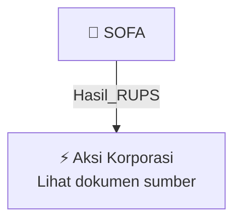

# 🏛️ Hasil & Keputusan RUPS / RUPSLB — [[SOFA]]

⬅️ [[knowledge-base/daily-digests/Daily_Digest_20261009|Kembali ke Daily Digest]] | 📅 **2026-10-09** | 🎛️ [[Dashboard|Ke Dashboard Utama]]

> [!IMPORTANT]
> Laporan ini disusun secara otomatis oleh **Corporate Action Intelligence Agent** pada **2026-10-09**.
> Sumber dokumen: `20261007_SOFA_20261007_SOFA_Laporan Informasi dan Fakta Material_32164454_lamp1.pdf`

---

## 📌 1. Ringkasan Eksekutif & Tujuan Strategis

- **Kode & Nama Emiten**: `[[SOFA]]`
- **Kategori Aksi Korporasi**: `Hasil_RUPS`
- **Dokumen Sumber**: `20261007_SOFA_20261007_SOFA_Laporan Informasi dan Fakta Material_32164454_lamp1.pdf`
- **Tanggal Laporan**: `2026-10-09`

[Analisis LLM tidak tersedia — isi manual]

---

## 📊 2. Fakta Material & Parameter Keuangan

| Parameter Utama | Nilai / Keterangan |
| :--- | :--- |
| **Nama Perseroan** | `PT Solusi Environment Asia Tbk` |
| **Kode Emiten** | `SOFA` |
| **Tanggal Keterbukaan Informasi** | `7 Oktober 2026` |
| **Tanggal Transaksi** | `5 Oktober 2026` |
| **Jenis Transaksi** | `Transaksi Material dan Transaksi Afiliasi` |
| **Pemberi Pinjaman** | `AIC` |
| **Penerima Pinjaman** | `PT Ananta Energi Asia (AEA)` |
| **Jumlah Pokok Pinjaman** | `Rp16.300.000.000,00` |
| **Tujuan Pinjaman** | `Memenuhi kewajiban penyetoran modal AEA pada PT Weiming Nusantara Gamma (WNG) sehubungan dengan Capital Call WNG untuk proyek Waste-to-Energy (WTE) di Bogor Raya` |
| **Perusahaan Penerima Penyetoran Modal** | `PT Weiming Nusantara Gamma (WNG)` |
| **Proyek** | `Waste-to-Energy (WTE) di kota Bogor Raya` |
| **Kepemilikan AIC pada Perseroan** | `70,97% dari modal ditempatkan dan disetor Perseroan` |
| **Kepemilikan Perseroan pada AEA** | `99,99% dari seluruh modal ditempatkan dan disetor AEA` |
| **Nilai Transaksi terhadap Ekuitas Perseroan** | `48,87% dari ekuitas Perseroan berdasarkan laporan keuangan audited untuk tahun buku sampai dengan 30 Juni 2026` |
| **Status Transaksi Material** | `Transaksi Material karena lebih dari 20% ekuitas Perseroan berdasarkan POJK 17/2020` |
| **Kewajiban Persetujuan RUPS** | `Tidak mencapai ambang batas yang mewajibkan persetujuan RUPS karena tidak melebihi 50% ekuitas Perseroan` |
| **Pernyataan Benturan Kepentingan** | `Direksi dan Dewan Komisaris menyatakan Transaksi tidak mengandung Benturan Kepentingan sebagaimana dimaksud dalam POJK 42/2020` |
| **Dasar Regulasi** | `POJK Nomor 17/POJK.04/2020 dan POJK Nomor 42/POJK.04/2020` |

---

## 👥 3. Struktur Kepemilikan, Pengendali & Pembeli Siaga

- **Emiten**: `SOFA` | Informasi kepemilikan mengacu pada dokumen resmi sumber.

---

## 🎯 4. Alokasi & Rencana Penggunaan Dana

- Informasi alokasi dana belum tersedia — lihat prospektus / dokumen resmi.

---

## 📅 5. Timeline & Jadwal Pelaksanaan

| Tahapan / Event | Tanggal |
| :--- | :---: |
| **Jadwal** | Lihat dokumen sumber. |

---

## 📈 6. Diagram Visual Flowchart (Mermaid)

---

## 💡 7. Rekomendasi Investor & Strategi Trading

[Analisis LLM tidak tersedia — isi manual]

---

## 🔗 8. Hubungan Note Terkait (Knowledge Graph)

- [[knowledge-base/daily-digests/Daily_Digest_20261009|📄 Daily Digest 2026-10-09]]
- [[knowledge-base/trading-signals/Trading_Signals_20261009|🎯 Sinyal Cuan 2026-10-09]]
- [[SOFA|🏬 Halaman Emiten SOFA]]
- [[Dashboard|🎛️ Kembali ke Dashboard Utama]]

---

*Laporan dibuat otomatis oleh Corporate Action Intelligence Agent · 2026-10-09*