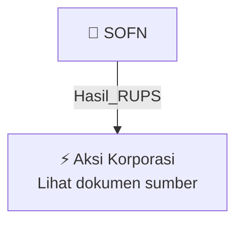

# 🏛️ Hasil & Keputusan RUPS / RUPSLB — [[SOFN]]

⬅️ [[knowledge-base/daily-digests/Daily_Digest_20261002|Kembali ke Daily Digest]] | 📅 **2026-10-02** | 🎛️ [[Dashboard|Ke Dashboard Utama]]

> [!IMPORTANT]
> Laporan ini disusun secara otomatis oleh **Corporate Action Intelligence Agent** pada **2026-10-02**.
> Sumber dokumen: `20261001_SOFN_20260930_SOFN_Laporan Informasi dan Fakta Material_32162211_lamp2.pdf`

---

## 📌 1. Ringkasan Eksekutif & Tujuan Strategis

- **Kode & Nama Emiten**: `[[SOFN]]`
- **Kategori Aksi Korporasi**: `Hasil_RUPS`
- **Dokumen Sumber**: `20261001_SOFN_20260930_SOFN_Laporan Informasi dan Fakta Material_32162211_lamp2.pdf`
- **Tanggal Laporan**: `2026-10-02`

[Analisis LLM tidak tersedia — isi manual]

---

## 📊 2. Fakta Material & Parameter Keuangan

| Parameter Utama | Nilai / Keterangan |
| :--- | :--- |
| **Dasar perubahan** | `Pernyataan Keputusan Para Pemegang Saham PT Summit Oto Finance Nomor 55 tanggal 21 September 2026` |
| **Notaris** | `Aulia Taufani, S.H., berkedudukan di Jakarta` |
| **Surat Kementerian Hukum RI** | `Nomor AHU-AH.01.03-0265891 tanggal 1 Oktober 2026 tentang Penerimaan Pemberitahuan Perubahan Anggaran Dasar PT Summit Oto Finance` |
| **Pasal yang diubah** | `Pasal 4 Anggaran Dasar Perseroan` |
| **Modal dasar Perseroan** | `Rp6.000.000.000.000 (enam triliun rupiah)` |
| **Jumlah saham seri A dalam modal dasar** | `1.800.000 saham` |
| **Nilai nominal saham seri A** | `Rp500.000,00 per saham` |
| **Jumlah saham seri B dalam modal dasar** | `10.200.000 saham` |
| **Nilai nominal saham seri B** | `Rp500.000,00 per saham` |
| **Jumlah saham ditempatkan dan disetor penuh** | `8.054.523 saham` |
| **Nilai nominal seluruh saham ditempatkan dan disetor** | `Rp4.027.261.500.000 (empat triliun dua puluh tujuh miliar dua ratus enam puluh satu juta lima ratus ribu rupiah)` |
| **Rincian saham seri A ditempatkan dan disetor** | `1.208.179 saham dengan nilai nominal seluruhnya Rp604.089.500.000` |
| **Rincian saham seri B ditempatkan dan disetor** | `6.846.344 saham dengan nilai nominal seluruhnya Rp3.423.172.000.000` |
| **Pasal yang diubah lainnya** | `Pasal 15 ayat (4) Anggaran Dasar Perseroan` |
| **Pokok perubahan Pasal 15 ayat (4)** | `Direksi mewakili Perseroan di dalam maupun di luar pengadilan, mengikat Perseroan dengan pihak lain, serta menjalankan kepengurusan dan kepemilikan dengan pembatasan dan syarat untuk membuat transaksi sewa guna usaha, anjak piutang, atau pembiayaan konsumen dengan pihak lain, atau memberikan fasilitas pinjaman uang atau fasilitas pembiayaan.` |
| **Saham dalam simpanan** | `Dikeluarkan oleh Perseroan menurut keperluan modal Perseroan dengan persetujuan RUPS dan mengindahkan peraturan perundang-undangan yang berlaku.` |

---

## 👥 3. Struktur Kepemilikan, Pengendali & Pembeli Siaga

- **Emiten**: `SOFN` | Informasi kepemilikan mengacu pada dokumen resmi sumber.

---

## 🎯 4. Alokasi & Rencana Penggunaan Dana

- Informasi alokasi dana belum tersedia — lihat prospektus / dokumen resmi.

---

## 📅 5. Timeline & Jadwal Pelaksanaan

| Tahapan / Event | Tanggal |
| :--- | :---: |
| **Jadwal** | Lihat dokumen sumber. |

---

## 📈 6. Diagram Visual Flowchart (Mermaid)

---

## 💡 7. Rekomendasi Investor & Strategi Trading

[Analisis LLM tidak tersedia — isi manual]

---

## 🔗 8. Hubungan Note Terkait (Knowledge Graph)

- [[knowledge-base/daily-digests/Daily_Digest_20261002|📄 Daily Digest 2026-10-02]]
- [[knowledge-base/trading-signals/Trading_Signals_20261002|🎯 Sinyal Cuan 2026-10-02]]
- [[SOFN|🏬 Halaman Emiten SOFN]]
- [[Dashboard|🎛️ Kembali ke Dashboard Utama]]

---

*Laporan dibuat otomatis oleh Corporate Action Intelligence Agent · 2026-10-02*