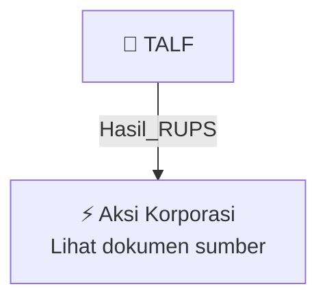

# 🏛️ Hasil & Keputusan RUPS / RUPSLB — [[TALF]]

⬅️ [[knowledge-base/daily-digests/Daily_Digest_20261006|Kembali ke Daily Digest]] | 📅 **2026-10-06** | 🎛️ [[Dashboard|Ke Dashboard Utama]]

> [!IMPORTANT]
> Laporan ini disusun secara otomatis oleh **Corporate Action Intelligence Agent** pada **2026-10-06**.
> Sumber dokumen: `20261005_TALF_20261005_TALF_Transaksi Material Tanpa Persetujuan RUPS_32163329_lamp1.pdf`

---

## 📌 1. Ringkasan Eksekutif & Tujuan Strategis

- **Kode & Nama Emiten**: `[[TALF]]`
- **Kategori Aksi Korporasi**: `Hasil_RUPS`
- **Dokumen Sumber**: `20261005_TALF_20261005_TALF_Transaksi Material Tanpa Persetujuan RUPS_32163329_lamp1.pdf`
- **Tanggal Laporan**: `2026-10-06`

[Analisis LLM tidak tersedia — isi manual]

---

## 📊 2. Fakta Material & Parameter Keuangan

| Parameter Utama | Nilai / Keterangan |
| :--- | :--- |
| **Nama Emiten** | `PT Tunas Alfin Tbk` |
| **Nomor Surat** | `669/TA/X/2026` |
| **Tanggal Surat/Pelaporan** | `5 Oktober 2026` |
| **Tanggal Kejadian** | `2 Oktober 2026` |
| **Objek Transaksi Material** | `Pembelian bahan baku Solvent untuk mengoperasikan Mesin Printing dan Mesin Laminasi milik Perseroan, sebagaimana diatur dalam Perjanjian Bahan Baku Solvent Daur Ulang yang Dihasilkan dari Mesin Solvent Recovery & Reuse melalui Pengolahan Limbah Udara dari Proses Mesin Printing dan Laminasi.` |
| **Pihak Pembeli** | `Perseroan (PT Tunas Alfin Tbk)` |
| **Pihak Penjual** | `PT Bluesky Technology Indonesia` |
| **Sifat Hubungan Pihak** | `Tidak ada hubungan afiliasi; bukan transaksi afiliasi dan bukan transaksi benturan kepentingan sesuai POJK No. 42/POJK.04/2020.` |
| **Dasar Pengecualian** | `Pasal 13 ayat (1) POJK No. 17/POJK.04/2020 tentang Transaksi Material dan Perubahan Kegiatan Usaha Utama.` |
| **Tanggal Perjanjian** | `2 Oktober 2026` |
| **Jangka Waktu Perjanjian** | `10 (sepuluh) tahun` |
| **Bidang Usaha Penjual** | `Perdagangan Besar Mesin, Peralatan Dan Perlengkapan Lainnya` |
| **Akta Pendirian Penjual** | `Akta Nomor 294 tanggal 29 Juni 2024, dibuat di hadapan Notaris James Sinaga, S.H., Notaris di Tangerang Selatan.` |

---

## 👥 3. Struktur Kepemilikan, Pengendali & Pembeli Siaga

- **Emiten**: `TALF` | Informasi kepemilikan mengacu pada dokumen resmi sumber.

---

## 🎯 4. Alokasi & Rencana Penggunaan Dana

- Informasi alokasi dana belum tersedia — lihat prospektus / dokumen resmi.

---

## 📅 5. Timeline & Jadwal Pelaksanaan

| Tahapan / Event | Tanggal |
| :--- | :---: |
| **Jadwal** | Lihat dokumen sumber. |

---

## 📈 6. Diagram Visual Flowchart (Mermaid)

---

## 💡 7. Rekomendasi Investor & Strategi Trading

[Analisis LLM tidak tersedia — isi manual]

---

## 🔗 8. Hubungan Note Terkait (Knowledge Graph)

- [[knowledge-base/daily-digests/Daily_Digest_20261006|📄 Daily Digest 2026-10-06]]
- [[knowledge-base/trading-signals/Trading_Signals_20261006|🎯 Sinyal Cuan 2026-10-06]]
- [[TALF|🏬 Halaman Emiten TALF]]
- [[Dashboard|🎛️ Kembali ke Dashboard Utama]]

---

*Laporan dibuat otomatis oleh Corporate Action Intelligence Agent · 2026-10-06*