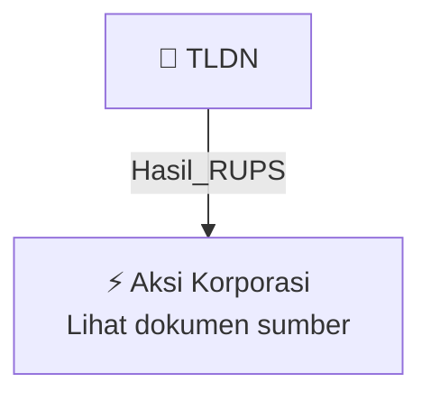

# 🏛️ Hasil & Keputusan RUPS / RUPSLB — [[TLDN]]

⬅️ [[knowledge-base/daily-digests/Daily_Digest_20261009|Kembali ke Daily Digest]] | 📅 **2026-10-09** | 🎛️ [[Dashboard|Ke Dashboard Utama]]

> [!IMPORTANT]
> Laporan ini disusun secara otomatis oleh **Corporate Action Intelligence Agent** pada **2026-10-09**.
> Sumber dokumen: `20261008_TLDN_20261007_TLDN_Laporan Penggunaan Dana Hasil Penawaran Umum_32164090.pdf`

---

## 📌 1. Ringkasan Eksekutif & Tujuan Strategis

- **Kode & Nama Emiten**: `[[TLDN]]`
- **Kategori Aksi Korporasi**: `Hasil_RUPS`
- **Dokumen Sumber**: `20261008_TLDN_20261007_TLDN_Laporan Penggunaan Dana Hasil Penawaran Umum_32164090.pdf`
- **Tanggal Laporan**: `2026-10-09`

[Analisis LLM tidak tersedia — isi manual]

---

## 📊 2. Fakta Material & Parameter Keuangan

| Parameter Utama | Nilai / Keterangan |
| :--- | :--- |
| **Nomor Pengumuman** | `125/TPA-Dir/X/2026` |
| **Mengoreksi Surat Nomor** | `114/TPA-Dir/VII/2026 tanggal 14 Juli 2026` |
| **Periode Laporan** | `30 Juni 2026` |
| **Jenis Penawaran Umum** | `IPO Saham TLDN` |
| **Tanggal Efektif** | `31 Maret 2022` |
| **Jumlah Hasil Penawaran Umum** | `300.359.496.000 IDR` |
| **Biaya Penawaran Umum** | `14.754.919.060 IDR` |
| **Hasil Realisasi Bersih** | `285.604.576.940 IDR` |
| **Rencana Penggunaan Dana Menurut Prospektus** | `285.604.576.940 IDR` |
| **Realisasi Penggunaan Dana Menurut Prospektus** | `285.604.576.940 IDR` |
| **Sisa Dana** | `0 IDR` |
| **Penempatan Sisa Dana** | `0 IDR; Tingkat Bunga/Bagi Hasil 0%; Jangka Waktu -; Hubungan dengan Perusahaan 0 pihak ketiga` |
| **Rencana Akuisisi PT Cipta Davia Mandiri** | `18.157.199 lembar saham atau 99,99% kepemilikan dari PT REA Kaltim Plantations senilai 136.324.250.092 IDR (48%)` |
| **Rencana Penyetoran Modal kepada PT Telen Prima Sawit (TPS)** | `44.000.000.000 IDR (15%) untuk pembangunan Kernel Crushing Plant/KCP` |
| **Rencana Penyetoran Modal kepada PT Daya Lestari (DL)** | `40.000.000.000 IDR (14%) untuk pembangunan biogas power plant/pembangkit listrik tenaga biogas` |
| **Rencana Penyetoran Modal dan/atau Uang Muka Setoran Modal kepada PT Cipta Davia Mandiri** | `65.280.326.848 IDR (23%)` |
| **Realisasi Akuisisi PT Cipta Davia Mandiri** | `18.157.199 lembar saham atau 99,99% kepemilikan dari PT REA Kaltim Plantations senilai 136.324.250.092 IDR (48%)` |
| **Realisasi Penyetoran Modal kepada PT Telen Prima Sawit (TPS)** | `44.000.000.000 IDR (15%)` |
| **Realisasi Penyetoran Modal kepada PT Cipta Davia Mandiri** | `40.000.000.000 IDR (14%)` |
| **Realisasi Penyetoran Uang Muka Modal kepada PT Cipta Davia Mandiri** | `65.280.326.848 IDR (23%)` |
| **Persetujuan Perubahan Penggunaan Dana** | `RUPS Tahunan tanggal 16 April 2026` |
| **LRPD Terakhir** | `Ya` |
| **Penggunaan Dana Sebelum Perubahan LRPD** | `Akuisisi Perusahaan` |
| **Penggunaan Dana Setelah Perubahan LRPD** | `Penyetoran modal dan atau uang muka setoran modal` |
| **Nama Pengirim** | `Arya Wibisana` |
| **Jabatan Pengirim** | `Corsec & Legal` |
| **Tanggal Pengumuman** | `08-10-2026 17:20` |
| **Lampiran** | `1. TLDN Revisi LRPD per 30 Juni 2026.pdf` |

---

## 👥 3. Struktur Kepemilikan, Pengendali & Pembeli Siaga

- **Emiten**: `TLDN` | Informasi kepemilikan mengacu pada dokumen resmi sumber.

---

## 🎯 4. Alokasi & Rencana Penggunaan Dana

- Informasi alokasi dana belum tersedia — lihat prospektus / dokumen resmi.

---

## 📅 5. Timeline & Jadwal Pelaksanaan

| Tahapan / Event | Tanggal |
| :--- | :---: |
| **Jadwal** | Lihat dokumen sumber. |

---

## 📈 6. Diagram Visual Flowchart (Mermaid)

---

## 💡 7. Rekomendasi Investor & Strategi Trading

[Analisis LLM tidak tersedia — isi manual]

---

## 🔗 8. Hubungan Note Terkait (Knowledge Graph)

- [[knowledge-base/daily-digests/Daily_Digest_20261009|📄 Daily Digest 2026-10-09]]
- [[knowledge-base/trading-signals/Trading_Signals_20261009|🎯 Sinyal Cuan 2026-10-09]]
- [[TLDN|🏬 Halaman Emiten TLDN]]
- [[Dashboard|🎛️ Kembali ke Dashboard Utama]]

---

*Laporan dibuat otomatis oleh Corporate Action Intelligence Agent · 2026-10-09*