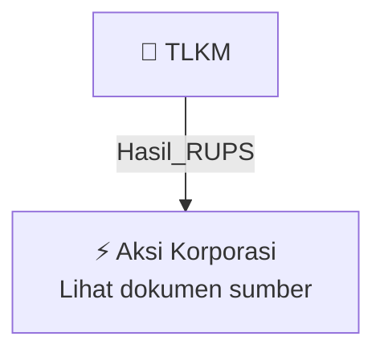

# 🏛️ Hasil & Keputusan RUPS / RUPSLB — [[TLKM]]

⬅️ [[knowledge-base/daily-digests/Daily_Digest_20261002|Kembali ke Daily Digest]] | 📅 **2026-10-02** | 🎛️ [[Dashboard|Ke Dashboard Utama]]

> [!IMPORTANT]
> Laporan ini disusun secara otomatis oleh **Corporate Action Intelligence Agent** pada **2026-10-02**.
> Sumber dokumen: `20260930_TLKM_20260930_TLKM_Laporan Informasi dan Fakta Material_32162298_lamp2.pdf`

---

## 📌 1. Ringkasan Eksekutif & Tujuan Strategis

- **Kode & Nama Emiten**: `[[TLKM]]`
- **Kategori Aksi Korporasi**: `Hasil_RUPS`
- **Dokumen Sumber**: `20260930_TLKM_20260930_TLKM_Laporan Informasi dan Fakta Material_32162298_lamp2.pdf`
- **Tanggal Laporan**: `2026-10-02`

[Analisis LLM tidak tersedia — isi manual]

---

## 📊 2. Fakta Material & Parameter Keuangan

| Parameter Utama | Nilai / Keterangan |
| :--- | :--- |
| **Nomor surat** | `Tel.88/PR 000/COP-M0000000/2026` |
| **Tanggal surat** | `2026-09-30` |
| **Jenis aksi korporasi** | `Spin-off segmen usaha Wholesale Fiber Connectivity` |
| **Pihak pengalih** | `PT Telkom Indonesia (Persero) Tbk` |
| **Pihak penerima** | `PT Telkom Infrastruktur Indonesia (TIF)` |
| **Tanggal pelaksanaan akta spin-off** | `2026-09-30` |
| **Tanggal persetujuan RUPSLB** | `2026-09-30` |
| **Perkiraan tanggal efektif peningkatan modal TIF** | `2026-10-01` |
| **Kepemilikan Telkom di TIF sebelum spin-off** | `99,9999997%` |
| **Kepemilikan Telkom di TIF setelah spin-off** | `99,9999999%` |
| **Kepemilikan PT Multimedia Nusantara di TIF sebelum spin-off** | `0,0000003%` |
| **Kepemilikan PT Multimedia Nusantara di TIF setelah spin-off** | `0,0000001%` |
| **Status TIF** | `Perusahaan Terkendali Telkom` |
| **Dasar pelaporan** | `POJK No. 31/POJK.04/2015 sebagaimana terakhir diubah dengan POJK No. 45 Tahun 2024` |
| **Tembusan** | `PT Bursa Efek Indonesia via IDXNet; Trustee PT Bank Permata Tbk` |
| **Penandatangan** | `Edie Kurniawan` |

---

## 👥 3. Struktur Kepemilikan, Pengendali & Pembeli Siaga

- **Emiten**: `TLKM` | Informasi kepemilikan mengacu pada dokumen resmi sumber.

---

## 🎯 4. Alokasi & Rencana Penggunaan Dana

- Informasi alokasi dana belum tersedia — lihat prospektus / dokumen resmi.

---

## 📅 5. Timeline & Jadwal Pelaksanaan

| Tahapan / Event | Tanggal |
| :--- | :---: |
| **Jadwal** | Lihat dokumen sumber. |

---

## 📈 6. Diagram Visual Flowchart (Mermaid)

---

## 💡 7. Rekomendasi Investor & Strategi Trading

[Analisis LLM tidak tersedia — isi manual]

---

## 🔗 8. Hubungan Note Terkait (Knowledge Graph)

- [[knowledge-base/daily-digests/Daily_Digest_20261002|📄 Daily Digest 2026-10-02]]
- [[knowledge-base/trading-signals/Trading_Signals_20261002|🎯 Sinyal Cuan 2026-10-02]]
- [[TLKM|🏬 Halaman Emiten TLKM]]
- [[Dashboard|🎛️ Kembali ke Dashboard Utama]]

---

*Laporan dibuat otomatis oleh Corporate Action Intelligence Agent · 2026-10-02*