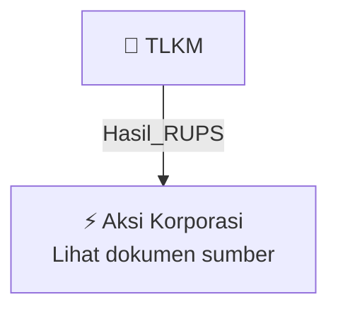

# 🏛️ Hasil & Keputusan RUPS / RUPSLB — [[TLKM]]

⬅️ [[knowledge-base/daily-digests/Daily_Digest_20261005|Kembali ke Daily Digest]] | 📅 **2026-10-05** | 🎛️ [[Dashboard|Ke Dashboard Utama]]

> [!IMPORTANT]
> Laporan ini disusun secara otomatis oleh **Corporate Action Intelligence Agent** pada **2026-10-05**.
> Sumber dokumen: `20261002_TLKM_20261002_TLKM_Ringkasan RisalahRisalah RUPS_32162739_lamp2.pdf`

---

## 📌 1. Ringkasan Eksekutif & Tujuan Strategis

- **Kode & Nama Emiten**: `[[TLKM]]`
- **Kategori Aksi Korporasi**: `Hasil_RUPS`
- **Dokumen Sumber**: `20261002_TLKM_20261002_TLKM_Ringkasan RisalahRisalah RUPS_32162739_lamp2.pdf`
- **Tanggal Laporan**: `2026-10-05`

[Analisis LLM tidak tersedia — isi manual]

---

## 📊 2. Fakta Material & Parameter Keuangan

| Parameter Utama | Nilai / Keterangan |
| :--- | :--- |
| **Nama Emiten** | `PT Telekomunikasi Indonesia Tbk (Persero)` |
| **Kode Emiten** | `TLKM` |
| **Jenis RUPS** | `RUPS Luar Biasa Tahun 2026` |
| **Nomor Pengumuman** | `Tel.90/LP 000/COP-M0000000/2026` |
| **Hari/Tanggal RUPS** | `Rabu, 30 September 2026` |
| **Waktu RUPS** | `16.45 sampai 17.22 WIB` |
| **Tempat RUPS** | `Meeting Link (tidak dicantumkan dalam teks)` |
| **Jumlah Saham Hadir** | `86.917.778.519 saham` |
| **Persentase Saham Hadir** | `88,1689481%` |
| **Total Saham dengan Hak Suara Setelah Treasury** | `98.580.940.800 saham` |
| **Tanggal Daftar Pemegang Saham** | `7 September 2026` |
| **Nomor Risalah** | `63b/IX/2026` |
| **Tanggal Risalah** | `30 September 2026` |
| **Notaris** | `Titik Krisna Murti Wikaningsih Hastuti, S.H., M.Kn.` |
| **Pihak Penghitung dan Validasi Suara** | `PT Datindo Entrycom` |
| **Agenda Pertama** | `Persetujuan rencana Perseroan untuk melakukan Partial Spin-Off segmen bisnis Wholesale Fiber Connectivity (Phase 2) kepada PT Telkom Infrastruktur Indonesia` |
| **Kepemilikan Saham PT Telkom Infrastruktur Indonesia** | `99,99%` |
| **Hasil Voting Tidak Setuju** | `277.808.090 saham atau 0,3196217%` |
| **Hasil Voting Abstain** | `426.783.977 saham atau 0,4910203%` |
| **Hasil Voting Setuju** | `86.213.186.452 saham atau 99,1893579%` |
| **Total Suara Mayoritas** | `86.639.970.429 suara atau 99,6803783%` |
| **Keputusan Agenda Pertama** | `Menyetujui tindakan Perseroan untuk melakukan spin-off sebagian segmen bisnis wholesale fiber connectivity (Phase 2) kepada PT Telkom Infrastruktur Indonesia, efektif setelah terpenuhinya seluruh persyaratan hukum yang berlaku.` |
| **Komisaris Tidak Hadir** | `Angga Raka Prabowo (Presiden Komisaris)` |
| **Direktur Tidak Hadir** | `Veranita Yosephine (Director of Enterprise & Business Service)` |
| **Dasar Quorum** | `Pasal 26 ayat (6) huruf a Anggaran Dasar dan Pasal 43 huruf a POJK No. 15/POJK.04/2020; Pasal 26 ayat (4) huruf a Anggaran Dasar` |

---

## 👥 3. Struktur Kepemilikan, Pengendali & Pembeli Siaga

- **Emiten**: `TLKM` | Informasi kepemilikan mengacu pada dokumen resmi sumber.

---

## 🎯 4. Alokasi & Rencana Penggunaan Dana

- Informasi alokasi dana belum tersedia — lihat prospektus / dokumen resmi.

---

## 📅 5. Timeline & Jadwal Pelaksanaan

| Tahapan / Event | Tanggal |
| :--- | :---: |
| **Jadwal** | Lihat dokumen sumber. |

---

## 📈 6. Diagram Visual Flowchart (Mermaid)

---

## 💡 7. Rekomendasi Investor & Strategi Trading

[Analisis LLM tidak tersedia — isi manual]

---

## 🔗 8. Hubungan Note Terkait (Knowledge Graph)

- [[knowledge-base/daily-digests/Daily_Digest_20261005|📄 Daily Digest 2026-10-05]]
- [[knowledge-base/trading-signals/Trading_Signals_20261005|🎯 Sinyal Cuan 2026-10-05]]
- [[TLKM|🏬 Halaman Emiten TLKM]]
- [[Dashboard|🎛️ Kembali ke Dashboard Utama]]

---

*Laporan dibuat otomatis oleh Corporate Action Intelligence Agent · 2026-10-05*