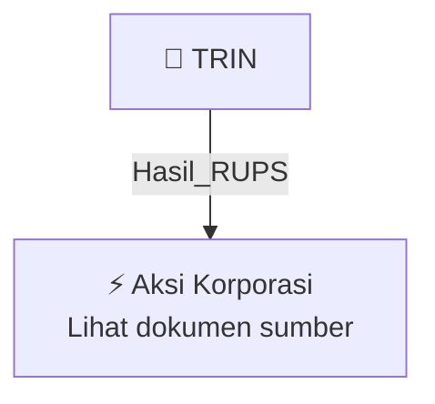

# 🏛️ Hasil & Keputusan RUPS / RUPSLB — [[TRIN]]

⬅️ [[knowledge-base/daily-digests/Daily_Digest_20261009|Kembali ke Daily Digest]] | 📅 **2026-10-09** | 🎛️ [[Dashboard|Ke Dashboard Utama]]

> [!IMPORTANT]
> Laporan ini disusun secara otomatis oleh **Corporate Action Intelligence Agent** pada **2026-10-09**.
> Sumber dokumen: `20261009_TRIN_20261009_TRIN_Laporan Informasi dan Fakta Material_32164985_lamp1.pdf`

---

## 📌 1. Ringkasan Eksekutif & Tujuan Strategis

- **Kode & Nama Emiten**: `[[TRIN]]`
- **Kategori Aksi Korporasi**: `Hasil_RUPS`
- **Dokumen Sumber**: `20261009_TRIN_20261009_TRIN_Laporan Informasi dan Fakta Material_32164985_lamp1.pdf`
- **Tanggal Laporan**: `2026-10-09`

[Analisis LLM tidak tersedia — isi manual]

---

## 📊 2. Fakta Material & Parameter Keuangan

| Parameter Utama | Nilai / Keterangan |
| :--- | :--- |
| **Nomor surat** | `158/CORSEC/PTP/X/2026` |
| **Tanggal surat/pelaporan** | `2026-10-09` |
| **Tanggal kejadian** | `2026-10-07` |
| **Jenis informasi atau fakta material** | `Pengunduran Diri Komisaris Utama PT Perintis Triniti Properti Tbk` |
| **Nama emiten** | `PT Perintis Triniti Properti Tbk` |
| **Bidang usaha** | `Real Estat` |
| **Nama pihak yang mengundurkan diri** | `Rahayu Saraswati D. Djojohadikusumo` |
| **Jabatan** | `Komisaris Utama` |
| **Status sampai pengunduran diri berlaku efektif** | `Tetap menjalankan tugas dan tanggung jawab sebagai Komisaris Utama Perseroan` |
| **Status setelah pengunduran diri berlaku efektif** | `Tidak lagi menjabat dalam jajaran pengurus Perseroan; tetap menjadi pemegang saham langsung maupun tidak langsung` |
| **Tindak lanjut** | `Akan diputuskan dalam Rapat Umum Pemegang Saham Luar Biasa (RUPSLB)` |
| **Kewajiban keterbukaan hasil RUPSLB** | `Paling lambat 2 hari kerja setelah RUPSLB` |
| **Dampak terhadap kegiatan operasional, hukum, kondisi keuangan, atau kelangsungan usaha** | `Tidak berdampak secara material` |
| **Penandatangan** | `Ishak Chandra, Direktur Utama` |

---

## 👥 3. Struktur Kepemilikan, Pengendali & Pembeli Siaga

- **Emiten**: `TRIN` | Informasi kepemilikan mengacu pada dokumen resmi sumber.

---

## 🎯 4. Alokasi & Rencana Penggunaan Dana

- Informasi alokasi dana belum tersedia — lihat prospektus / dokumen resmi.

---

## 📅 5. Timeline & Jadwal Pelaksanaan

| Tahapan / Event | Tanggal |
| :--- | :---: |
| **Jadwal** | Lihat dokumen sumber. |

---

## 📈 6. Diagram Visual Flowchart (Mermaid)

---

## 💡 7. Rekomendasi Investor & Strategi Trading

[Analisis LLM tidak tersedia — isi manual]

---

## 🔗 8. Hubungan Note Terkait (Knowledge Graph)

- [[knowledge-base/daily-digests/Daily_Digest_20261009|📄 Daily Digest 2026-10-09]]
- [[knowledge-base/trading-signals/Trading_Signals_20261009|🎯 Sinyal Cuan 2026-10-09]]
- [[TRIN|🏬 Halaman Emiten TRIN]]
- [[Dashboard|🎛️ Kembali ke Dashboard Utama]]

---

*Laporan dibuat otomatis oleh Corporate Action Intelligence Agent · 2026-10-09*