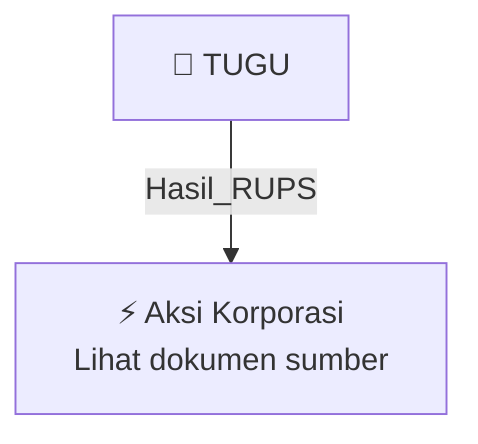

# 🏛️ Hasil & Keputusan RUPS / RUPSLB — [[TUGU]]

⬅️ [[knowledge-base/daily-digests/Daily_Digest_20261002|Kembali ke Daily Digest]] | 📅 **2026-10-02** | 🎛️ [[Dashboard|Ke Dashboard Utama]]

> [!IMPORTANT]
> Laporan ini disusun secara otomatis oleh **Corporate Action Intelligence Agent** pada **2026-10-02**.
> Sumber dokumen: `20260930_TUGU_20260930_TUGU_Laporan Informasi dan Fakta Material_32162284_lamp1.pdf`

---

## 📌 1. Ringkasan Eksekutif & Tujuan Strategis

- **Kode & Nama Emiten**: `[[TUGU]]`
- **Kategori Aksi Korporasi**: `Hasil_RUPS`
- **Dokumen Sumber**: `20260930_TUGU_20260930_TUGU_Laporan Informasi dan Fakta Material_32162284_lamp1.pdf`
- **Tanggal Laporan**: `2026-10-02`

[Analisis LLM tidak tersedia — isi manual]

---

## 📊 2. Fakta Material & Parameter Keuangan

| Parameter Utama | Nilai / Keterangan |
| :--- | :--- |
| **Nomor Surat** | `099/S/01/COS-ATPI/IX/2026` |
| **Tanggal Surat/Pelaporan** | `30 September 2026` |
| **Jenis Informasi atau Fakta Material** | `Perubahan Pengurus Perseroan PT Asuransi Tugu Pratama Indonesia Tbk` |
| **Tanggal Kejadian** | `29 September 2026` |
| **Penyelenggaraan RUPSLB** | `Jakarta, Selasa, 29 September 2026` |
| **Mata Acara RUPSLB** | `Persetujuan Perubahan Pengurus Perseroan` |
| **Pengangkatan Komisaris Independen** | `Bambang Wijanarko, SE. MM.` |
| **Dasar Pengangkatan Komisaris Independen** | `Surat Badan Pengaturan Badan Usaha Milik Negara Republik Indonesia Nomor SR-516/BP/09/2026 tanggal 29 September 2026` |
| **Pengangkatan Dewan Pengawas Syariah** | `Prof. Dr. Muhammad Maksum, S.H., M.A., MDC; dan dr. Siti Hannah, M.K.M.` |
| **Presiden Direktur** | `Adi Pramana` |
| **Direktur Kepatuhan & Manajemen Risiko** | `Edi Yoga Prasetyo` |
| **Direktur Keuangan & Layanan Korporat** | `Fitri Azwar, SE` |
| **Direktur Pemasaran Asuransi** | `Ery Widiatmoko` |
| **Direktur Teknik** | `Fadlil Iswahyudi` |
| **Presiden Komisaris & Komisaris Independen** | `Abdul Ghofar` |
| **Komisaris** | `Ony Suprihartono, SE, MM` |
| **Komisaris** | `Clifford Patrick Wuisan` |
| **Komisaris Independen** | `Bambang Wijanarko, SE. MM.` |
| **Catatan Proses Uji Kemampuan dan Kepatutan OJK** | `Pengangkatan Clifford Patrick Wuisan dan Bambang Wijanarko, SE. MM. dalam proses uji kemampuan dan kepatutan pada Otoritas Jasa Keuangan (OJK); pemberitahuan kepada Kementerian Hukum Republik Indonesia menunggu surat persetujuan OJK.` |
| **Dewan Pengawas Syariah** | `Prof. Dr. Muhammad Maksum, S.H., M.A., MDC; dr. Siti Hannah, M.K.M.` |
| **Dampak terhadap Kegiatan Operasional, Hukum, Kondisi Keuangan, atau Kelangsungan Usaha** | `Tidak Ada` |
| **Keterangan Lain-lain** | `Tidak Ada` |
| **Penandatangan** | `Dudi Subekti` |
| **Tembusan** | `Direksi PT Bursa Efek Indonesia; Direksi PT Asuransi Tugu Pratama Indonesia Tbk` |

---

## 👥 3. Struktur Kepemilikan, Pengendali & Pembeli Siaga

- **Emiten**: `TUGU` | Informasi kepemilikan mengacu pada dokumen resmi sumber.

---

## 🎯 4. Alokasi & Rencana Penggunaan Dana

- Informasi alokasi dana belum tersedia — lihat prospektus / dokumen resmi.

---

## 📅 5. Timeline & Jadwal Pelaksanaan

| Tahapan / Event | Tanggal |
| :--- | :---: |
| **Jadwal** | Lihat dokumen sumber. |

---

## 📈 6. Diagram Visual Flowchart (Mermaid)

---

## 💡 7. Rekomendasi Investor & Strategi Trading

[Analisis LLM tidak tersedia — isi manual]

---

## 🔗 8. Hubungan Note Terkait (Knowledge Graph)

- [[knowledge-base/daily-digests/Daily_Digest_20261002|📄 Daily Digest 2026-10-02]]
- [[knowledge-base/trading-signals/Trading_Signals_20261002|🎯 Sinyal Cuan 2026-10-02]]
- [[TUGU|🏬 Halaman Emiten TUGU]]
- [[Dashboard|🎛️ Kembali ke Dashboard Utama]]

---

*Laporan dibuat otomatis oleh Corporate Action Intelligence Agent · 2026-10-02*