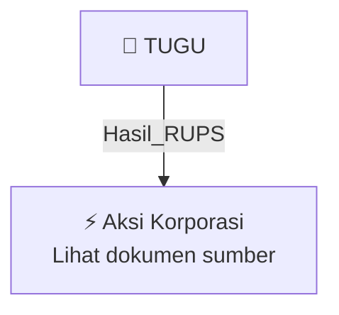

# 🏛️ Hasil & Keputusan RUPS / RUPSLB — [[TUGU]]

⬅️ [[knowledge-base/daily-digests/Daily_Digest_20261002|Kembali ke Daily Digest]] | 📅 **2026-10-02** | 🎛️ [[Dashboard|Ke Dashboard Utama]]

> [!IMPORTANT]
> Laporan ini disusun secara otomatis oleh **Corporate Action Intelligence Agent** pada **2026-10-02**.
> Sumber dokumen: `20261001_TUGU_20261001_TUGU_Ringkasan RisalahRisalah RUPS_32162465_lamp2.pdf`

---

## 📌 1. Ringkasan Eksekutif & Tujuan Strategis

- **Kode & Nama Emiten**: `[[TUGU]]`
- **Kategori Aksi Korporasi**: `Hasil_RUPS`
- **Dokumen Sumber**: `20261001_TUGU_20261001_TUGU_Ringkasan RisalahRisalah RUPS_32162465_lamp2.pdf`
- **Tanggal Laporan**: `2026-10-02`

[Analisis LLM tidak tersedia — isi manual]

---

## 📊 2. Fakta Material & Parameter Keuangan

| Parameter Utama | Nilai / Keterangan |
| :--- | :--- |
| **Nama Perseroan** | `PT Asuransi Tugu Pratama Indonesia Tbk` |
| **Jenis Rapat** | `Rapat Umum Pemegang Saham Luar Biasa (RUPSLB)` |
| **Tanggal Pengumuman** | `2026-10-01` |
| **Hari/Tanggal Rapat** | `Selasa, 29 September 2026` |
| **Waktu Rapat** | `18:02 WIB – 18:59 WIB` |
| **Tempat Rapat** | `Jakarta Selatan dan melalui fasilitas Electronic General Meeting System` |
| **Mata Acara 1** | `Persetujuan Perubahan Pengurus Perusahaan` |
| **Mata Acara 2** | `Persetujuan Perubahan Rencana Kerja Pemisahan Unit Syariah (RKPUS Perubahan)` |
| **Mata Acara 3** | `Persetujuan Pelaksanaan Pengalihan Portofolio Kepesertaan Unit Usaha Syariah kepada Perusahaan Asuransi Syariah yang telah memperoleh izin usaha` |
| **Jumlah Saham Hadir** | `3.057.384.820 saham` |
| **Persentase Saham Hadir** | `85,9884633% dari seluruh saham dengan hak suara yang sah yang telah dikeluarkan` |
| **Mekanisme Pengambilan Keputusan** | `Musyawarah untuk mufakat; jika tidak tercapai, pemungutan suara; keputusan sah jika disetujui lebih dari 1/2 bagian dari seluruh saham dengan hak suara yang hadir` |
| **Hasil Voting Mata Acara 1 - Setuju** | `2.999.604.782 suara atau 98,1101483%` |
| **Hasil Voting Mata Acara 1 - Abstain** | `15.682.900 suara atau 0,5129515%` |
| **Hasil Voting Mata Acara 1 - Tidak Setuju** | `42.097.138 suara atau 1,3769002%` |
| **Hasil Voting Mata Acara 1 - Total Setuju** | `3.015.287.682 suara atau 98,6230998%` |
| **Keputusan Mata Acara 1 - Pengangkatan Komisaris Independen** | `Menyetujui pengangkatan Bambang Wijanarko, SE. MM. sebagai Komisaris Independen` |
| **Dasar Pengangkatan Komisaris Independen** | `Surat Badan Pengaturan Badan Usaha Milik Negara Republik Indonesia Nomor SR-516/BP/09/2026 tanggal 29 September 2026` |
| **Keputusan Mata Acara 1 - Pengangkatan Dewan Pengawas Syariah** | `Menyetujui pengangkatan Prof. Dr. Muhammad Maksum, S.H., M.A., MDC dan dr. Siti Hannah, M.K.M. sebagai Dewan Pengawas Syariah` |
| **Susunan Direksi** | `Presiden Direktur: Adi Pramana; Direktur Kepatuhan & Manajemen Risiko: Edi Yoga Prasetyo; Direktur Keuangan & Layanan Korporat: Fitri Azwar, SE; Direktur Pemasaran Asuransi: Ery Widiatmoko` |
| **Susunan Dewan Komisaris** | `Presiden Komisaris & Komisaris Independen: Abdul Ghofar; Komisaris: Ony Suprihartono, SE, MM; Komisaris Independen: Bambang Wijanarko, SE. MM.` |
| **Susunan Dewan Pengawas Syariah** | `Prof. Dr. Muhammad Maksum, S.H., M.A., MDC; dr. Siti Hannah, M.K.M.` |
| **Pertanyaan/Pendapat Pemegang Saham** | `Tidak ada pertanyaan dan/atau pendapat untuk Mata Acara 1, Mata Acara 2, dan Mata Acara 3` |

---

## 👥 3. Struktur Kepemilikan, Pengendali & Pembeli Siaga

- **Emiten**: `TUGU` | Informasi kepemilikan mengacu pada dokumen resmi sumber.

---

## 🎯 4. Alokasi & Rencana Penggunaan Dana

- Informasi alokasi dana belum tersedia — lihat prospektus / dokumen resmi.

---

## 📅 5. Timeline & Jadwal Pelaksanaan

| Tahapan / Event | Tanggal |
| :--- | :---: |
| **Jadwal** | Lihat dokumen sumber. |

---

## 📈 6. Diagram Visual Flowchart (Mermaid)

---

## 💡 7. Rekomendasi Investor & Strategi Trading

[Analisis LLM tidak tersedia — isi manual]

---

## 🔗 8. Hubungan Note Terkait (Knowledge Graph)

- [[knowledge-base/daily-digests/Daily_Digest_20261002|📄 Daily Digest 2026-10-02]]
- [[knowledge-base/trading-signals/Trading_Signals_20261002|🎯 Sinyal Cuan 2026-10-02]]
- [[TUGU|🏬 Halaman Emiten TUGU]]
- [[Dashboard|🎛️ Kembali ke Dashboard Utama]]

---

*Laporan dibuat otomatis oleh Corporate Action Intelligence Agent · 2026-10-02*