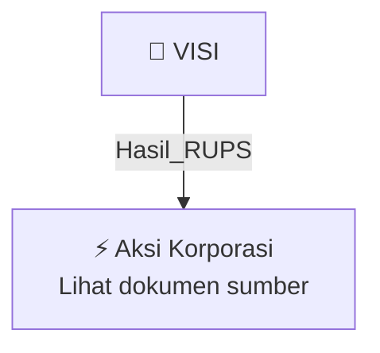

# 🏛️ Hasil & Keputusan RUPS / RUPSLB — [[VISI]]

⬅️ [[knowledge-base/daily-digests/Daily_Digest_20260929|Kembali ke Daily Digest]] | 📅 **2026-09-29** | 🎛️ [[Dashboard|Ke Dashboard Utama]]

> [!IMPORTANT]
> Laporan ini disusun secara otomatis oleh **Corporate Action Intelligence Agent** pada **2026-09-29**.
> Sumber dokumen: `20260928_VISI_20260928_VISI_Rencana Transaksi Material Dengan Persetujuan RUPS_32161538_lamp1.pdf`

---

## 📌 1. Ringkasan Eksekutif & Tujuan Strategis

- **Kode & Nama Emiten**: `[[VISI]]`
- **Kategori Aksi Korporasi**: `Hasil_RUPS`
- **Dokumen Sumber**: `20260928_VISI_20260928_VISI_Rencana Transaksi Material Dengan Persetujuan RUPS_32161538_lamp1.pdf`
- **Tanggal Laporan**: `2026-09-29`

[Analisis LLM tidak tersedia — isi manual]

---

## 📊 2. Fakta Material & Parameter Keuangan

| Parameter Utama | Nilai / Keterangan |
| :--- | :--- |
| **Uraian Kejadian** | `1 PT Satu Visi Putra Tbk (“Perseroan”) Kegiatan Usaha Utama: Bergerak dalam bidang Perdagangan Besar Berbagai Macam Barang untuk Bahan Advertising dan Printing seperti Banner, Display, Tinta dan PVC Board, serta Pergudangan dan Penyimpanan. Berkedudukan di Surabaya, Indonesia Kantor Pusat: Telepon: (+62-31) 7496364 / 7497576 Email: corporatesecretary@satuvisiputra.com DOKUMEN INI MERUPAKAN INFORMASI KEPADA PARA PEMEGANG SAHAM SEHUBUNGAN DENGAN RENCANA PERSEROAN UNTUK: (i) MENGUBAH KEGIATAN USAHA` |

---

## 👥 3. Struktur Kepemilikan, Pengendali & Pembeli Siaga

- **Emiten**: `VISI` | Informasi kepemilikan mengacu pada dokumen resmi sumber.

---

## 🎯 4. Alokasi & Rencana Penggunaan Dana

- Informasi alokasi dana belum tersedia — lihat prospektus / dokumen resmi.

---

## 📅 5. Timeline & Jadwal Pelaksanaan

| Tahapan / Event | Tanggal |
| :--- | :---: |
| **Jadwal** | Lihat dokumen sumber. |

---

## 📈 6. Diagram Visual Flowchart (Mermaid)

---

## 💡 7. Rekomendasi Investor & Strategi Trading

[Analisis LLM tidak tersedia — isi manual]

---

## 🔗 8. Hubungan Note Terkait (Knowledge Graph)

- [[knowledge-base/daily-digests/Daily_Digest_20260929|📄 Daily Digest 2026-09-29]]
- [[knowledge-base/trading-signals/Trading_Signals_20260929|🎯 Sinyal Cuan 2026-09-29]]
- [[VISI|🏬 Halaman Emiten VISI]]
- [[Dashboard|🎛️ Kembali ke Dashboard Utama]]

---

*Laporan dibuat otomatis oleh Corporate Action Intelligence Agent · 2026-09-29*