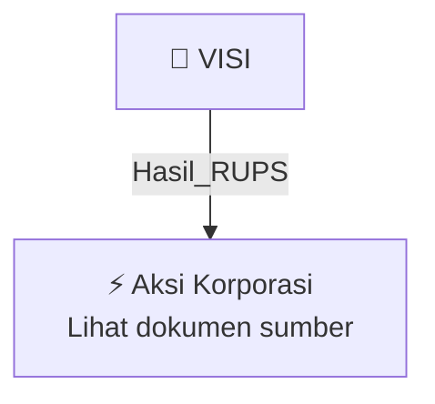

# 🏛️ Hasil & Keputusan RUPS / RUPSLB — [[VISI]]

⬅️ [[knowledge-base/daily-digests/Daily_Digest_20261005|Kembali ke Daily Digest]] | 📅 **2026-10-05** | 🎛️ [[Dashboard|Ke Dashboard Utama]]

> [!IMPORTANT]
> Laporan ini disusun secara otomatis oleh **Corporate Action Intelligence Agent** pada **2026-10-05**.
> Sumber dokumen: `20261002_VISI_20261002_VISI_Ringkasan RisalahRisalah RUPS_32162693.pdf`

---

## 📌 1. Ringkasan Eksekutif & Tujuan Strategis

- **Kode & Nama Emiten**: `[[VISI]]`
- **Kategori Aksi Korporasi**: `Hasil_RUPS`
- **Dokumen Sumber**: `20261002_VISI_20261002_VISI_Ringkasan RisalahRisalah RUPS_32162693.pdf`
- **Tanggal Laporan**: `2026-10-05`

[Analisis LLM tidak tersedia — isi manual]

---

## 📊 2. Fakta Material & Parameter Keuangan

| Parameter Utama | Nilai / Keterangan |
| :--- | :--- |
| **Jenis RUPS** | `Rapat Umum Pemegang Saham Luar Biasa dan Independen` |
| **Tanggal RUPS** | `30 September 2026` |
| **Kuorum kehadiran** | `2.943.070.300 saham atau 95,71% dari seluruh saham dengan hak suara yang sah` |
| **Agenda 1** | `Persetujuan perubahan alamat dan tempat kedudukan Perseroan` |
| **Hasil Agenda 1** | `Setuju 95,71%; Tidak Setuju 0%; Abstain 0%` |
| **Perubahan tempat kedudukan** | `Dari Surabaya, Jawa Timur menjadi Jakarta Pusat` |
| **Alamat kantor pusat baru** | `Warga 11, Kelurahan Karet Tengsin, Kecamatan Tanah Abang, Jakarta Pusat 10220` |
| **Agenda 2** | `Persetujuan Perubahan Pasal 3 Anggaran Dasar Perseroan terkait penambahan kegiatan usaha utama dan penyesuaian KBLI 2025` |
| **Hasil Agenda 2** | `Setuju 95,71%; Tidak Setuju 0%; Abstain 0%` |
| **Kegiatan usaha utama baru** | `KBLI No. 64210 (Aktivitas Perusahaan Induk)` |
| **Studi kelayakan** | `KJPP Ferdinand, Danar, Ichsan & Rekan (KJPP FDI&R), tanggal 24 September 2026, No. 00192/2.0176-00/BS/05/0453/1/IX/2026` |
| **Keterbukaan informasi** | `24 Agustus 2026 dan 28 September 2026` |
| **Pemberian wewenang** | `Direksi Perseroan dengan hak substitusi untuk melaksanakan keputusan RUPS` |

---

## 👥 3. Struktur Kepemilikan, Pengendali & Pembeli Siaga

- **Emiten**: `VISI` | Informasi kepemilikan mengacu pada dokumen resmi sumber.

---

## 🎯 4. Alokasi & Rencana Penggunaan Dana

- Informasi alokasi dana belum tersedia — lihat prospektus / dokumen resmi.

---

## 📅 5. Timeline & Jadwal Pelaksanaan

| Tahapan / Event | Tanggal |
| :--- | :---: |
| **Jadwal** | Lihat dokumen sumber. |

---

## 📈 6. Diagram Visual Flowchart (Mermaid)

---

## 💡 7. Rekomendasi Investor & Strategi Trading

[Analisis LLM tidak tersedia — isi manual]

---

## 🔗 8. Hubungan Note Terkait (Knowledge Graph)

- [[knowledge-base/daily-digests/Daily_Digest_20261005|📄 Daily Digest 2026-10-05]]
- [[knowledge-base/trading-signals/Trading_Signals_20261005|🎯 Sinyal Cuan 2026-10-05]]
- [[VISI|🏬 Halaman Emiten VISI]]
- [[Dashboard|🎛️ Kembali ke Dashboard Utama]]

---

*Laporan dibuat otomatis oleh Corporate Action Intelligence Agent · 2026-10-05*