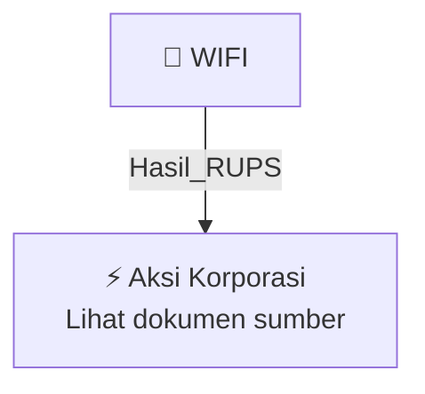

# 🏛️ Hasil & Keputusan RUPS / RUPSLB — [[WIFI]]

⬅️ [[knowledge-base/daily-digests/Daily_Digest_20261002|Kembali ke Daily Digest]] | 📅 **2026-10-02** | 🎛️ [[Dashboard|Ke Dashboard Utama]]

> [!IMPORTANT]
> Laporan ini disusun secara otomatis oleh **Corporate Action Intelligence Agent** pada **2026-10-02**.
> Sumber dokumen: `20261001_WIFI_20261001_WIFI_Laporan Informasi dan Fakta Material_32162582_lamp1.pdf`

---

## 📌 1. Ringkasan Eksekutif & Tujuan Strategis

- **Kode & Nama Emiten**: `[[WIFI]]`
- **Kategori Aksi Korporasi**: `Hasil_RUPS`
- **Dokumen Sumber**: `20261001_WIFI_20261001_WIFI_Laporan Informasi dan Fakta Material_32162582_lamp1.pdf`
- **Tanggal Laporan**: `2026-10-02`

[Analisis LLM tidak tersedia — isi manual]

---

## 📊 2. Fakta Material & Parameter Keuangan

| Parameter Utama | Nilai / Keterangan |
| :--- | :--- |
| **Nama Emiten** | `PT Solusi Sinergi Digital Tbk` |
| **Kode Saham** | `WIFI` |
| **Nomor Surat** | `122/CORSEC/SSD/X/2026` |
| **Tanggal Laporan** | `2026-10-01` |
| **Jenis Informasi atau Fakta Material** | `Perubahan anggota Direksi dan anggota Dewan Komisaris Perseroan` |
| **Jumlah Surat Pengunduran Diri Diterima** | `2 (dua) surat` |
| **Nama Pihak Mengundurkan Diri 1** | `Hashim S. Djojohadikusumo` |
| **Jabatan Pihak Mengundurkan Diri 1** | `Komisaris Utama` |
| **Tanggal Surat Pengunduran Diri 1** | `2026-09-29` |
| **Tanggal Diterima Perseroan 1** | `2026-09-30` |
| **Berlaku Pengunduran Diri 1** | `Berlaku sejak tanggal surat, 29 September 2026` |
| **Nama Pihak Mengundurkan Diri 2** | `Henny Santoso` |
| **Jabatan Pihak Mengundurkan Diri 2** | `Direktur` |
| **Tanggal Surat Pengunduran Diri 2** | `2026-10-01` |
| **Tanggal Diterima Perseroan 2** | `2026-10-01` |
| **Permintaan Tindakan** | `Menyelenggarakan RUPS dalam jangka waktu yang ditentukan dalam Anggaran Dasar Perseroan untuk memutuskan pengunduran diri` |
| **Peraturan Acuan** | `POJK 33/2014, POJK 31/2015, Peraturan I-E, dan Anggaran Dasar Perseroan` |
| **Bidang Usaha** | `Periklanan, serta perusahaan holding yang melakukan investasi dalam bidang periklanan, produk dan layanan digital, dan jaringan serat optik melalui perusahaan anak` |
| **Telepon** | `(021) 765 9229` |
| **Surat Elektronik** | `corporate@surge.co.id` |

---

## 👥 3. Struktur Kepemilikan, Pengendali & Pembeli Siaga

- **Emiten**: `WIFI` | Informasi kepemilikan mengacu pada dokumen resmi sumber.

---

## 🎯 4. Alokasi & Rencana Penggunaan Dana

- Informasi alokasi dana belum tersedia — lihat prospektus / dokumen resmi.

---

## 📅 5. Timeline & Jadwal Pelaksanaan

| Tahapan / Event | Tanggal |
| :--- | :---: |
| **Jadwal** | Lihat dokumen sumber. |

---

## 📈 6. Diagram Visual Flowchart (Mermaid)

---

## 💡 7. Rekomendasi Investor & Strategi Trading

[Analisis LLM tidak tersedia — isi manual]

---

## 🔗 8. Hubungan Note Terkait (Knowledge Graph)

- [[knowledge-base/daily-digests/Daily_Digest_20261002|📄 Daily Digest 2026-10-02]]
- [[knowledge-base/trading-signals/Trading_Signals_20261002|🎯 Sinyal Cuan 2026-10-02]]
- [[WIFI|🏬 Halaman Emiten WIFI]]
- [[Dashboard|🎛️ Kembali ke Dashboard Utama]]

---

*Laporan dibuat otomatis oleh Corporate Action Intelligence Agent · 2026-10-02*