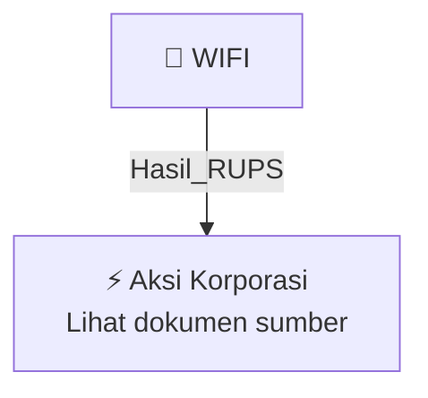

# 🏛️ Hasil & Keputusan RUPS / RUPSLB — [[WIFI]]

⬅️ [[knowledge-base/daily-digests/Daily_Digest_20261007|Kembali ke Daily Digest]] | 📅 **2026-10-07** | 🎛️ [[Dashboard|Ke Dashboard Utama]]

> [!IMPORTANT]
> Laporan ini disusun secara otomatis oleh **Corporate Action Intelligence Agent** pada **2026-10-07**.
> Sumber dokumen: `20261006_WIFI_20261006_WIFI_Tanggapan atas Permintaan Penjelasan Bursa_32163640_lamp1.pdf`

---

## 📌 1. Ringkasan Eksekutif & Tujuan Strategis

- **Kode & Nama Emiten**: `[[WIFI]]`
- **Kategori Aksi Korporasi**: `Hasil_RUPS`
- **Dokumen Sumber**: `20261006_WIFI_20261006_WIFI_Tanggapan atas Permintaan Penjelasan Bursa_32163640_lamp1.pdf`
- **Tanggal Laporan**: `2026-10-07`

[Analisis LLM tidak tersedia — isi manual]

---

## 📊 2. Fakta Material & Parameter Keuangan

| Parameter Utama | Nilai / Keterangan |
| :--- | :--- |
| **Nomor Surat Tanggapan** | `124/CORSEC/SSD/X/2026` |
| **Tanggal Surat Tanggapan** | `6 Oktober 2026` |
| **Nomor Surat Bursa** | `S-12704/BEI.PP3/10-2026` |
| **Tanggal Surat Bursa** | `5 Oktober 2026` |
| **Perihal** | `Permintaan penjelasan atas volatilitas transaksi efek PT Solusi Sinergi Digital Tbk` |
| **Status Informasi atau Fakta Material** | `Perseroan tidak memiliki informasi atau fakta material yang wajib diungkapkan dan belum diungkapkan kepada publik yang dapat memengaruhi nilai efek Perseroan atau keputusan investasi pemodal` |
| **Keterbukaan Informasi yang Telah Disampaikan** | `Fasilitas pembiayaan yang diperoleh PT Integrasi Jaringan Ekosistem dari Export Development Canada; rencana penyelenggaraan Rapat Umum Pemegang Saham Luar Biasa; informasi pengunduran diri anggota Dewan Komisaris dan anggota Direksi Perseroan tanggal 1 Oktober 2026` |
| **Aktivitas Pemegang Saham Tertentu** | `Perseroan tidak menerima informasi adanya aktivitas tertentu dari pemegang saham sebagaimana dimaksud dalam POJK Nomor 4 Tahun 2024` |
| **Rencana RUPSLB** | `21 Oktober 2026` |
| **Agenda RUPSLB** | `Persetujuan perubahan Pasal 3 Anggaran Dasar mengenai Maksud dan Tujuan serta Kegiatan Usaha, termasuk pembahasan Studi Kelayakan tentang Rencana Penambahan Kegiatan Usaha; persetujuan perubahan Pasal 12 ayat (13) Anggaran Dasar mengenai Tugas, Tanggung Jawab dan Wewenang Direksi; persetujuan perubahan susunan anggota Dewan Komisaris dan/atau Direksi Perseroan` |

---

## 👥 3. Struktur Kepemilikan, Pengendali & Pembeli Siaga

- **Emiten**: `WIFI` | Informasi kepemilikan mengacu pada dokumen resmi sumber.

---

## 🎯 4. Alokasi & Rencana Penggunaan Dana

- Informasi alokasi dana belum tersedia — lihat prospektus / dokumen resmi.

---

## 📅 5. Timeline & Jadwal Pelaksanaan

| Tahapan / Event | Tanggal |
| :--- | :---: |
| **Jadwal** | Lihat dokumen sumber. |

---

## 📈 6. Diagram Visual Flowchart (Mermaid)

---

## 💡 7. Rekomendasi Investor & Strategi Trading

[Analisis LLM tidak tersedia — isi manual]

---

## 🔗 8. Hubungan Note Terkait (Knowledge Graph)

- [[knowledge-base/daily-digests/Daily_Digest_20261007|📄 Daily Digest 2026-10-07]]
- [[knowledge-base/trading-signals/Trading_Signals_20261007|🎯 Sinyal Cuan 2026-10-07]]
- [[WIFI|🏬 Halaman Emiten WIFI]]
- [[Dashboard|🎛️ Kembali ke Dashboard Utama]]

---

*Laporan dibuat otomatis oleh Corporate Action Intelligence Agent · 2026-10-07*