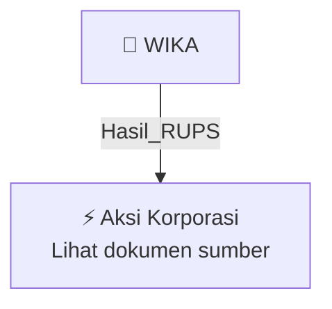

# 🏛️ Hasil & Keputusan RUPS / RUPSLB — [[WIKA]]

⬅️ [[knowledge-base/daily-digests/Daily_Digest_20261006|Kembali ke Daily Digest]] | 📅 **2026-10-06** | 🎛️ [[Dashboard|Ke Dashboard Utama]]

> [!IMPORTANT]
> Laporan ini disusun secara otomatis oleh **Corporate Action Intelligence Agent** pada **2026-10-06**.
> Sumber dokumen: `20261006_WIKA_20261005_WIKA_Pemberitahuan RencanaPenyampaian PanggilanHasil RUPORUPSURUP EBA-SP_32163006_lamp1.pdf`

---

## 📌 1. Ringkasan Eksekutif & Tujuan Strategis

- **Kode & Nama Emiten**: `[[WIKA]]`
- **Kategori Aksi Korporasi**: `Hasil_RUPS`
- **Dokumen Sumber**: `20261006_WIKA_20261005_WIKA_Pemberitahuan RencanaPenyampaian PanggilanHasil RUPORUPSURUP EBA-SP_32163006_lamp1.pdf`
- **Tanggal Laporan**: `2026-10-06`

[Analisis LLM tidak tersedia — isi manual]

---

## 📊 2. Fakta Material & Parameter Keuangan

| Parameter Utama | Nilai / Keterangan |
| :--- | :--- |
| **Nama Obligasi** | `Obligasi Berkelanjutan II Wijaya Karya Tahap I Tahun 2021` |
| **Emiten** | `PT Wijaya Karya (Persero) Tbk` |
| **Wali Amanat** | `PT Bank Mega Tbk` |
| **Hari/Tanggal RUPO** | `Senin, 19 Oktober 2026` |
| **Waktu RUPO** | `Pukul 09.00 WIB s.d. selesai` |
| **Tempat RUPO** | `WIKA Tower 2, Jl. D.I Panjaitan Kavling 9-10` |
| **Agenda RUPO 1** | `Penjelasan PT Wijaya Karya (Persero) Tbk selaku Emiten sehubungan dengan kelalaian tidak dipenuhinya kewajiban pembayaran Bunga ke-20 Obligasi Berkelanjutan II Wijaya Karya Tahap I Tahun 2021 Seri B dan Seri C, serta kewajiban pelunasan Pokok Obligasi Berkelanjutan II Wijaya Karya Tahap I Tahun 2021 Seri B, dan usulan Emiten terkait hal tersebut.` |
| **Agenda RUPO 2** | `Penentuan Sikap/Keputusan para Pemegang Obligasi Berkelanjutan II Wijaya Karya Tahap I Tahun 2021 terhadap penjelasan dan usulan PT Wijaya Karya (Persero) Tbk sehubungan dengan kelalaian tidak dipenuhinya kewajiban pembayaran Bunga ke-20 Seri B dan Seri C serta kewajiban pelunasan Pokok Seri B.` |
| **Kewajiban yang Dilalaikan** | `Pembayaran Bunga ke-20 Obligasi Berkelanjutan II Wijaya Karya Tahap I Tahun 2021 Seri B dan Seri C; pelunasan Pokok Obligasi Berkelanjutan II Wijaya Karya Tahap I Tahun 2021 Seri B.` |
| **Kuorum Kehadiran RUPO** | `Sah apabila dihadiri oleh Pemegang Obligasi atau diwakili paling sedikit 3/4 (tiga per empat) bagian dari jumlah Obligasi yang masih belum dilunasi.` |
| **Kuorum Pengambilan Keputusan RUPO** | `Sah dan mengikat apabila disetujui paling sedikit 3/4 (tiga per empat) bagian dari jumlah Obligasi yang hadir dalam RUPO.` |
| **Hak Suara Obligasi Emiten/Afiliasi** | `Obligasi yang dimiliki oleh Emiten dan/atau Afiliasi Emiten tidak memiliki hak suara dan tidak diperhitungkan dalam kuorum kehadiran, kecuali Afiliasi tersebut terjadi karena kepemilikan atau penyertaan modal Pemerintah.` |
| **Penyelenggara RUPO** | `RUPO diselenggarakan atas permintaan PT Bank Mega Tbk selaku Wali Amanat.` |
| **Ketentuan Kehadiran** | `Pemegang Obligasi atau kuasanya diharapkan hadir 30 menit sebelum RUPO dimulai.` |
| **Tanggal Surat** | `Jakarta, 5 Oktober 2026` |
| **Pihak Penandatangan** | `Emiten: PT Wijaya Karya (Persero) Tbk; Wali Amanat: PT Bank Mega Tbk.` |

---

## 👥 3. Struktur Kepemilikan, Pengendali & Pembeli Siaga

- **Emiten**: `WIKA` | Informasi kepemilikan mengacu pada dokumen resmi sumber.

---

## 🎯 4. Alokasi & Rencana Penggunaan Dana

- Informasi alokasi dana belum tersedia — lihat prospektus / dokumen resmi.

---

## 📅 5. Timeline & Jadwal Pelaksanaan

| Tahapan / Event | Tanggal |
| :--- | :---: |
| **Jadwal** | Lihat dokumen sumber. |

---

## 📈 6. Diagram Visual Flowchart (Mermaid)

---

## 💡 7. Rekomendasi Investor & Strategi Trading

[Analisis LLM tidak tersedia — isi manual]

---

## 🔗 8. Hubungan Note Terkait (Knowledge Graph)

- [[knowledge-base/daily-digests/Daily_Digest_20261006|📄 Daily Digest 2026-10-06]]
- [[knowledge-base/trading-signals/Trading_Signals_20261006|🎯 Sinyal Cuan 2026-10-06]]
- [[WIKA|🏬 Halaman Emiten WIKA]]
- [[Dashboard|🎛️ Kembali ke Dashboard Utama]]

---

*Laporan dibuat otomatis oleh Corporate Action Intelligence Agent · 2026-10-06*