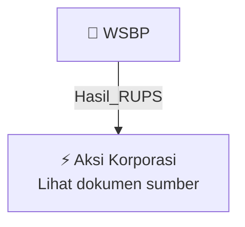

# 🏛️ Hasil & Keputusan RUPS / RUPSLB — [[WSBP]]

⬅️ [[knowledge-base/daily-digests/Daily_Digest_20261007|Kembali ke Daily Digest]] | 📅 **2026-10-07** | 🎛️ [[Dashboard|Ke Dashboard Utama]]

> [!IMPORTANT]
> Laporan ini disusun secara otomatis oleh **Corporate Action Intelligence Agent** pada **2026-10-07**.
> Sumber dokumen: `20261006_WSBP_20261006_WSBP_Ringkasan RisalahRisalah RUPS_32163945_lamp1.pdf`

---

## 📌 1. Ringkasan Eksekutif & Tujuan Strategis

- **Kode & Nama Emiten**: `[[WSBP]]`
- **Kategori Aksi Korporasi**: `Hasil_RUPS`
- **Dokumen Sumber**: `20261006_WSBP_20261006_WSBP_Ringkasan RisalahRisalah RUPS_32163945_lamp1.pdf`
- **Tanggal Laporan**: `2026-10-07`

[Analisis LLM tidak tersedia — isi manual]

---

## 📊 2. Fakta Material & Parameter Keuangan

| Parameter Utama | Nilai / Keterangan |
| :--- | :--- |
| **Nama Emiten** | `PT Waskita Beton Precast Tbk` |
| **Jenis RUPS** | `Rapat Umum Pemegang Saham Luar Biasa (RUPSLB) Tahun 2026` |
| **Tanggal RUPSLB** | `2 Oktober 2026` |
| **Tanggal Surat** | `06 Oktober 2026` |
| **Nomor Surat** | `841/WBP/DIR/2026` |
| **Kota Penyampaian** | `Jakarta` |
| **Peraturan Acuan** | `POJK No. 15/POJK.04/2020 dan Peraturan BEI No. I-E` |
| **Jumlah Lampiran** | `3 (tiga) berkas` |
| **Tembusan** | `Direksi PT Waskita Beton Precast Tbk` |
| **Penandatangan** | `Direktur Keuangan, HCM, dan Manajemen Risiko Koento Wahyudiat` |

---

## 👥 3. Struktur Kepemilikan, Pengendali & Pembeli Siaga

- **Emiten**: `WSBP` | Informasi kepemilikan mengacu pada dokumen resmi sumber.

---

## 🎯 4. Alokasi & Rencana Penggunaan Dana

- Informasi alokasi dana belum tersedia — lihat prospektus / dokumen resmi.

---

## 📅 5. Timeline & Jadwal Pelaksanaan

| Tahapan / Event | Tanggal |
| :--- | :---: |
| **Jadwal** | Lihat dokumen sumber. |

---

## 📈 6. Diagram Visual Flowchart (Mermaid)

---

## 💡 7. Rekomendasi Investor & Strategi Trading

[Analisis LLM tidak tersedia — isi manual]

---

## 🔗 8. Hubungan Note Terkait (Knowledge Graph)

- [[knowledge-base/daily-digests/Daily_Digest_20261007|📄 Daily Digest 2026-10-07]]
- [[knowledge-base/trading-signals/Trading_Signals_20261007|🎯 Sinyal Cuan 2026-10-07]]
- [[WSBP|🏬 Halaman Emiten WSBP]]
- [[Dashboard|🎛️ Kembali ke Dashboard Utama]]

---

*Laporan dibuat otomatis oleh Corporate Action Intelligence Agent · 2026-10-07*