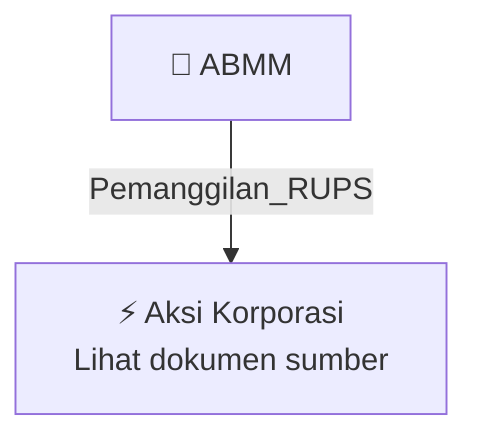

# 📢 Pemanggilan RUPS / RUPSLB — [[ABMM]]

⬅️ [[knowledge-base/daily-digests/Daily_Digest_20260924|Kembali ke Daily Digest]] | 📅 **2026-09-24** | 🎛️ [[Dashboard|Ke Dashboard Utama]]

> [!IMPORTANT]
> Laporan ini disusun secara otomatis oleh **Corporate Action Intelligence Agent** pada **2026-09-24**.
> Sumber dokumen: `20260923_ABMM_20260923_ABMM_Pemanggilan RUPS_32150522_lamp1.pdf`

---

## 📌 1. Ringkasan Eksekutif & Tujuan Strategis

- **Kode & Nama Emiten**: `[[ABMM]]`
- **Kategori Aksi Korporasi**: `Pemanggilan_RUPS`
- **Dokumen Sumber**: `20260923_ABMM_20260923_ABMM_Pemanggilan RUPS_32150522_lamp1.pdf`
- **Tanggal Laporan**: `2026-09-24`

[Analisis LLM tidak tersedia — isi manual]

---

## 📊 2. Fakta Material & Parameter Keuangan

| Parameter Utama | Nilai / Keterangan |
| :--- | :--- |
| **Uraian Kejadian** | `PEMANGGILAN RAPAT UMUM PEMEGANG SAHAM LUAR BIASA PT ABM INVESTAMA TBK Direksi PT ABM Investama Tbk (“Perseroan”) yang berdomisili di Jakarta dengan ini mengundang Pemegang Saham Perseroan untuk menghadiri Rapat Umum Pemegang Saham Luar Biasa Tahun 2026 (“RUPSLB”) yang akan diselenggarakan secara elektronik melalui Hari/Tanggal : Kamis, 15 Oktober 2026 Waktu : 14.00 WIB – 15.00 WIB Link Rapat tautan yang RUPSLB akan diselenggarakan secara elektronik sesuai Peraturan Otoritas Jasa Keuangan (“POJK”` |

---

## 👥 3. Struktur Kepemilikan, Pengendali & Pembeli Siaga

- **Emiten**: `ABMM` | Informasi kepemilikan mengacu pada dokumen resmi sumber.

---

## 🎯 4. Alokasi & Rencana Penggunaan Dana

- Informasi alokasi dana belum tersedia — lihat prospektus / dokumen resmi.

---

## 📅 5. Timeline & Jadwal Pelaksanaan

| Tahapan / Event | Tanggal |
| :--- | :---: |
| **Jadwal** | Lihat dokumen sumber. |

---

## 📈 6. Diagram Visual Flowchart (Mermaid)

---

## 💡 7. Rekomendasi Investor & Strategi Trading

[Analisis LLM tidak tersedia — isi manual]

---

## 🔗 8. Hubungan Note Terkait (Knowledge Graph)

- [[knowledge-base/daily-digests/Daily_Digest_20260924|📄 Daily Digest 2026-09-24]]
- [[knowledge-base/trading-signals/Trading_Signals_20260924|🎯 Sinyal Cuan 2026-09-24]]
- [[ABMM|🏬 Halaman Emiten ABMM]]
- [[Dashboard|🎛️ Kembali ke Dashboard Utama]]

---

*Laporan dibuat otomatis oleh Corporate Action Intelligence Agent · 2026-09-24*