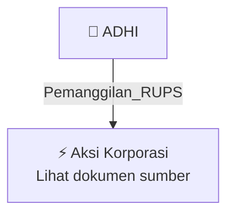

# 📢 Pemanggilan RUPS / RUPSLB — [[ADHI]]

⬅️ [[knowledge-base/daily-digests/Daily_Digest_20261009|Kembali ke Daily Digest]] | 📅 **2026-10-09** | 🎛️ [[Dashboard|Ke Dashboard Utama]]

> [!IMPORTANT]
> Laporan ini disusun secara otomatis oleh **Corporate Action Intelligence Agent** pada **2026-10-09**.
> Sumber dokumen: `20261007_ADHI_20261007_ADHI_Pengumuman RUPS_32164437_lamp1.pdf`

---

## 📌 1. Ringkasan Eksekutif & Tujuan Strategis

- **Kode & Nama Emiten**: `[[ADHI]]`
- **Kategori Aksi Korporasi**: `Pemanggilan_RUPS`
- **Dokumen Sumber**: `20261007_ADHI_20261007_ADHI_Pengumuman RUPS_32164437_lamp1.pdf`
- **Tanggal Laporan**: `2026-10-09`

[Analisis LLM tidak tersedia — isi manual]

---

## 📊 2. Fakta Material & Parameter Keuangan

| Parameter Utama | Nilai / Keterangan |
| :--- | :--- |
| **Jenis Rapat** | `Rapat Umum Pemegang Saham Luar Biasa (RUPSLB)` |
| **Penyelenggara** | `PT ADHI KARYA (Persero) Tbk` |
| **Tanggal Rapat** | `2026-11-13` |
| **Hari Rapat** | `Jumat` |
| **Metode Rapat** | `Hybrid, yaitu secara fisik dan elektronik` |
| **Tanggal Pengumuman** | `2026-10-07` |
| **Kota dan Tanggal Surat** | `Jakarta, 07 Oktober 2026` |
| **Pihak yang Mengumumkan** | `Direksi Perseroan` |
| **Tanggal Pemanggilan Rapat** | `2026-10-22` |
| **Tanggal Daftar Pemegang Saham yang Berhak Hadir** | `2026-10-21 sampai dengan pukul 16.00 WIB` |
| **Batas Pengajuan Usul Mata Acara** | `2026-10-15, selambat-lambatnya 7 hari sebelum tanggal Pemanggilan Rapat` |
| **Syarat Pengusul Mata Acara** | `Pemegang saham yang mewakili 1/20 atau lebih dari jumlah seluruh saham dengan hak suara` |
| **Fasilitas e-Proxy** | `Tersedia sejak tanggal Pemanggilan Rapat sampai dengan 1 hari kerja sebelum Rapat, yaitu 2026-11-12` |
| **Dasar Regulasi** | `POJK No. 15/POJK.04/2020 dan POJK No. 14 Tahun 2025` |

---

## 👥 3. Struktur Kepemilikan, Pengendali & Pembeli Siaga

- **Emiten**: `ADHI` | Informasi kepemilikan mengacu pada dokumen resmi sumber.

---

## 🎯 4. Alokasi & Rencana Penggunaan Dana

- Informasi alokasi dana belum tersedia — lihat prospektus / dokumen resmi.

---

## 📅 5. Timeline & Jadwal Pelaksanaan

| Tahapan / Event | Tanggal |
| :--- | :---: |
| **Jadwal** | Lihat dokumen sumber. |

---

## 📈 6. Diagram Visual Flowchart (Mermaid)

---

## 💡 7. Rekomendasi Investor & Strategi Trading

[Analisis LLM tidak tersedia — isi manual]

---

## 🔗 8. Hubungan Note Terkait (Knowledge Graph)

- [[knowledge-base/daily-digests/Daily_Digest_20261009|📄 Daily Digest 2026-10-09]]
- [[knowledge-base/trading-signals/Trading_Signals_20261009|🎯 Sinyal Cuan 2026-10-09]]
- [[ADHI|🏬 Halaman Emiten ADHI]]
- [[Dashboard|🎛️ Kembali ke Dashboard Utama]]

---

*Laporan dibuat otomatis oleh Corporate Action Intelligence Agent · 2026-10-09*