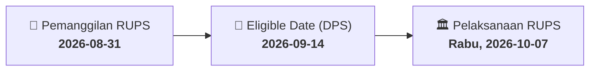

# ⚡ Laporan Intelijen Aksi Korporasi: [[AGRO]] - RUPS

⬅️ [[knowledge-base/daily-digests/Daily_Digest_20260831|Kembali ke Daily Digest]] | 📅 **2026-08-31** | 🎛️ [[Dashboard|Ke Dashboard Utama]]

> [!IMPORTANT]
> Laporan ini disusun secara otomatis oleh **Corporate Action Intelligence Agent** untuk memetakan implikasi strategis, rasio keuangan, alokasi dana, jadwal penting, dan panduan investor.

---

## 📌 1. Ringkasan Eksekutif & Katalis Strategis
- **Kode & Nama Emiten**: `[[AGRO]]`
- **Kategori Aksi Korporasi**: `RUPS`
- **Dokumen Resmi Bursa**: `Pengumuman RUPS`
- **Ringkasan Inti Aksi**: PT Bank Raya Indonesia Tbk (AGRO) mengumumkan rencana penyelenggaraan Rapat Umum Pemegang Saham Luar Biasa (RUPSLB) yang akan diselenggarakan pada hari Rabu, 7 Oktober 2026 pukul 14:00 WIB di Menara BRILiaN Lantai 19, Jakarta. Tanggal pencatatan pemegang saham yang berhak hadir adalah 14 September 2026.

---

## 📊 2. Matriks Parameter Material & Angka Kunci
| Parameter Utama | Nilai / Keterangan Resmi |
| :--- | :--- |
| **Nomor Surat** | `B.355/DIR.02/CSC/08/2026` |
| **Merujuk Surat** | `B.342/DIR.01.02/CSC/08/2026` |
| **Lokasi RUPS** | `Menara BRILiaN Lantai 19, JL Gatot Subroto No.177A, Menteng Dalam, Tebet` |
| **Tanggal Daftar Pemegang Saham (DPS)** | `2026-09-14` |
| **Hari/Tanggal RUPS** | `Rabu, 2026-10-07` |
| **Waktu RUPS** | `14:00` |
| **Nama Pengirim** | `Ajeng Putri Hapsari` |
| **Jabatan Pengirim** | `Kepala Divisi` |
| **Tanggal Pengumuman** | `2026-08-31` |
| **Lampiran** | `B 355 Surat Pengantar Pengumuman RUPSLB Bank Raya.pdf, Pengumuman RUPSLB 2026 Bank Raya.pdf` |

---

## 📌 3. Detail Pelaksanaan RUPS / RUPSLB
- **Hari, Tanggal Pelaksanaan**: `Rabu, 2026-10-07`
- **Waktu Pelaksanaan**: `14:00`
- **Lokasi / Tempat Pelaksanaan**: `Menara BRILiaN Lantai 19, JL Gatot Subroto No.177A, Menteng Dalam, Tebet`
- **Batas Hak Suara (Eligible Date / Recording Date)**: `2026-09-14`

## 📝 4. Matriks Agenda & Mata Acara Rapat
| No | Agenda / Mata Acara | Penjelasan & Sub-Acara |
| :-: | :--- | :--- |
| 1 | **Agenda Utama RUPS** | PT Bank Raya Indonesia Tbk (AGRO) mengumumkan rencana penyelenggaraan Rapat Umum Pemegang Saham Luar Biasa (RUPSLB) yang akan diselenggarakan pada hari Rabu, 7 Oktober 2026 pukul 14:00 WIB di Menara BRILiaN Lantai 19, Jakarta. Tanggal pencatatan pemegang saham yang berhak hadir adalah 14 September 2026. |

## 🗓️ 5. Timeline Investor & Ketentuan Kehadiran

## 💡 6. Panduan Investor & E-Voting
- 👥 **Hak Suara**: Pemegang saham yang berhak hadir/memberikan suara adalah yang terdaftar dalam DPS pada **Eligible Date (2026-09-14)**.
- 🗳️ **E-Voting eASY.KSEI**: Pemegang saham dapat memberikan kuasa/suara secara elektronik melalui sistem eASY.KSEI.

---

## 🔗 Hubungan Note Terkait (Knowledge Graph)
- [[knowledge-base/daily-digests/Daily_Digest_20260831|📄 Daily Digest 2026-08-31]]
- [[knowledge-base/trading-signals/Trading_Signals_20260831|🎯 Sinyal Cuan 2026-08-31]]
- [[Dashboard|🎛️ Kembali ke Dashboard]]