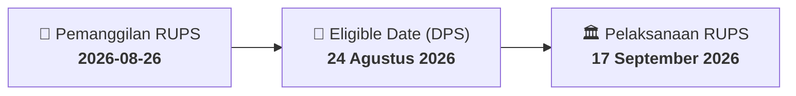

# ⚡ Laporan Intelijen Aksi Korporasi: [[AIMS]] - RUPS

⬅️ [[knowledge-base/daily-digests/Daily_Digest_20260826|Kembali ke Daily Digest]] | 📅 **2026-08-26** | 🎛️ [[Dashboard|Ke Dashboard Utama]]

> [!IMPORTANT]
> Laporan ini disusun secara otomatis oleh **Corporate Action Intelligence Agent** untuk memetakan implikasi strategis, rasio keuangan, alokasi dana, jadwal penting, dan panduan investor.

---

## 📌 1. Ringkasan Eksekutif & Katalis Strategis
- **Kode & Nama Emiten**: `[[AIMS]]`
- **Kategori Aksi Korporasi**: `RUPS`
- **Dokumen Resmi Bursa**: `Pemanggilan RUPS`
- **Ringkasan Inti Aksi**: PT Artha Mahiya Investama Tbk menyampaikan pemanggilan Rapat Umum Pemegang Saham Tahunan untuk tahun buku yang berakhir 31 Desember 2025, yang akan diselenggarakan pada 17 September 2026 pukul 10:00 di The Tribrata Darmawangsa, Jakarta Selatan, dengan recording date 24 Agustus 2026.

---

## 📊 2. Matriks Parameter Material & Angka Kunci
| Parameter Utama | Nilai / Keterangan Resmi |
| :--- | :--- |
| **Jenis Rapat** | `Rapat Umum Pemegang Saham Tahunan` |
| **Tahun Buku** | `31 Desember 2025` |
| **Nomor Surat Pemberitahuan** | `002/-PRUPS-AIMS/VIII/2026` |
| **Tanggal Surat Pemberitahuan** | `11 Agustus 2026` |
| **Hari/Tanggal RUPS** | `17 September 2026` |
| **Waktu RUPS** | `10:00` |
| **Lokasi RUPS** | `Chora 1 & 2, Level 2 The Tribrata, Darmawangsa Jakarta, Jl. Darmawangsa III No.2, RT.2/RW.1, Kelurahan Pulo, Jakarta Selatan, DKI Jakarta 12160` |
| **Recording Date** | `24 Agustus 2026` |
| **Agenda 1** | `Persetujuan Laporan Tahunan dan Laporan Keuangan Tahunan` |
| **Agenda 2** | `Persetujuan Penunjukkan Akuntan Publik dan/atau Kantor Akuntan Publik` |
| **Agenda 3** | `Persetujuan Penggunaan Laba Bersih` |
| **Agenda 4** | `Persetujuan Laporan Realisasi Penggunaan Dana` |

---

## 📌 3. Detail Pelaksanaan RUPS / RUPSLB
- **Hari, Tanggal Pelaksanaan**: `17 September 2026`
- **Waktu Pelaksanaan**: `10:00`
- **Lokasi / Tempat Pelaksanaan**: `Chora 1 & 2, Level 2 The Tribrata, Darmawangsa Jakarta, Jl. Darmawangsa III No.2, RT.2/RW.1, Kelurahan Pulo, Jakarta Selatan, DKI Jakarta 12160`
- **Batas Hak Suara (Eligible Date / Recording Date)**: `24 Agustus 2026`

## 📝 4. Matriks Agenda & Mata Acara Rapat
| No | Agenda / Mata Acara | Penjelasan & Sub-Acara |
| :-: | :--- | :--- |
| 1 | **Agenda 1** | Persetujuan Laporan Tahunan dan Laporan Keuangan Tahunan |
| 2 | **Agenda 2** | Persetujuan Penunjukkan Akuntan Publik dan/atau Kantor Akuntan Publik |
| 3 | **Agenda 3** | Persetujuan Penggunaan Laba Bersih |
| 4 | **Agenda 4** | Persetujuan Laporan Realisasi Penggunaan Dana |

## 🗓️ 5. Timeline Investor & Ketentuan Kehadiran

## 💡 6. Panduan Investor & E-Voting
- 👥 **Hak Suara**: Pemegang saham yang berhak hadir/memberikan suara adalah yang terdaftar dalam DPS pada **Eligible Date (24 Agustus 2026)**.
- 🗳️ **E-Voting eASY.KSEI**: Pemegang saham dapat memberikan kuasa/suara secara elektronik melalui sistem eASY.KSEI.

---

## 🔗 Hubungan Note Terkait (Knowledge Graph)
- [[knowledge-base/daily-digests/Daily_Digest_20260826|📄 Daily Digest 2026-08-26]]
- [[knowledge-base/trading-signals/Trading_Signals_20260826|🎯 Sinyal Cuan 2026-08-26]]
- [[Dashboard|🎛️ Kembali ke Dashboard]]