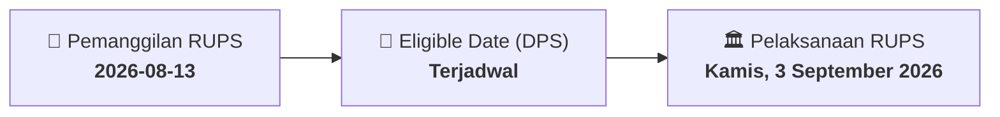

# ⚡ Laporan Intelijen Aksi Korporasi: [[AKPI]] - RUPS

⬅️ [[knowledge-base/daily-digests/Daily_Digest_20260813|Kembali ke Daily Digest]] | 📅 **2026-08-13** | 🎛️ [[Dashboard|Ke Dashboard Utama]]

> [!IMPORTANT]
> Laporan ini disusun secara otomatis oleh **Corporate Action Intelligence Agent** untuk memetakan implikasi strategis, rasio keuangan, alokasi dana, jadwal penting, dan panduan investor.

---

## 📌 1. Ringkasan Eksekutif & Katalis Strategis
- **Kode & Nama Emiten**: `[[AKPI]]`
- **Kategori Aksi Korporasi**: `RUPS`
- **Dokumen Resmi Bursa**: `Pemanggilan RUPS lamp2`
- **Ringkasan Inti Aksi**: PT Argha Karya Prima Industry Tbk (AKPI) menyelenggarakan Rapat Umum Pemegang Saham Luar Biasa (RUPSLB) pada Kamis, 3 September 2026, pukul 15.00 WIB secara elektronik. Agenda tunggal rapat adalah persetujuan perubahan Pasal 3 Anggaran Dasar Perseroan mengenai Maksud dan Tujuan serta Kegiatan Usaha untuk penyesuaian dengan Klasifikasi Baku Lapangan Usaha Indonesia (KBLI) Tahun 2025.

---

## 📊 2. Matriks Parameter Material & Angka Kunci
| Parameter Utama | Nilai / Keterangan Resmi |
| :--- | :--- |
| **Jenis Rapat** | `Rapat Umum Pemegang Saham Luar Biasa (RUPSLB)` |
| **Hari/Tanggal Rapat** | `Kamis, 3 September 2026` |
| **Waktu Rapat** | `pukul 15.00 WIB - selesai` |
| **Tempat Rapat** | `Secara elektronik melalui fasilitas Electronic General Meeting` |
| **Mata Acara Rapat** | `Persetujuan atas perubahan Pasal 3 Anggaran Dasar Perseroan mengenai Maksud dan Tujuan serta Kegiatan Usaha Perseroan dalam rangka penyesuaian dengan Klasifikasi Baku Lapangan Usaha Indonesia (KBLI) Tahun 2025` |
| **Dasar Hukum Pemanggilan** | `Pasal 17 jo. Pasal 52 POJK Nomor 15/POJK.04/2020 dan Pasal 24 ayat (1) POJK Nomor 14 Tahun 2025` |
| **Dasar Hukum Perubahan Anggaran Dasar** | `Pasal 19 Undang-Undang Nomor 40 Tahun 2007 tentang Perseroan Terbatas sebagaimana telah diubah terakhir dengan Undang-Undang Nomor 6 Tahun 2023` |
| **Peraturan Terkait KBLI** | `Peraturan Badan Pusat Statistik Nomor 7 Tahun 2025 tentang Klasifikasi Baku Lapangan Usaha Indonesia (KBLI 2025)` |

---

## 📌 3. Detail Pelaksanaan RUPS / RUPSLB
- **Hari, Tanggal Pelaksanaan**: `Kamis, 3 September 2026`
- **Waktu Pelaksanaan**: `pukul 15.00 WIB - selesai`
- **Lokasi / Tempat Pelaksanaan**: `Secara elektronik melalui fasilitas Electronic General Meeting`
- **Batas Hak Suara (Eligible Date / Recording Date)**: `Terjadwal`

## 📝 4. Matriks Agenda & Mata Acara Rapat
| No | Agenda / Mata Acara | Penjelasan & Sub-Acara |
| :-: | :--- | :--- |
| 1 | **Mata Acara Rapat** | Persetujuan atas perubahan Pasal 3 Anggaran Dasar Perseroan mengenai Maksud dan Tujuan serta Kegiatan Usaha Perseroan dalam rangka penyesuaian dengan Klasifikasi Baku Lapangan Usaha Indonesia (KBLI) Tahun 2025 |

## 🗓️ 5. Timeline Investor & Ketentuan Kehadiran

## 💡 6. Panduan Investor & E-Voting
- 👥 **Hak Suara**: Pemegang saham yang berhak hadir/memberikan suara adalah yang terdaftar dalam DPS pada **Eligible Date (Terjadwal)**.
- 🗳️ **E-Voting eASY.KSEI**: Pemegang saham dapat memberikan kuasa/suara secara elektronik melalui sistem eASY.KSEI.

---

## 🔗 Hubungan Note Terkait (Knowledge Graph)
- [[knowledge-base/daily-digests/Daily_Digest_20260813|📄 Daily Digest 2026-08-13]]
- [[knowledge-base/trading-signals/Trading_Signals_20260813|🎯 Sinyal Cuan 2026-08-13]]
- [[Dashboard|🎛️ Kembali ke Dashboard]]