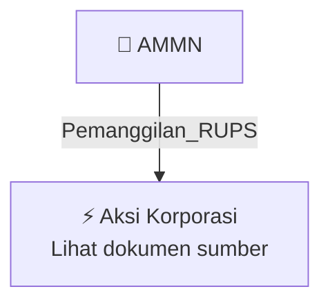

# 📢 Pemanggilan RUPS / RUPSLB — [[AMMN]]

⬅️ [[knowledge-base/daily-digests/Daily_Digest_20261009|Kembali ke Daily Digest]] | 📅 **2026-10-09** | 🎛️ [[Dashboard|Ke Dashboard Utama]]

> [!IMPORTANT]
> Laporan ini disusun secara otomatis oleh **Corporate Action Intelligence Agent** pada **2026-10-09**.
> Sumber dokumen: `20261009_AMMN_20261009_AMMN_Pengumuman RUPS_32165104_lamp2.pdf`

---

## 📌 1. Ringkasan Eksekutif & Tujuan Strategis

- **Kode & Nama Emiten**: `[[AMMN]]`
- **Kategori Aksi Korporasi**: `Pemanggilan_RUPS`
- **Dokumen Sumber**: `20261009_AMMN_20261009_AMMN_Pengumuman RUPS_32165104_lamp2.pdf`
- **Tanggal Laporan**: `2026-10-09`

[Analisis LLM tidak tersedia — isi manual]

---

## 📊 2. Fakta Material & Parameter Keuangan

| Parameter Utama | Nilai / Keterangan |
| :--- | :--- |
| **Jenis rapat** | `RUPS Luar Biasa (Extraordinary General Meeting of Shareholders/EGMS)` |
| **Penyelenggaraan rapat** | `Secara elektronik menggunakan sistem` |
| **Hari/Tanggal RUPS** | `Selasa, 17 November 2026` |
| **Waktu RUPS** | `10.30 WIB sampai selesai` |
| **Recording date pemegang saham yang berhak hadir** | `23 Oktober 2026` |
| **Batas pengajuan usulan agenda** | `Paling lambat 7 hari kalender sebelum tanggal undangan RUPS` |
| **Syarat pengusul agenda** | `Satu atau lebih pemegang saham yang bersama-sama mewakili paling sedikit 1/20 dari total saham beredar dengan hak suara` |
| **Dasar hukum** | `Anggaran Dasar Perseroan, POJK No. 15/POJK.04/2020, dan POJK No. 14 Tahun 2025` |
| **Lokasi pengumuman undangan RUPS** | `Website Bursa Efek Indonesia (IDX)` |
| **Kota dan tanggal pengumuman** | `Jakarta, 9 Oktober 2026` |
| **Pihak yang mengumumkan** | `Direksi PT Amman Mineral Internasional Tbk` |

---

## 👥 3. Struktur Kepemilikan, Pengendali & Pembeli Siaga

- **Emiten**: `AMMN` | Informasi kepemilikan mengacu pada dokumen resmi sumber.

---

## 🎯 4. Alokasi & Rencana Penggunaan Dana

- Informasi alokasi dana belum tersedia — lihat prospektus / dokumen resmi.

---

## 📅 5. Timeline & Jadwal Pelaksanaan

| Tahapan / Event | Tanggal |
| :--- | :---: |
| **Jadwal** | Lihat dokumen sumber. |

---

## 📈 6. Diagram Visual Flowchart (Mermaid)

---

## 💡 7. Rekomendasi Investor & Strategi Trading

[Analisis LLM tidak tersedia — isi manual]

---

## 🔗 8. Hubungan Note Terkait (Knowledge Graph)

- [[knowledge-base/daily-digests/Daily_Digest_20261009|📄 Daily Digest 2026-10-09]]
- [[knowledge-base/trading-signals/Trading_Signals_20261009|🎯 Sinyal Cuan 2026-10-09]]
- [[AMMN|🏬 Halaman Emiten AMMN]]
- [[Dashboard|🎛️ Kembali ke Dashboard Utama]]

---

*Laporan dibuat otomatis oleh Corporate Action Intelligence Agent · 2026-10-09*