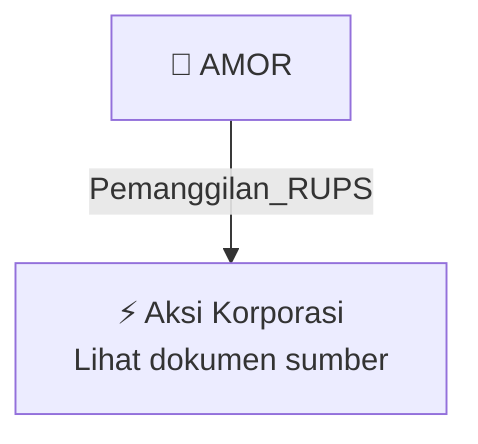

# 📢 Pemanggilan RUPS / RUPSLB — [[AMOR]]

⬅️ [[knowledge-base/daily-digests/Daily_Digest_20260929|Kembali ke Daily Digest]] | 📅 **2026-09-29** | 🎛️ [[Dashboard|Ke Dashboard Utama]]

> [!IMPORTANT]
> Laporan ini disusun secara otomatis oleh **Corporate Action Intelligence Agent** pada **2026-09-29**.
> Sumber dokumen: `20260928_AMOR_20260928_AMOR_Pengumuman RUPS_32161343_lamp1.pdf`

---

## 📌 1. Ringkasan Eksekutif & Tujuan Strategis

- **Kode & Nama Emiten**: `[[AMOR]]`
- **Kategori Aksi Korporasi**: `Pemanggilan_RUPS`
- **Dokumen Sumber**: `20260928_AMOR_20260928_AMOR_Pengumuman RUPS_32161343_lamp1.pdf`
- **Tanggal Laporan**: `2026-09-29`

[Analisis LLM tidak tersedia — isi manual]

---

## 📊 2. Fakta Material & Parameter Keuangan

| Parameter Utama | Nilai / Keterangan |
| :--- | :--- |
| **Uraian Kejadian** | `PT Ashmore Asset Management Indonesia Tbk T : +62 21 29539000 F : +62 21 29539001 PT ASHMORE ASSET MANAGEMENT INDONESIA Tbk (the “Company”) ANNOUNCEMENT TO THE SHAREHOLDERS OF THE COMPANY Board of Directors of PT Ashmore Asset Management Indonesia Tbk (“the Company”) hereby announced to the shareholders of the Company that the 2026 Annual General Meeting of the Shareholders of the Company (the “AGMS”) will be convened on Wednesday, 4 November 2026. Notice of the AGMS will be advertised on the Co` |

---

## 👥 3. Struktur Kepemilikan, Pengendali & Pembeli Siaga

- **Emiten**: `AMOR` | Informasi kepemilikan mengacu pada dokumen resmi sumber.

---

## 🎯 4. Alokasi & Rencana Penggunaan Dana

- Informasi alokasi dana belum tersedia — lihat prospektus / dokumen resmi.

---

## 📅 5. Timeline & Jadwal Pelaksanaan

| Tahapan / Event | Tanggal |
| :--- | :---: |
| **Jadwal** | Lihat dokumen sumber. |

---

## 📈 6. Diagram Visual Flowchart (Mermaid)

---

## 💡 7. Rekomendasi Investor & Strategi Trading

[Analisis LLM tidak tersedia — isi manual]

---

## 🔗 8. Hubungan Note Terkait (Knowledge Graph)

- [[knowledge-base/daily-digests/Daily_Digest_20260929|📄 Daily Digest 2026-09-29]]
- [[knowledge-base/trading-signals/Trading_Signals_20260929|🎯 Sinyal Cuan 2026-09-29]]
- [[AMOR|🏬 Halaman Emiten AMOR]]
- [[Dashboard|🎛️ Kembali ke Dashboard Utama]]

---

*Laporan dibuat otomatis oleh Corporate Action Intelligence Agent · 2026-09-29*