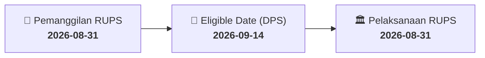

# ⚡ Laporan Intelijen Aksi Korporasi: [[APEX]] - RUPS

⬅️ [[knowledge-base/daily-digests/Daily_Digest_20260831|Kembali ke Daily Digest]] | 📅 **2026-08-31** | 🎛️ [[Dashboard|Ke Dashboard Utama]]

> [!IMPORTANT]
> Laporan ini disusun secara otomatis oleh **Corporate Action Intelligence Agent** untuk memetakan implikasi strategis, rasio keuangan, alokasi dana, jadwal penting, dan panduan investor.

---

## 📌 1. Ringkasan Eksekutif & Katalis Strategis
- **Kode & Nama Emiten**: `[[APEX]]`
- **Kategori Aksi Korporasi**: `RUPS`
- **Dokumen Resmi Bursa**: `Pengumuman RUPS lamp2`
- **Ringkasan Inti Aksi**: PT Apexindo Pratama Duta Tbk mengumumkan akan menyelenggarakan Rapat Umum Pemegang Saham Luar Biasa (RUPSLB) pada 7 Oktober 2026. Pemegang saham yang berhak hadir adalah yang tercatat dalam Daftar Pemegang Saham Perseroan pada 14 September 2026 pukul 16.00 WIB. Undangan RUPSLB akan diumumkan pada 15 September 2026 melalui website BEI dan website Perseroan. Pemegang saham yang mewakili minimal 1/20 dari total saham dengan hak suara dapat mengajukan usulan agenda RUPSLB paling lambat 8 September 2026.

---

## 📊 2. Matriks Parameter Material & Angka Kunci
| Parameter Utama | Nilai / Keterangan Resmi |
| :--- | :--- |
| **Jenis Rapat** | `Rapat Umum Pemegang Saham Luar Biasa (RUPSLB)` |
| **Tanggal Pelaksanaan RUPSLB** | `2026-10-07` |
| **Tanggal Pengumuman Undangan RUPSLB** | `2026-09-15` |
| **Tanggal Daftar Pemegang Saham (Recording Date)** | `2026-09-14` |
| **Batas Waktu Pencatatan Pemegang Saham** | `16:00 WIB` |
| **Batas Akhir Pengajuan Usulan Agenda RUPSLB** | `2026-09-08` |
| **Syarat Pengajuan Usulan Agenda** | `Satu atau lebih pemegang saham mewakili minimal 1/20 dari total saham dengan hak suara` |
| **Mekanisme Pemberian Kuasa** | `E-proxy (elektronik)` |
| **Tanggal Pengumuman RUPSLB** | `2026-08-31` |

---

## 📌 3. Detail Pelaksanaan RUPS / RUPSLB
- **Hari, Tanggal Pelaksanaan**: `2026-08-31`
- **Waktu Pelaksanaan**: `16:00 WIB`
- **Lokasi / Tempat Pelaksanaan**: `Aplikasi eASY.KSEI / Kantor Perseroan`
- **Batas Hak Suara (Eligible Date / Recording Date)**: `2026-09-14`

## 📝 4. Matriks Agenda & Mata Acara Rapat
| No | Agenda / Mata Acara | Penjelasan & Sub-Acara |
| :-: | :--- | :--- |
| 1 | **Batas Akhir Pengajuan Usulan Agenda RUPSLB** | 2026-09-08 |
| 2 | **Syarat Pengajuan Usulan Agenda** | Satu atau lebih pemegang saham mewakili minimal 1/20 dari total saham dengan hak suara |

## 🗓️ 5. Timeline Investor & Ketentuan Kehadiran

## 💡 6. Panduan Investor & E-Voting
- 👥 **Hak Suara**: Pemegang saham yang berhak hadir/memberikan suara adalah yang terdaftar dalam DPS pada **Eligible Date (2026-09-14)**.
- 🗳️ **E-Voting eASY.KSEI**: Pemegang saham dapat memberikan kuasa/suara secara elektronik melalui sistem eASY.KSEI.

---

## 🔗 Hubungan Note Terkait (Knowledge Graph)
- [[knowledge-base/daily-digests/Daily_Digest_20260831|📄 Daily Digest 2026-08-31]]
- [[knowledge-base/trading-signals/Trading_Signals_20260831|🎯 Sinyal Cuan 2026-08-31]]
- [[Dashboard|🎛️ Kembali ke Dashboard]]