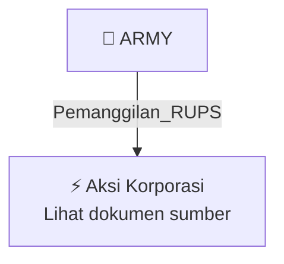

# 📢 Pemanggilan RUPS / RUPSLB — [[ARMY]]

⬅️ [[knowledge-base/daily-digests/Daily_Digest_20261009|Kembali ke Daily Digest]] | 📅 **2026-10-09** | 🎛️ [[Dashboard|Ke Dashboard Utama]]

> [!IMPORTANT]
> Laporan ini disusun secara otomatis oleh **Corporate Action Intelligence Agent** pada **2026-10-09**.
> Sumber dokumen: `20261008_ARMY_20261008_ARMY_Pemanggilan RUPS_32164484_lamp1.pdf`

---

## 📌 1. Ringkasan Eksekutif & Tujuan Strategis

- **Kode & Nama Emiten**: `[[ARMY]]`
- **Kategori Aksi Korporasi**: `Pemanggilan_RUPS`
- **Dokumen Sumber**: `20261008_ARMY_20261008_ARMY_Pemanggilan RUPS_32164484_lamp1.pdf`
- **Tanggal Laporan**: `2026-10-09`

[Analisis LLM tidak tersedia — isi manual]

---

## 📊 2. Fakta Material & Parameter Keuangan

| Parameter Utama | Nilai / Keterangan |
| :--- | :--- |
| **Nomor Surat** | `042/ARMY/DIR/X/2026` |
| **Perihal** | `Penyampaian Pengumuman Pemanggilan Rapat Umum Pemegang Saham Luar Biasa` |
| **Jenis Rapat** | `Rapat Umum Pemegang Saham Luar Biasa (RUPSLB)` |
| **Tanggal Pelaksanaan RUPSLB** | `2026-10-30` |
| **Hari Pelaksanaan RUPSLB** | `Jumat` |
| **Tanggal Pemanggilan Rapat** | `2026-10-08` |
| **Hari Pemanggilan Rapat** | `Kamis` |
| **Media Pemanggilan** | `Situs web Bursa` |
| **Dasar Hukum** | `POJK No. 15/POJK.04/2020, POJK No. 16/POJK.04/2020, Ketentuan Bursa Efek Indonesia No. I-E` |
| **Pihak yang Menyampaikan** | `PT Armidian Karyatama Tbk` |
| **Penandatangan** | `Firdaus, Direktur Utama` |

---

## 👥 3. Struktur Kepemilikan, Pengendali & Pembeli Siaga

- **Emiten**: `ARMY` | Informasi kepemilikan mengacu pada dokumen resmi sumber.

---

## 🎯 4. Alokasi & Rencana Penggunaan Dana

- Informasi alokasi dana belum tersedia — lihat prospektus / dokumen resmi.

---

## 📅 5. Timeline & Jadwal Pelaksanaan

| Tahapan / Event | Tanggal |
| :--- | :---: |
| **Jadwal** | Lihat dokumen sumber. |

---

## 📈 6. Diagram Visual Flowchart (Mermaid)

---

## 💡 7. Rekomendasi Investor & Strategi Trading

[Analisis LLM tidak tersedia — isi manual]

---

## 🔗 8. Hubungan Note Terkait (Knowledge Graph)

- [[knowledge-base/daily-digests/Daily_Digest_20261009|📄 Daily Digest 2026-10-09]]
- [[knowledge-base/trading-signals/Trading_Signals_20261009|🎯 Sinyal Cuan 2026-10-09]]
- [[ARMY|🏬 Halaman Emiten ARMY]]
- [[Dashboard|🎛️ Kembali ke Dashboard Utama]]

---

*Laporan dibuat otomatis oleh Corporate Action Intelligence Agent · 2026-10-09*