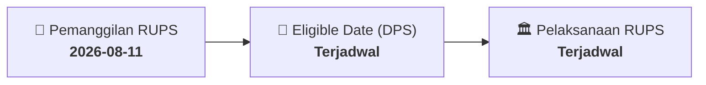

# ⚡ Laporan Intelijen Aksi Korporasi: [[ASMI]] - RUPS

⬅️ [[knowledge-base/daily-digests/Daily_Digest_20260811|Kembali ke Daily Digest]] | 📅 **2026-08-11** | 🎛️ [[Dashboard|Ke Dashboard Utama]]

> [!IMPORTANT]
> Laporan ini disusun secara otomatis oleh **Corporate Action Intelligence Agent** untuk memetakan implikasi strategis, rasio keuangan, alokasi dana, jadwal penting, dan panduan investor.

---

## 📌 1. Ringkasan Eksekutif & Katalis Strategis
- **Kode & Nama Emiten**: `[[ASMI]]`
- **Kategori Aksi Korporasi**: `RUPS`
- **Dokumen Resmi Bursa**: `Pemanggilan RUPS lamp1`
- **Ringkasan Inti Aksi**: Informasi dan fakta material ASMI: PEMANGGILAN RAPAT UMUM PEMEGANG SAHAM LUAR BIASA INVITATION OF EXTRA ORDINARY MEETING OF SHAREHOLDERS Sehubungan dengan tidak tercapainya kuorum dalam pelaksanaan Rapat Umum Pemegang Saham Luar Biasa (RUPSLB) yang telah dilaksanakan pada hari Senin, 27 Juli 2026 (“Rapat Pertama”) sebagaimana disyaratkan dalam Anggaran Dasar Perseroan dan Peraturan OJK, maka berdasarkan Peraturan OJK No.15/POJK.04/2020, Direksi PT Asuransi Maximus Graha Persada Tbk (“Perseroan”) dengan ini mengundang para Pemegan

---

## 📊 2. Matriks Parameter Material & Angka Kunci
| Parameter Utama | Nilai / Keterangan Resmi |
| :--- | :--- |
| **Uraian Kejadian** | `PEMANGGILAN RAPAT UMUM PEMEGANG SAHAM LUAR BIASA INVITATION OF EXTRA ORDINARY MEETING OF SHAREHOLDERS Sehubungan dengan tidak tercapainya kuorum dalam pelaksanaan Rapat Umum Pemegang Saham Luar Biasa (RUPSLB) yang telah dilaksanakan pada hari Senin, 27 Juli 2026 (“Rapat Pertama”) sebagaimana disyaratkan dalam Anggaran Dasar Perseroan dan Peraturan OJK, maka berdasarkan Peraturan OJK No.15/POJK.04/2020, Direksi PT Asuransi Maximus Graha Persada Tbk (“Perseroan”) dengan ini mengundang para Pemegan` |

---

## 📌 3. Detail Pelaksanaan RUPS / RUPSLB
- **Hari, Tanggal Pelaksanaan**: `Terjadwal`
- **Waktu Pelaksanaan**: `09.00 WIB s.d. selesai`
- **Lokasi / Tempat Pelaksanaan**: `Aplikasi eASY.KSEI / Kantor Perseroan`
- **Batas Hak Suara (Eligible Date / Recording Date)**: `Terjadwal`

## 📝 4. Matriks Agenda & Mata Acara Rapat
| No | Agenda / Mata Acara | Penjelasan & Sub-Acara |
| :-: | :--- | :--- |
| 1 | **Agenda Utama RUPS** | Informasi dan fakta material ASMI: PEMANGGILAN RAPAT UMUM PEMEGANG SAHAM LUAR BIASA INVITATION OF EXTRA ORDINARY MEETING OF SHAREHOLDERS Sehubungan dengan tidak tercapainya kuorum dalam pelaksanaan Rapat Umum Pemegang Saham Luar Biasa (RUPSLB) yang telah dilaksanakan pada hari Senin, 27 Juli 2026 (“Rapat Pertama”) sebagaimana disyaratkan dalam Anggaran Dasar Perseroan dan Peraturan OJK, maka berdasarkan Peraturan OJK No.15/POJK.04/2020, Direksi PT Asuransi Maximus Graha Persada Tbk (“Perseroan”) dengan ini mengundang para Pemegan |

## 🗓️ 5. Timeline Investor & Ketentuan Kehadiran

## 💡 6. Panduan Investor & E-Voting
- 👥 **Hak Suara**: Pemegang saham yang berhak hadir/memberikan suara adalah yang terdaftar dalam DPS pada **Eligible Date (Terjadwal)**.
- 🗳️ **E-Voting eASY.KSEI**: Pemegang saham dapat memberikan kuasa/suara secara elektronik melalui sistem eASY.KSEI.

---

## 🔗 Hubungan Note Terkait (Knowledge Graph)
- [[knowledge-base/daily-digests/Daily_Digest_20260811|📄 Daily Digest 2026-08-11]]
- [[knowledge-base/trading-signals/Trading_Signals_20260811|🎯 Sinyal Cuan 2026-08-11]]
- [[Dashboard|🎛️ Kembali ke Dashboard]]