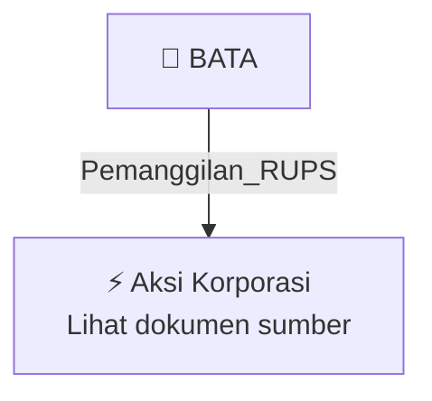

# 📢 Pemanggilan RUPS / RUPSLB — [[BATA]]

⬅️ [[knowledge-base/daily-digests/Daily_Digest_20260929|Kembali ke Daily Digest]] | 📅 **2026-09-29** | 🎛️ [[Dashboard|Ke Dashboard Utama]]

> [!IMPORTANT]
> Laporan ini disusun secara otomatis oleh **Corporate Action Intelligence Agent** pada **2026-09-29**.
> Sumber dokumen: `20260929_BATA_20260929_BATA_Pengumuman RUPS_32161585_lamp1.pdf`

---

## 📌 1. Ringkasan Eksekutif & Tujuan Strategis

- **Kode & Nama Emiten**: `[[BATA]]`
- **Kategori Aksi Korporasi**: `Pemanggilan_RUPS`
- **Dokumen Sumber**: `20260929_BATA_20260929_BATA_Pengumuman RUPS_32161585_lamp1.pdf`
- **Tanggal Laporan**: `2026-09-29`

[Analisis LLM tidak tersedia — isi manual]

---

## 📊 2. Fakta Material & Parameter Keuangan

| Parameter Utama | Nilai / Keterangan |
| :--- | :--- |
| **Uraian Kejadian** | `PT. SEPATU BATA Tbk. PENGUMUMAN RAPAT UMUM PEMEGANG SAHAM LUAR BIASA (RUPSLB) PT SEPATU BATA TBK Direksi PT Sepatu Bata Tbk (“Perseroan”) dengan ini mengumumkan kepada para Pemegang Saham bahwa Perseroan akan menyelenggarakan Rapat Umum Pemegang Saham Luar Biasa (“Rapat”) pada hari Kamis, 5 November 2026. Sesuai dengan ketentuan Anggaran Dasar dan Peraturan Otoritas Jasa Keuangan (“OJK”) Nomor 15/POJK.04/2020 tentang Rencana dan Penyelenggaraan Rapat Umum Pemegang Saham Perusahaan Terbuka (“POJK` |

---

## 👥 3. Struktur Kepemilikan, Pengendali & Pembeli Siaga

- **Emiten**: `BATA` | Informasi kepemilikan mengacu pada dokumen resmi sumber.

---

## 🎯 4. Alokasi & Rencana Penggunaan Dana

- Informasi alokasi dana belum tersedia — lihat prospektus / dokumen resmi.

---

## 📅 5. Timeline & Jadwal Pelaksanaan

| Tahapan / Event | Tanggal |
| :--- | :---: |
| **Jadwal** | Lihat dokumen sumber. |

---

## 📈 6. Diagram Visual Flowchart (Mermaid)

---

## 💡 7. Rekomendasi Investor & Strategi Trading

[Analisis LLM tidak tersedia — isi manual]

---

## 🔗 8. Hubungan Note Terkait (Knowledge Graph)

- [[knowledge-base/daily-digests/Daily_Digest_20260929|📄 Daily Digest 2026-09-29]]
- [[knowledge-base/trading-signals/Trading_Signals_20260929|🎯 Sinyal Cuan 2026-09-29]]
- [[BATA|🏬 Halaman Emiten BATA]]
- [[Dashboard|🎛️ Kembali ke Dashboard Utama]]

---

*Laporan dibuat otomatis oleh Corporate Action Intelligence Agent · 2026-09-29*