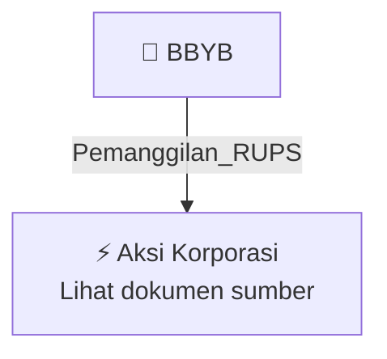

# 📢 Pemanggilan RUPS / RUPSLB — [[BBYB]]

⬅️ [[knowledge-base/daily-digests/Daily_Digest_20261009|Kembali ke Daily Digest]] | 📅 **2026-10-09** | 🎛️ [[Dashboard|Ke Dashboard Utama]]

> [!IMPORTANT]
> Laporan ini disusun secara otomatis oleh **Corporate Action Intelligence Agent** pada **2026-10-09**.
> Sumber dokumen: `20261007_BBYB_20261007_BBYB_Pemanggilan RUPS_32164200.pdf`

---

## 📌 1. Ringkasan Eksekutif & Tujuan Strategis

- **Kode & Nama Emiten**: `[[BBYB]]`
- **Kategori Aksi Korporasi**: `Pemanggilan_RUPS`
- **Dokumen Sumber**: `20261007_BBYB_20261007_BBYB_Pemanggilan RUPS_32164200.pdf`
- **Tanggal Laporan**: `2026-10-09`

[Analisis LLM tidak tersedia — isi manual]

---

## 📊 2. Fakta Material & Parameter Keuangan

| Parameter Utama | Nilai / Keterangan |
| :--- | :--- |
| **Nomor surat pemanggilan** | `050/BNC-Tbk/E-Report/IDX/X/2026` |
| **Nomor surat pemberitahuan sebelumnya** | `047/BNC-Tbk/E-Report/IDX/IX/2026` |
| **Tanggal surat pemberitahuan sebelumnya** | `2026-09-22` |
| **Jenis rapat** | `Rapat Umum Pemegang Saham Luar Biasa (RUPSLB)` |
| **Hari/Tanggal/Waktu RUPS** | `29 Oktober 2026, 14:00` |
| **Lokasi RUPS** | `Kantor PT Bank Neo Commerce Tbk, Jendral Sudirman Kav. 52-53, Jakarta Selatan` |
| **Recording Date** | `2026-10-06` |
| **Agenda RUPSLB** | `Perubahan Susunan Pengurus Perseroan` |
| **Pengirim dokumen** | `Heru Sulistiadhi` |
| **Jabatan pengirim** | `PT Bank Neo Commerce Tbk.` |
| **Tanggal dan waktu pelaporan dokumen** | `2026-10-07 16:08` |
| **Lampiran** | `Panggilan RUPSLB 29 Okt 2026.pdf` |

---

## 👥 3. Struktur Kepemilikan, Pengendali & Pembeli Siaga

- **Emiten**: `BBYB` | Informasi kepemilikan mengacu pada dokumen resmi sumber.

---

## 🎯 4. Alokasi & Rencana Penggunaan Dana

- Informasi alokasi dana belum tersedia — lihat prospektus / dokumen resmi.

---

## 📅 5. Timeline & Jadwal Pelaksanaan

| Tahapan / Event | Tanggal |
| :--- | :---: |
| **Jadwal** | Lihat dokumen sumber. |

---

## 📈 6. Diagram Visual Flowchart (Mermaid)

---

## 💡 7. Rekomendasi Investor & Strategi Trading

[Analisis LLM tidak tersedia — isi manual]

---

## 🔗 8. Hubungan Note Terkait (Knowledge Graph)

- [[knowledge-base/daily-digests/Daily_Digest_20261009|📄 Daily Digest 2026-10-09]]
- [[knowledge-base/trading-signals/Trading_Signals_20261009|🎯 Sinyal Cuan 2026-10-09]]
- [[BBYB|🏬 Halaman Emiten BBYB]]
- [[Dashboard|🎛️ Kembali ke Dashboard Utama]]

---

*Laporan dibuat otomatis oleh Corporate Action Intelligence Agent · 2026-10-09*