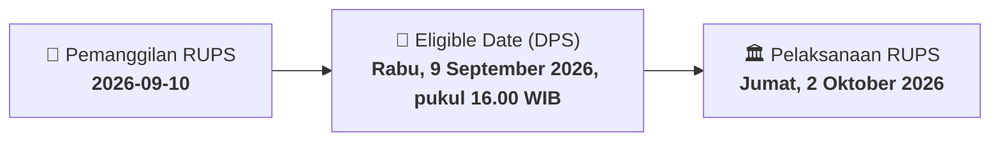

# ⚡ Laporan Intelijen Aksi Korporasi: [[BEER]] - RUPS

⬅️ [[knowledge-base/daily-digests/Daily_Digest_20260910|Kembali ke Daily Digest]] | 📅 **2026-09-10** | 🎛️ [[Dashboard|Ke Dashboard Utama]]

> [!IMPORTANT]
> Laporan ini disusun secara otomatis oleh **Corporate Action Intelligence Agent** untuk memetakan implikasi strategis, rasio keuangan, alokasi dana, jadwal penting, dan panduan investor.

---

## 📌 1. Ringkasan Eksekutif & Katalis Strategis
- **Kode & Nama Emiten**: `[[BEER]]`
- **Kategori Aksi Korporasi**: `RUPS`
- **Dokumen Resmi Bursa**: `Pemanggilan RUPS lamp2`
- **Ringkasan Inti Aksi**: Pemanggilan Rapat Umum Pemegang Saham Luar Biasa (RUPSLB) PT Jobubu Jarum Minahasa Tbk (BEER) yang akan diselenggarakan pada Jumat, 2 Oktober 2026, pukul 10.00 WIB secara elektronik melalui fasilitas eASY.KSEI. Agenda rapat meliputi persetujuan perubahan Pasal 3 Anggaran Dasar untuk penyesuaian dengan KBLI 2025 dan persetujuan perubahan susunan anggota Direksi dan/atau Dewan Komisaris.

---

## 📊 2. Matriks Parameter Material & Angka Kunci
| Parameter Utama | Nilai / Keterangan Resmi |
| :--- | :--- |
| **Hari/Tanggal Rapat** | `Jumat, 2 Oktober 2026` |
| **Waktu Rapat** | `10.00 WIB – selesai` |
| **Tempat Rapat** | `Jakarta Selatan, secara elektronik melalui fasilitas Electronic General Meeting (eASY.KSEI)` |
| **Agenda 1** | `Persetujuan atas Perubahan Pasal 3 Anggaran Dasar Perseroan dalam rangka penyesuaian dengan Klasifikasi Baku Lapangan Usaha Indonesia 2025 (KBLI 2025)` |
| **Agenda 2** | `Persetujuan perubahan susunan anggota Direksi dan/atau Dewan Komisaris Perseroan` |
| **Tanggal Daftar Pemegang Saham (DPS)** | `Rabu, 9 September 2026, pukul 16.00 WIB` |
| **Dasar Hukum Pemanggilan** | `Pasal 52 POJK 15/2020 juncto Pasal 21 ayat 10 a (i) Anggaran Dasar Perseroan` |
| **Mekanisme Rapat** | `Secara elektronik melalui aplikasi eASY.KSEI, sesuai POJK No. 14 Tahun 2025` |

---

## 📌 3. Detail Pelaksanaan RUPS / RUPSLB
- **Hari, Tanggal Pelaksanaan**: `Jumat, 2 Oktober 2026`
- **Waktu Pelaksanaan**: `10.00 WIB – selesai`
- **Lokasi / Tempat Pelaksanaan**: `Jakarta Selatan, secara elektronik melalui fasilitas Electronic General Meeting (eASY.KSEI)`
- **Batas Hak Suara (Eligible Date / Recording Date)**: `Rabu, 9 September 2026, pukul 16.00 WIB`

## 📝 4. Matriks Agenda & Mata Acara Rapat
| No | Agenda / Mata Acara | Penjelasan & Sub-Acara |
| :-: | :--- | :--- |
| 1 | **Agenda 1** | Persetujuan atas Perubahan Pasal 3 Anggaran Dasar Perseroan dalam rangka penyesuaian dengan Klasifikasi Baku Lapangan Usaha Indonesia 2025 (KBLI 2025) |
| 2 | **Agenda 2** | Persetujuan perubahan susunan anggota Direksi dan/atau Dewan Komisaris Perseroan |

## 🗓️ 5. Timeline Investor & Ketentuan Kehadiran

## 💡 6. Panduan Investor & E-Voting
- 👥 **Hak Suara**: Pemegang saham yang berhak hadir/memberikan suara adalah yang terdaftar dalam DPS pada **Eligible Date (Rabu, 9 September 2026, pukul 16.00 WIB)**.
- 🗳️ **E-Voting eASY.KSEI**: Pemegang saham dapat memberikan kuasa/suara secara elektronik melalui sistem eASY.KSEI.

---

## 🔗 Hubungan Note Terkait (Knowledge Graph)
- [[knowledge-base/daily-digests/Daily_Digest_20260910|📄 Daily Digest 2026-09-10]]
- [[knowledge-base/trading-signals/Trading_Signals_20260910|🎯 Sinyal Cuan 2026-09-10]]
- [[Dashboard|🎛️ Kembali ke Dashboard]]