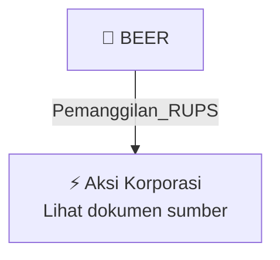

# 📢 Pemanggilan RUPS / RUPSLB — [[BEER]]

⬅️ [[knowledge-base/daily-digests/Daily_Digest_20261002|Kembali ke Daily Digest]] | 📅 **2026-10-02** | 🎛️ [[Dashboard|Ke Dashboard Utama]]

> [!IMPORTANT]
> Laporan ini disusun secara otomatis oleh **Corporate Action Intelligence Agent** pada **2026-10-02**.
> Sumber dokumen: `20261001_BEER_20261001_BEER_Laporan Informasi dan Fakta Material_32162485.pdf`

---

## 📌 1. Ringkasan Eksekutif & Tujuan Strategis

- **Kode & Nama Emiten**: `[[BEER]]`
- **Kategori Aksi Korporasi**: `Pemanggilan_RUPS`
- **Dokumen Sumber**: `20261001_BEER_20261001_BEER_Laporan Informasi dan Fakta Material_32162485.pdf`
- **Tanggal Laporan**: `2026-10-02`

[Analisis LLM tidak tersedia — isi manual]

---

## 📊 2. Fakta Material & Parameter Keuangan

| Parameter Utama | Nilai / Keterangan |
| :--- | :--- |
| **Nomor Surat** | `104/JJM/CORPSEC/IX/2026` |
| **Nama Emiten atau Perusahaan Publik** | `PT Jobubu Jarum Minahasa Tbk` |
| **Bidang Usaha** | `Industri Minuman Beralkohol Hasil Destilasi, Industri Minuman Beralkohol Hasil Fermentasi` |
| **Tanggal Kejadian** | `2026-10-01` |
| **Jenis Informasi atau Fakta Material** | `Ralat Pemanggilan Rapat Umum Pemegang Saham Luar Biasa PT Jobubu Jarum Minahasa Tbk` |
| **Tanggal RUPSLB** | `2026-10-02` |
| **Hari RUPSLB** | `Jumat` |
| **Mata Acara yang Dihapus** | `Perubahan Susunan Anggota Direksi dan Dewan Komisaris Perseroan` |
| **Mata Acara Tunggal RUPSLB** | `Persetujuan atas Perubahan Pasal 3 Anggaran Dasar Perseroan dalam rangka penyesuaian dengan Klasifikasi Baku Lapangan Usaha Indonesia 2025 (KBLI 2025)` |
| **Lampiran** | `1. Surat Pengantar Ralat Pemanggilan RUPSLB.pdf; 2. RALAT Pemanggilan RUPSLB 2026.pdf` |
| **Nama Pengirim** | `M. Dwi Hapsoro` |
| **Jabatan Pengirim** | `PT Jobubu Jarum Minahasa Tbk` |
| **Waktu Pelaporan** | `2026-10-01 16:12` |

---

## 👥 3. Struktur Kepemilikan, Pengendali & Pembeli Siaga

- **Emiten**: `BEER` | Informasi kepemilikan mengacu pada dokumen resmi sumber.

---

## 🎯 4. Alokasi & Rencana Penggunaan Dana

- Informasi alokasi dana belum tersedia — lihat prospektus / dokumen resmi.

---

## 📅 5. Timeline & Jadwal Pelaksanaan

| Tahapan / Event | Tanggal |
| :--- | :---: |
| **Jadwal** | Lihat dokumen sumber. |

---

## 📈 6. Diagram Visual Flowchart (Mermaid)

---

## 💡 7. Rekomendasi Investor & Strategi Trading

[Analisis LLM tidak tersedia — isi manual]

---

## 🔗 8. Hubungan Note Terkait (Knowledge Graph)

- [[knowledge-base/daily-digests/Daily_Digest_20261002|📄 Daily Digest 2026-10-02]]
- [[knowledge-base/trading-signals/Trading_Signals_20261002|🎯 Sinyal Cuan 2026-10-02]]
- [[BEER|🏬 Halaman Emiten BEER]]
- [[Dashboard|🎛️ Kembali ke Dashboard Utama]]

---

*Laporan dibuat otomatis oleh Corporate Action Intelligence Agent · 2026-10-02*