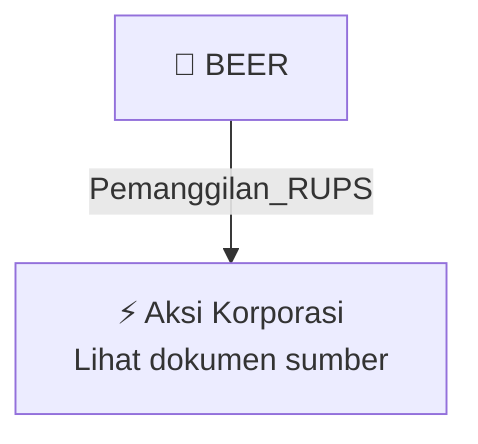

# 📢 Pemanggilan RUPS / RUPSLB — [[BEER]]

⬅️ [[knowledge-base/daily-digests/Daily_Digest_20261007|Kembali ke Daily Digest]] | 📅 **2026-10-07** | 🎛️ [[Dashboard|Ke Dashboard Utama]]

> [!IMPORTANT]
> Laporan ini disusun secara otomatis oleh **Corporate Action Intelligence Agent** pada **2026-10-07**.
> Sumber dokumen: `20261006_BEER_20261006_BEER_Ringkasan RisalahRisalah RUPS_32163682.pdf`

---

## 📌 1. Ringkasan Eksekutif & Tujuan Strategis

- **Kode & Nama Emiten**: `[[BEER]]`
- **Kategori Aksi Korporasi**: `Pemanggilan_RUPS`
- **Dokumen Sumber**: `20261006_BEER_20261006_BEER_Ringkasan RisalahRisalah RUPS_32163682.pdf`
- **Tanggal Laporan**: `2026-10-07`

[Analisis LLM tidak tersedia — isi manual]

---

## 📊 2. Fakta Material & Parameter Keuangan

| Parameter Utama | Nilai / Keterangan |
| :--- | :--- |
| **Nomor surat Perseroan** | `109/JJM/CORPSECT/X/2026` |
| **Referensi surat panggilan RUPS** | `091/JJM/CORPSEC/IX/2026 tanggal 10 September 2026` |
| **Jenis RUPS** | `RUPS Luar Biasa` |
| **Tanggal penyelenggaraan RUPS** | `02 Oktober 2026` |
| **Kuorum kehadiran** | `3.229.191.625 saham atau 80,73% dari seluruh saham dengan hak suara yang sah` |
| **Agenda 1** | `Persetujuan atas Perubahan Pasal 3 Anggaran Dasar Perseroan dalam rangka penyesuaian dengan Klasifikasi Baku Lapangan Usaha Indonesia 2025 (KBLI 2025)` |
| **Hasil keputusan Agenda 1** | `Setuju` |
| **Suara setuju Agenda 1** | `3.047.747.925 saham atau 94,38%` |
| **Suara tidak setuju Agenda 1** | `50.400 saham atau 0,002%` |
| **Suara abstain Agenda 1** | `181.393.300 saham atau 5,62%` |
| **Keputusan Agenda 1** | `Menyetujui dan mengubah Pasal 3 Anggaran Dasar Perseroan mengenai Maksud dan Tujuan serta Kegiatan Usaha dalam rangka penyesuaian dengan KBLI 2025` |
| **Pemberian kuasa** | `Memberikan kuasa dan wewenang kepada Direksi Perseroan dan/atau Tuan AUDY CHARLES LIEKE, baik bersama-sama maupun sendiri-sendiri, dengan hak substitusi, untuk melaksanakan keputusan Rapat` |
| **Agenda 2** | `Persetujuan perubahan susunan anggota Direksi dan/atau Dewan Komisaris Perseroan` |
| **Status Agenda 2** | `Dibatalkan sesuai keterbukaan informasi tanggal 1 Oktober 2026 nomor 104/JJM/CORPSEC/IX/2026 tentang Ralat Pemanggilan RUPS Luar Biasa PT Jobubu Jarum Minahasa Tbk` |
| **Alamat** | `Desa Kapitu, Kelurahan Kapitu, Kecamatan Amurang Barat` |
| **Tanggal pelaporan elektronik** | `06-10-2026 13:46` |
| **Lampiran** | `Surat Pengantar Ringkasan Risalah RUPSLB 2026.pdf; beer_covernote_rupslb_2 Okt 26_V1.pdf` |

---

## 👥 3. Struktur Kepemilikan, Pengendali & Pembeli Siaga

- **Emiten**: `BEER` | Informasi kepemilikan mengacu pada dokumen resmi sumber.

---

## 🎯 4. Alokasi & Rencana Penggunaan Dana

- Informasi alokasi dana belum tersedia — lihat prospektus / dokumen resmi.

---

## 📅 5. Timeline & Jadwal Pelaksanaan

| Tahapan / Event | Tanggal |
| :--- | :---: |
| **Jadwal** | Lihat dokumen sumber. |

---

## 📈 6. Diagram Visual Flowchart (Mermaid)

---

## 💡 7. Rekomendasi Investor & Strategi Trading

[Analisis LLM tidak tersedia — isi manual]

---

## 🔗 8. Hubungan Note Terkait (Knowledge Graph)

- [[knowledge-base/daily-digests/Daily_Digest_20261007|📄 Daily Digest 2026-10-07]]
- [[knowledge-base/trading-signals/Trading_Signals_20261007|🎯 Sinyal Cuan 2026-10-07]]
- [[BEER|🏬 Halaman Emiten BEER]]
- [[Dashboard|🎛️ Kembali ke Dashboard Utama]]

---

*Laporan dibuat otomatis oleh Corporate Action Intelligence Agent · 2026-10-07*