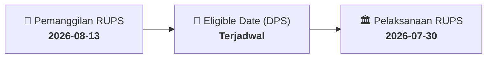

# ⚡ Laporan Intelijen Aksi Korporasi: [[BESS]] - RUPS

⬅️ [[knowledge-base/daily-digests/Daily_Digest_20260813|Kembali ke Daily Digest]] | 📅 **2026-08-13** | 🎛️ [[Dashboard|Ke Dashboard Utama]]

> [!IMPORTANT]
> Laporan ini disusun secara otomatis oleh **Corporate Action Intelligence Agent** untuk memetakan implikasi strategis, rasio keuangan, alokasi dana, jadwal penting, dan panduan investor.

---

## 📌 1. Ringkasan Eksekutif & Katalis Strategis
- **Kode & Nama Emiten**: `[[BESS]]`
- **Kategori Aksi Korporasi**: `RUPS`
- **Dokumen Resmi Bursa**: `Pemanggilan RUPS`
- **Ringkasan Inti Aksi**: PT Batulicin Nusantara Maritim Tbk. mengumumkan penundaan Rapat Umum Pemegang Saham Luar Biasa (RUPSLB) yang sebelumnya direncanakan berdasarkan surat No. 594/BNM-PST/VII/2026 tanggal 30 Juli 2026. Penundaan dilakukan sampai dengan pengumuman lebih lanjut. Agenda RUPSLB mencakup pembahasan studi kelayakan tentang perubahan kegiatan usaha dan persetujuan rencana perubahan dan/atau penambahan kegiatan usaha utama (transaksi material).

---

## 📊 2. Matriks Parameter Material & Angka Kunci
| Parameter Utama | Nilai / Keterangan Resmi |
| :--- | :--- |
| **Nomor Surat Pengumuman** | `602/BNM-PST/VIII/2026` |
| **Tanggal Pengumuman** | `2026-08-07` |
| **Nomor Surat Pemanggilan RUPSLB Sebelumnya** | `594/BNM-PST/VII/2026` |
| **Tanggal Pemanggilan RUPSLB Sebelumnya** | `2026-07-30` |
| **Status RUPSLB** | `Ditunda sampai pengumuman lebih lanjut` |
| **Agenda 1** | `Pembahasan Studi Kelayakan Tentang Perubahan Kegiatan Usaha` |
| **Agenda 2** | `Persetujuan Rencana Perubahan dan/atau Penambahan Kegiatan Usaha Utama (Transaksi Material)` |
| **Nama Pengirim** | `Yuliana` |
| **Jabatan Pengirim** | `Direktur` |

---

## 📌 3. Detail Pelaksanaan RUPS / RUPSLB
- **Hari, Tanggal Pelaksanaan**: `2026-07-30`
- **Waktu Pelaksanaan**: `09.00 WIB s.d. selesai`
- **Lokasi / Tempat Pelaksanaan**: `Aplikasi eASY.KSEI / Kantor Perseroan`
- **Batas Hak Suara (Eligible Date / Recording Date)**: `Terjadwal`

## 📝 4. Matriks Agenda & Mata Acara Rapat
| No | Agenda / Mata Acara | Penjelasan & Sub-Acara |
| :-: | :--- | :--- |
| 1 | **Agenda 1** | Pembahasan Studi Kelayakan Tentang Perubahan Kegiatan Usaha |
| 2 | **Agenda 2** | Persetujuan Rencana Perubahan dan/atau Penambahan Kegiatan Usaha Utama (Transaksi Material) |

## 🗓️ 5. Timeline Investor & Ketentuan Kehadiran

## 💡 6. Panduan Investor & E-Voting
- 👥 **Hak Suara**: Pemegang saham yang berhak hadir/memberikan suara adalah yang terdaftar dalam DPS pada **Eligible Date (Terjadwal)**.
- 🗳️ **E-Voting eASY.KSEI**: Pemegang saham dapat memberikan kuasa/suara secara elektronik melalui sistem eASY.KSEI.

---

## 🔗 Hubungan Note Terkait (Knowledge Graph)
- [[knowledge-base/daily-digests/Daily_Digest_20260813|📄 Daily Digest 2026-08-13]]
- [[knowledge-base/trading-signals/Trading_Signals_20260813|🎯 Sinyal Cuan 2026-08-13]]
- [[Dashboard|🎛️ Kembali ke Dashboard]]