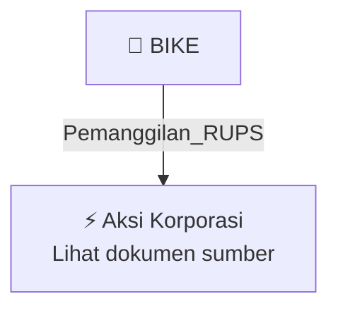

# 📢 Pemanggilan RUPS / RUPSLB — [[BIKE]]

⬅️ [[knowledge-base/daily-digests/Daily_Digest_20260925|Kembali ke Daily Digest]] | 📅 **2026-09-25** | 🎛️ [[Dashboard|Ke Dashboard Utama]]

> [!IMPORTANT]
> Laporan ini disusun secara otomatis oleh **Corporate Action Intelligence Agent** pada **2026-09-25**.
> Sumber dokumen: `20260924_BIKE_20260924_BIKE_Pengumuman RUPS_32150729.pdf`

---

## 📌 1. Ringkasan Eksekutif & Tujuan Strategis

- **Kode & Nama Emiten**: `[[BIKE]]`
- **Kategori Aksi Korporasi**: `Pemanggilan_RUPS`
- **Dokumen Sumber**: `20260924_BIKE_20260924_BIKE_Pengumuman RUPS_32150729.pdf`
- **Tanggal Laporan**: `2026-09-25`

[Analisis LLM tidak tersedia — isi manual]

---

## 📊 2. Fakta Material & Parameter Keuangan

| Parameter Utama | Nilai / Keterangan |
| :--- | :--- |
| **Uraian Kejadian** | `2026/264/IX/EK PT Bhineka Inovasi Ketahanan Energi Tbk BIKE 1 Pemberitahuan Penundaan Rapat Umum Pemegang Saham Luar Biasa dan Independen Pengumuman Penundaan RUPS Merujuk pada surat : 2026/235R/IX/BIKE/EK Perseroan menyampaikan penundaan penyelenggaraan Rapat Umum Pemegang Saham pada : Lokasi Penyelenggaraan RUPS (bila sudah dapat diumumkan dan sesuai iklan) : Tanggal Daftar Pemegang Saham (DPS) yang berhak hadir dalam RUPS Selatan 22 September 2026 : Hari/Tanggal/Waktu : Kamis, 15 Oktober 2026` |

---

## 👥 3. Struktur Kepemilikan, Pengendali & Pembeli Siaga

- **Emiten**: `BIKE` | Informasi kepemilikan mengacu pada dokumen resmi sumber.

---

## 🎯 4. Alokasi & Rencana Penggunaan Dana

- Informasi alokasi dana belum tersedia — lihat prospektus / dokumen resmi.

---

## 📅 5. Timeline & Jadwal Pelaksanaan

| Tahapan / Event | Tanggal |
| :--- | :---: |
| **Jadwal** | Lihat dokumen sumber. |

---

## 📈 6. Diagram Visual Flowchart (Mermaid)

---

## 💡 7. Rekomendasi Investor & Strategi Trading

[Analisis LLM tidak tersedia — isi manual]

---

## 🔗 8. Hubungan Note Terkait (Knowledge Graph)

- [[knowledge-base/daily-digests/Daily_Digest_20260925|📄 Daily Digest 2026-09-25]]
- [[knowledge-base/trading-signals/Trading_Signals_20260925|🎯 Sinyal Cuan 2026-09-25]]
- [[BIKE|🏬 Halaman Emiten BIKE]]
- [[Dashboard|🎛️ Kembali ke Dashboard Utama]]

---

*Laporan dibuat otomatis oleh Corporate Action Intelligence Agent · 2026-09-25*