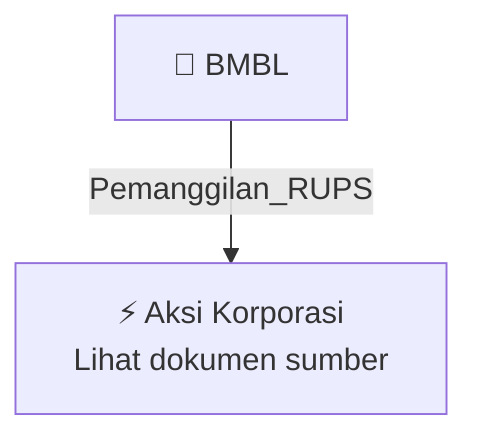

# 📢 Pemanggilan RUPS / RUPSLB — [[BMBL]]

⬅️ [[knowledge-base/daily-digests/Daily_Digest_20261006|Kembali ke Daily Digest]] | 📅 **2026-10-06** | 🎛️ [[Dashboard|Ke Dashboard Utama]]

> [!IMPORTANT]
> Laporan ini disusun secara otomatis oleh **Corporate Action Intelligence Agent** pada **2026-10-06**.
> Sumber dokumen: `20261005_BMBL_20261005_BMBL_Pengumuman RUPS_32163231_lamp1.pdf`

---

## 📌 1. Ringkasan Eksekutif & Tujuan Strategis

- **Kode & Nama Emiten**: `[[BMBL]]`
- **Kategori Aksi Korporasi**: `Pemanggilan_RUPS`
- **Dokumen Sumber**: `20261005_BMBL_20261005_BMBL_Pengumuman RUPS_32163231_lamp1.pdf`
- **Tanggal Laporan**: `2026-10-06`

[Analisis LLM tidak tersedia — isi manual]

---

## 📊 2. Fakta Material & Parameter Keuangan

| Parameter Utama | Nilai / Keterangan |
| :--- | :--- |
| **Nama Perseroan** | `PT Lavender Bina Cendikia Tbk` |
| **Kedudukan Hukum** | `Kota Depok` |
| **Jenis Rapat** | `Rapat Umum Pemegang Saham Tahunan / Rapat Umum Pemegang Saham Luar Biasa` |
| **Hari dan Tanggal Rapat** | `Rabu, 11 November 2026` |
| **Tanggal Pengumuman** | `05 Oktober 2026` |
| **Tanggal DPS dan Penutupan Perdagangan Saham** | `19 Oktober 2026 sampai dengan pukul 16:00 WIB` |
| **Metode Pelaksanaan Rapat** | `Secara fisik dan elektronik` |
| **Tautan Situs Web Perseroan** | `https://lavenderbinacendikia.id/` |
| **Dasar Hukum** | `POJK No. 15/POJK.04/2020 dan POJK No. 16/POJK.04/2020` |
| **Batas Pengajuan Usulan Mata Acara Rapat** | `Paling lambat 7 hari sebelum Pemanggilan Rapat` |
| **Kepemilikan Minimal untuk Mengusulkan Mata Acara Rapat** | `1/20 atau lebih dari jumlah seluruh saham dengan hak suara` |
| **Syarat Usulan Mata Acara Rapat** | `Diajukan tertulis, dengan itikad baik, mempertimbangkan kepentingan Perseroan, membutuhkan keputusan Rapat, menyertakan alasan dan bahan, serta tidak bertentangan dengan Anggaran Dasar dan peraturan perundang-undangan` |

---

## 👥 3. Struktur Kepemilikan, Pengendali & Pembeli Siaga

- **Emiten**: `BMBL` | Informasi kepemilikan mengacu pada dokumen resmi sumber.

---

## 🎯 4. Alokasi & Rencana Penggunaan Dana

- Informasi alokasi dana belum tersedia — lihat prospektus / dokumen resmi.

---

## 📅 5. Timeline & Jadwal Pelaksanaan

| Tahapan / Event | Tanggal |
| :--- | :---: |
| **Jadwal** | Lihat dokumen sumber. |

---

## 📈 6. Diagram Visual Flowchart (Mermaid)

---

## 💡 7. Rekomendasi Investor & Strategi Trading

[Analisis LLM tidak tersedia — isi manual]

---

## 🔗 8. Hubungan Note Terkait (Knowledge Graph)

- [[knowledge-base/daily-digests/Daily_Digest_20261006|📄 Daily Digest 2026-10-06]]
- [[knowledge-base/trading-signals/Trading_Signals_20261006|🎯 Sinyal Cuan 2026-10-06]]
- [[BMBL|🏬 Halaman Emiten BMBL]]
- [[Dashboard|🎛️ Kembali ke Dashboard Utama]]

---

*Laporan dibuat otomatis oleh Corporate Action Intelligence Agent · 2026-10-06*