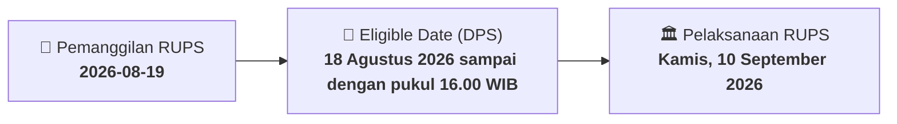

# ⚡ Laporan Intelijen Aksi Korporasi: [[BNBA]] - RUPS

⬅️ [[knowledge-base/daily-digests/Daily_Digest_20260819|Kembali ke Daily Digest]] | 📅 **2026-08-19** | 🎛️ [[Dashboard|Ke Dashboard Utama]]

> [!IMPORTANT]
> Laporan ini disusun secara otomatis oleh **Corporate Action Intelligence Agent** untuk memetakan implikasi strategis, rasio keuangan, alokasi dana, jadwal penting, dan panduan investor.

---

## 📌 1. Ringkasan Eksekutif & Katalis Strategis
- **Kode & Nama Emiten**: `[[BNBA]]`
- **Kategori Aksi Korporasi**: `RUPS`
- **Dokumen Resmi Bursa**: `Pemanggilan RUPS lamp3`
- **Ringkasan Inti Aksi**: Pemanggilan Rapat Umum Pemegang Saham Luar Biasa PT Bank Bumi Arta Tbk yang akan diselenggarakan pada Kamis, 10 September 2026 pukul 15.00 WIB di Pullman Jakarta Indonesia The Gallery, Lantai 2. Agenda utama meliputi perubahan susunan Dewan Komisaris dan Direksi, termasuk pengunduran diri Wakil Presiden Komisaris, Komisaris Independen, dan Presiden Direktur, serta pengangkatan penggantinya.

---

## 📊 2. Matriks Parameter Material & Angka Kunci
| Parameter Utama | Nilai / Keterangan Resmi |
| :--- | :--- |
| **Jenis Rapat** | `Rapat Umum Pemegang Saham Luar Biasa` |
| **Hari/Tanggal Rapat** | `Kamis, 10 September 2026` |
| **Waktu Rapat** | `15.00 WIB - selesai` |
| **Tempat Rapat** | `Pullman Jakarta Indonesia The Gallery, Lantai 2` |
| **Recording Date** | `18 Agustus 2026 sampai dengan pukul 16.00 WIB` |
| **Tanggal Pengumuman Rapat** | `04 Agustus 2026` |
| **Mata Acara 1** | `Persetujuan permohonan pengunduran diri Bapak Daniel Budi Dharma selaku Wakil Presiden Komisaris merangkap Komisaris Independen dan Bapak Mohammad Sjariffudin selaku Komisaris merangkap Komisaris Independen` |
| **Mata Acara 2** | `Persetujuan nominasi dan pengangkatan Bapak Markus Sugiono sebagai Komisaris merangkap Komisaris Independen` |
| **Mata Acara 3** | `Persetujuan nominasi dan pengangkatan Ibu Setiawati Samahita sebagai Komisaris merangkap Komisaris Independen` |
| **Mata Acara 4** | `Persetujuan nominasi dan pengangkatan Bapak Abi Kistono sebagai Komisaris merangkap Komisaris Independen` |
| **Mata Acara 5** | `Persetujuan nominasi dan pengangkatan Bapak I Gst Agung Rai Wirajaya sebagai Wakil Presiden Komisaris merangkap Komisaris Non Independen` |
| **Mata Acara 6** | `Persetujuan permohonan pengunduran diri Bapak Wikan Aryono S selaku Presiden Direktur` |
| **Mata Acara 7** | `Persetujuan nominasi dan pengangkatan Bapak Alex Susanto sebagai Presiden Direktur` |
| **Tindak Lanjut RUPS Tahunan** | `Menindaklanjuti Rapat Umum Pemegang Saham Tahunan Tahun Buku 2025 tanggal 30 Juni 2026` |
| **Mekanisme Rapat** | `Dapat diselenggarakan secara elektronik melalui aplikasi e-RUPS sesuai POJK No. 15/POJK.04/2020 dan POJK No. 14 Tahun 2025` |

---

## 📌 3. Detail Pelaksanaan RUPS / RUPSLB
- **Hari, Tanggal Pelaksanaan**: `Kamis, 10 September 2026`
- **Waktu Pelaksanaan**: `15.00 WIB - selesai`
- **Lokasi / Tempat Pelaksanaan**: `Pullman Jakarta Indonesia The Gallery, Lantai 2`
- **Batas Hak Suara (Eligible Date / Recording Date)**: `18 Agustus 2026 sampai dengan pukul 16.00 WIB`

## 📝 4. Matriks Agenda & Mata Acara Rapat
| No | Agenda / Mata Acara | Penjelasan & Sub-Acara |
| :-: | :--- | :--- |
| 1 | **Mata Acara 1** | Persetujuan permohonan pengunduran diri Bapak Daniel Budi Dharma selaku Wakil Presiden Komisaris merangkap Komisaris Independen dan Bapak Mohammad Sjariffudin selaku Komisaris merangkap Komisaris Independen |
| 2 | **Mata Acara 2** | Persetujuan nominasi dan pengangkatan Bapak Markus Sugiono sebagai Komisaris merangkap Komisaris Independen |
| 3 | **Mata Acara 3** | Persetujuan nominasi dan pengangkatan Ibu Setiawati Samahita sebagai Komisaris merangkap Komisaris Independen |
| 4 | **Mata Acara 4** | Persetujuan nominasi dan pengangkatan Bapak Abi Kistono sebagai Komisaris merangkap Komisaris Independen |
| 5 | **Mata Acara 5** | Persetujuan nominasi dan pengangkatan Bapak I Gst Agung Rai Wirajaya sebagai Wakil Presiden Komisaris merangkap Komisaris Non Independen |
| 6 | **Mata Acara 6** | Persetujuan permohonan pengunduran diri Bapak Wikan Aryono S selaku Presiden Direktur |
| 7 | **Mata Acara 7** | Persetujuan nominasi dan pengangkatan Bapak Alex Susanto sebagai Presiden Direktur |

## 🗓️ 5. Timeline Investor & Ketentuan Kehadiran

## 💡 6. Panduan Investor & E-Voting
- 👥 **Hak Suara**: Pemegang saham yang berhak hadir/memberikan suara adalah yang terdaftar dalam DPS pada **Eligible Date (18 Agustus 2026 sampai dengan pukul 16.00 WIB)**.
- 🗳️ **E-Voting eASY.KSEI**: Pemegang saham dapat memberikan kuasa/suara secara elektronik melalui sistem eASY.KSEI.

---

## 🔗 Hubungan Note Terkait (Knowledge Graph)
- [[knowledge-base/daily-digests/Daily_Digest_20260819|📄 Daily Digest 2026-08-19]]
- [[knowledge-base/trading-signals/Trading_Signals_20260819|🎯 Sinyal Cuan 2026-08-19]]
- [[Dashboard|🎛️ Kembali ke Dashboard]]