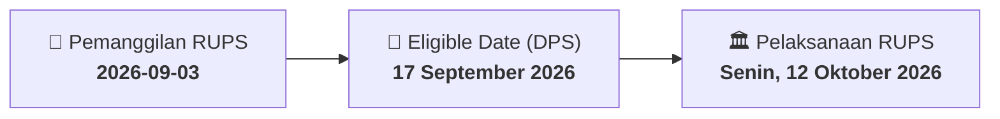

# ⚡ Laporan Intelijen Aksi Korporasi: [[BOSS]] - RUPS

⬅️ [[knowledge-base/daily-digests/Daily_Digest_20260903|Kembali ke Daily Digest]] | 📅 **2026-09-03** | 🎛️ [[Dashboard|Ke Dashboard Utama]]

> [!IMPORTANT]
> Laporan ini disusun secara otomatis oleh **Corporate Action Intelligence Agent** untuk memetakan implikasi strategis, rasio keuangan, alokasi dana, jadwal penting, dan panduan investor.

---

## 📌 1. Ringkasan Eksekutif & Katalis Strategis
- **Kode & Nama Emiten**: `[[BOSS]]`
- **Kategori Aksi Korporasi**: `RUPS`
- **Dokumen Resmi Bursa**: `Pengumuman RUPS`
- **Ringkasan Inti Aksi**: PT Borneo Olah Sarana Sukses Tbk mengumumkan rencana penyelenggaraan Rapat Umum Pemegang Saham Tahunan dan Luar Biasa untuk tahun buku yang berakhir 31 Desember 2023. RUPS akan diselenggarakan pada Senin, 12 Oktober 2026 pukul 10:00 di Jakarta, dengan recording date 17 September 2026.

---

## 📊 2. Matriks Parameter Material & Angka Kunci
| Parameter Utama | Nilai / Keterangan Resmi |
| :--- | :--- |
| **Jenis RUPS** | `Rapat Umum Pemegang Saham Tahunan dan Luar Biasa` |
| **Tahun Buku** | `31 Desember 2023` |
| **Lokasi RUPS** | `Jakarta` |
| **Recording Date** | `17 September 2026` |
| **Hari/Tanggal RUPS** | `Senin, 12 Oktober 2026` |
| **Waktu RUPS** | `10:00` |
| **Nomor Surat Rujukan** | `12.130/SL.e/Corsec/BOSS/VIII/2026` |
| **Nama Pengirim** | `Widodo Nurly S` |
| **Jabatan Pengirim** | `Direktur` |

---

## 📌 3. Detail Pelaksanaan RUPS / RUPSLB
- **Hari, Tanggal Pelaksanaan**: `Senin, 12 Oktober 2026`
- **Waktu Pelaksanaan**: `10:00`
- **Lokasi / Tempat Pelaksanaan**: `Jakarta`
- **Batas Hak Suara (Eligible Date / Recording Date)**: `17 September 2026`

## 📝 4. Matriks Agenda & Mata Acara Rapat
| No | Agenda / Mata Acara | Penjelasan & Sub-Acara |
| :-: | :--- | :--- |
| 1 | **Agenda Utama RUPS** | PT Borneo Olah Sarana Sukses Tbk mengumumkan rencana penyelenggaraan Rapat Umum Pemegang Saham Tahunan dan Luar Biasa untuk tahun buku yang berakhir 31 Desember 2023. RUPS akan diselenggarakan pada Senin, 12 Oktober 2026 pukul 10:00 di Jakarta, dengan recording date 17 September 2026. |

## 🗓️ 5. Timeline Investor & Ketentuan Kehadiran

## 💡 6. Panduan Investor & E-Voting
- 👥 **Hak Suara**: Pemegang saham yang berhak hadir/memberikan suara adalah yang terdaftar dalam DPS pada **Eligible Date (17 September 2026)**.
- 🗳️ **E-Voting eASY.KSEI**: Pemegang saham dapat memberikan kuasa/suara secara elektronik melalui sistem eASY.KSEI.

---

## 🔗 Hubungan Note Terkait (Knowledge Graph)
- [[knowledge-base/daily-digests/Daily_Digest_20260903|📄 Daily Digest 2026-09-03]]
- [[knowledge-base/trading-signals/Trading_Signals_20260903|🎯 Sinyal Cuan 2026-09-03]]
- [[Dashboard|🎛️ Kembali ke Dashboard]]