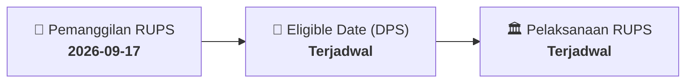

# ⚡ Laporan Intelijen Aksi Korporasi: [[BOSS]] - RUPS

⬅️ [[knowledge-base/daily-digests/Daily_Digest_20260917|Kembali ke Daily Digest]] | 📅 **2026-09-17** | 🎛️ [[Dashboard|Ke Dashboard Utama]]

> [!IMPORTANT]
> Laporan ini disusun secara otomatis oleh **Corporate Action Intelligence Agent** untuk memetakan implikasi strategis, rasio keuangan, alokasi dana, jadwal penting, dan panduan investor.

---

## 📌 1. Ringkasan Eksekutif & Katalis Strategis
- **Kode & Nama Emiten**: `[[BOSS]]`
- **Kategori Aksi Korporasi**: `RUPS`
- **Dokumen Resmi Bursa**: `Pengumuman RUPS lamp1`
- **Ringkasan Inti Aksi**: Informasi dan fakta material BOSS: Mohammad Sunusi & Rekan Registered Public Accountant Jakarta Garden City, La Seine, Cakung, Jakarta Timur DKI Jakarta 13960 Telephone : (021) 7989258 Whatsapp : 0853 7645 7285, 0813 2649 8306 Email : kapmsdanrekan.rh@gmail.com SURAT KETERANGAN Nomor : 0131/S/MSR-MMS/IX/2026 Melalui surat ini, kami menerangkan bahwa PT BORNEO OLAH SARANA SUKSES DAN ENTITAS ANAK saat ini masih dalam proses pemeriksaan (audit) atas laporan keuangan untuk tahun yang berakhir pada tanggal 31 Desember 2023, 2024 & 202

---

## 📊 2. Matriks Parameter Material & Angka Kunci
| Parameter Utama | Nilai / Keterangan Resmi |
| :--- | :--- |
| **Uraian Kejadian** | `Mohammad Sunusi & Rekan Registered Public Accountant Jakarta Garden City, La Seine, Cakung, Jakarta Timur DKI Jakarta 13960 Telephone : (021) 7989258 Whatsapp : 0853 7645 7285, 0813 2649 8306 Email : kapmsdanrekan.rh@gmail.com SURAT KETERANGAN Nomor : 0131/S/MSR-MMS/IX/2026 Melalui surat ini, kami menerangkan bahwa PT BORNEO OLAH SARANA SUKSES DAN ENTITAS ANAK saat ini masih dalam proses pemeriksaan (audit) atas laporan keuangan untuk tahun yang berakhir pada tanggal 31 Desember 2023, 2024 & 202` |

---

## 📌 3. Detail Pelaksanaan RUPS / RUPSLB
- **Hari, Tanggal Pelaksanaan**: `Terjadwal`
- **Waktu Pelaksanaan**: `09.00 WIB s.d. selesai`
- **Lokasi / Tempat Pelaksanaan**: `Aplikasi eASY.KSEI / Kantor Perseroan`
- **Batas Hak Suara (Eligible Date / Recording Date)**: `Terjadwal`

## 📝 4. Matriks Agenda & Mata Acara Rapat
| No | Agenda / Mata Acara | Penjelasan & Sub-Acara |
| :-: | :--- | :--- |
| 1 | **Agenda Utama RUPS** | Informasi dan fakta material BOSS: Mohammad Sunusi & Rekan Registered Public Accountant Jakarta Garden City, La Seine, Cakung, Jakarta Timur DKI Jakarta 13960 Telephone : (021) 7989258 Whatsapp : 0853 7645 7285, 0813 2649 8306 Email : kapmsdanrekan.rh@gmail.com SURAT KETERANGAN Nomor : 0131/S/MSR-MMS/IX/2026 Melalui surat ini, kami menerangkan bahwa PT BORNEO OLAH SARANA SUKSES DAN ENTITAS ANAK saat ini masih dalam proses pemeriksaan (audit) atas laporan keuangan untuk tahun yang berakhir pada tanggal 31 Desember 2023, 2024 & 202 |

## 🗓️ 5. Timeline Investor & Ketentuan Kehadiran

## 💡 6. Panduan Investor & E-Voting
- 👥 **Hak Suara**: Pemegang saham yang berhak hadir/memberikan suara adalah yang terdaftar dalam DPS pada **Eligible Date (Terjadwal)**.
- 🗳️ **E-Voting eASY.KSEI**: Pemegang saham dapat memberikan kuasa/suara secara elektronik melalui sistem eASY.KSEI.

---

## 🔗 Hubungan Note Terkait (Knowledge Graph)
- [[knowledge-base/daily-digests/Daily_Digest_20260917|📄 Daily Digest 2026-09-17]]
- [[knowledge-base/trading-signals/Trading_Signals_20260917|🎯 Sinyal Cuan 2026-09-17]]
- [[Dashboard|🎛️ Kembali ke Dashboard]]