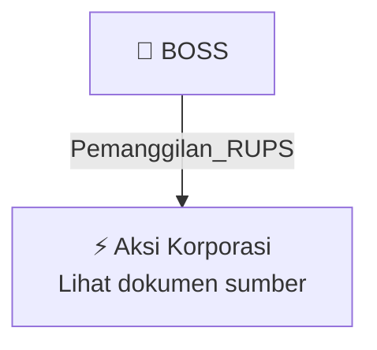

# 📢 Pemanggilan RUPS / RUPSLB — [[BOSS]]

⬅️ [[knowledge-base/daily-digests/Daily_Digest_20260923|Kembali ke Daily Digest]] | 📅 **2026-09-23** | 🎛️ [[Dashboard|Ke Dashboard Utama]]

> [!IMPORTANT]
> Laporan ini disusun secara otomatis oleh **Corporate Action Intelligence Agent** pada **2026-09-23**.
> Sumber dokumen: `20260922_BOSS_20260922_BOSS_Pengumuman RUPS_32150325_lamp1.pdf`

---

## 📌 1. Ringkasan Eksekutif & Tujuan Strategis

- **Kode & Nama Emiten**: `[[BOSS]]`
- **Kategori Aksi Korporasi**: `Pemanggilan_RUPS`
- **Dokumen Sumber**: `20260922_BOSS_20260922_BOSS_Pengumuman RUPS_32150325_lamp1.pdf`
- **Tanggal Laporan**: `2026-09-23`

[Analisis LLM tidak tersedia — isi manual]

---

## 📊 2. Fakta Material & Parameter Keuangan

| Parameter Utama | Nilai / Keterangan |
| :--- | :--- |
| **Uraian Kejadian** | `RALAT PENGUMUMAN KEPADA PARA PEMEGANG SAHAM PT BORNEO OLAH SARANA SUKSES TBK (“PERSEROAN”) Dengan ini diumumkan kepada Para Pemegang Saham Perseroan bahwa Perseroan akan menyelenggarakan Rapat Umum Pemegang Saham Tahunan Untuk Tahun Buku 2023, Tahun Buku 2024, Tahun Buku 2025 (“RUPST 2023, 2024, 2025)” dan Rapat Umum Pemegang Saham Luar Biasa (“RUPSLB”) (Selanjutnya disebut “RAPAT”) yang akan diselenggarakan pada : Hari/Tanggal : Kamis/ 29 Oktober 2026 Waktu : 10.00 WIB s/d selesai Tempat : Wism` |

---

## 👥 3. Struktur Kepemilikan, Pengendali & Pembeli Siaga

- **Emiten**: `BOSS` | Informasi kepemilikan mengacu pada dokumen resmi sumber.

---

## 🎯 4. Alokasi & Rencana Penggunaan Dana

- Informasi alokasi dana belum tersedia — lihat prospektus / dokumen resmi.

---

## 📅 5. Timeline & Jadwal Pelaksanaan

| Tahapan / Event | Tanggal |
| :--- | :---: |
| **Jadwal** | Lihat dokumen sumber. |

---

## 📈 6. Diagram Visual Flowchart (Mermaid)

---

## 💡 7. Rekomendasi Investor & Strategi Trading

[Analisis LLM tidak tersedia — isi manual]

---

## 🔗 8. Hubungan Note Terkait (Knowledge Graph)

- [[knowledge-base/daily-digests/Daily_Digest_20260923|📄 Daily Digest 2026-09-23]]
- [[knowledge-base/trading-signals/Trading_Signals_20260923|🎯 Sinyal Cuan 2026-09-23]]
- [[BOSS|🏬 Halaman Emiten BOSS]]
- [[Dashboard|🎛️ Kembali ke Dashboard Utama]]

---

*Laporan dibuat otomatis oleh Corporate Action Intelligence Agent · 2026-09-23*