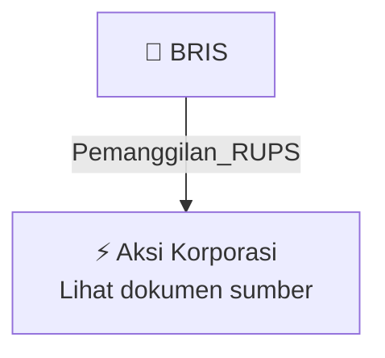

# 📢 Pemanggilan RUPS / RUPSLB — [[BRIS]]

⬅️ [[knowledge-base/daily-digests/Daily_Digest_20261001|Kembali ke Daily Digest]] | 📅 **2026-10-01** | 🎛️ [[Dashboard|Ke Dashboard Utama]]

> [!IMPORTANT]
> Laporan ini disusun secara otomatis oleh **Corporate Action Intelligence Agent** pada **2026-10-01**.
> Sumber dokumen: `20260930_BRIS_20260930_BRIS_Pengumuman RUPS_32161948_lamp2.pdf`

---

## 📌 1. Ringkasan Eksekutif & Tujuan Strategis

- **Kode & Nama Emiten**: `[[BRIS]]`
- **Kategori Aksi Korporasi**: `Pemanggilan_RUPS`
- **Dokumen Sumber**: `20260930_BRIS_20260930_BRIS_Pengumuman RUPS_32161948_lamp2.pdf`
- **Tanggal Laporan**: `2026-10-01`

[Analisis LLM tidak tersedia — isi manual]

---

## 📊 2. Fakta Material & Parameter Keuangan

| Parameter Utama | Nilai / Keterangan |
| :--- | :--- |
| **Uraian Kejadian** | `ANNOUNCEMENT EXTRAORDINARY GENERAL MEETING OF SHAREHOLDERS PT BANK SYARIAH INDONESIA (PERSERO) TBK PT Bank Syariah Indonesia (Persero) Tbk (hereinafter referred to as the “Company”) hereby announces to the Shareholders that the Company will convene an Extraordinary General Meeting of Shareholders (hereinafter referred to as the “Extraordinary GMS”) on Friday, November 6, 2026. In accordance with the provisions of the Company’s Articles of Association and by observing the Financial Services Autho` |

---

## 👥 3. Struktur Kepemilikan, Pengendali & Pembeli Siaga

- **Emiten**: `BRIS` | Informasi kepemilikan mengacu pada dokumen resmi sumber.

---

## 🎯 4. Alokasi & Rencana Penggunaan Dana

- Informasi alokasi dana belum tersedia — lihat prospektus / dokumen resmi.

---

## 📅 5. Timeline & Jadwal Pelaksanaan

| Tahapan / Event | Tanggal |
| :--- | :---: |
| **Jadwal** | Lihat dokumen sumber. |

---

## 📈 6. Diagram Visual Flowchart (Mermaid)

---

## 💡 7. Rekomendasi Investor & Strategi Trading

[Analisis LLM tidak tersedia — isi manual]

---

## 🔗 8. Hubungan Note Terkait (Knowledge Graph)

- [[knowledge-base/daily-digests/Daily_Digest_20261001|📄 Daily Digest 2026-10-01]]
- [[knowledge-base/trading-signals/Trading_Signals_20261001|🎯 Sinyal Cuan 2026-10-01]]
- [[BRIS|🏬 Halaman Emiten BRIS]]
- [[Dashboard|🎛️ Kembali ke Dashboard Utama]]

---

*Laporan dibuat otomatis oleh Corporate Action Intelligence Agent · 2026-10-01*