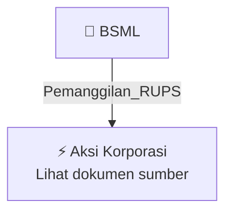

# 📢 Pemanggilan RUPS / RUPSLB — [[BSML]]

⬅️ [[knowledge-base/daily-digests/Daily_Digest_20260925|Kembali ke Daily Digest]] | 📅 **2026-09-25** | 🎛️ [[Dashboard|Ke Dashboard Utama]]

> [!IMPORTANT]
> Laporan ini disusun secara otomatis oleh **Corporate Action Intelligence Agent** pada **2026-09-25**.
> Sumber dokumen: `20260923_BSML_20260923_BSML_Pengumuman RUPS_32150504_lamp1.pdf`

---

## 📌 1. Ringkasan Eksekutif & Tujuan Strategis

- **Kode & Nama Emiten**: `[[BSML]]`
- **Kategori Aksi Korporasi**: `Pemanggilan_RUPS`
- **Dokumen Sumber**: `20260923_BSML_20260923_BSML_Pengumuman RUPS_32150504_lamp1.pdf`
- **Tanggal Laporan**: `2026-09-25`

[Analisis LLM tidak tersedia — isi manual]

---

## 📊 2. Fakta Material & Parameter Keuangan

| Parameter Utama | Nilai / Keterangan |
| :--- | :--- |
| **Uraian Kejadian** | `No : 065/DIR-BSML/IX/2026 PENGUMUMAN RAPAT UMUM PEMEGANG SAHAM LUAR BIASA PT BINTANG SAMUDERA MANDIRI LINES TBK Direksi PT Bintang Samudera Mandiri Lines Tbk ("Perseroan") dengan ini mengumumkan kepada para Pemegang Saham bahwa Perseroan akan menyelenggarakan Rapat Umum Pemegang Saham Luar Biasa ("Rapat") pada hari Jumat, tanggal 30 Oktober 2026 bertempat di Jakarta. Sesuai dengan ketentuan dalam Anggaran Dasar Perseroan dan dengan memperhatikan Peraturan Otoritas Jasa Keuangan No. 15/POJK.04/20` |

---

## 👥 3. Struktur Kepemilikan, Pengendali & Pembeli Siaga

- **Emiten**: `BSML` | Informasi kepemilikan mengacu pada dokumen resmi sumber.

---

## 🎯 4. Alokasi & Rencana Penggunaan Dana

- Informasi alokasi dana belum tersedia — lihat prospektus / dokumen resmi.

---

## 📅 5. Timeline & Jadwal Pelaksanaan

| Tahapan / Event | Tanggal |
| :--- | :---: |
| **Jadwal** | Lihat dokumen sumber. |

---

## 📈 6. Diagram Visual Flowchart (Mermaid)

---

## 💡 7. Rekomendasi Investor & Strategi Trading

[Analisis LLM tidak tersedia — isi manual]

---

## 🔗 8. Hubungan Note Terkait (Knowledge Graph)

- [[knowledge-base/daily-digests/Daily_Digest_20260925|📄 Daily Digest 2026-09-25]]
- [[knowledge-base/trading-signals/Trading_Signals_20260925|🎯 Sinyal Cuan 2026-09-25]]
- [[BSML|🏬 Halaman Emiten BSML]]
- [[Dashboard|🎛️ Kembali ke Dashboard Utama]]

---

*Laporan dibuat otomatis oleh Corporate Action Intelligence Agent · 2026-09-25*